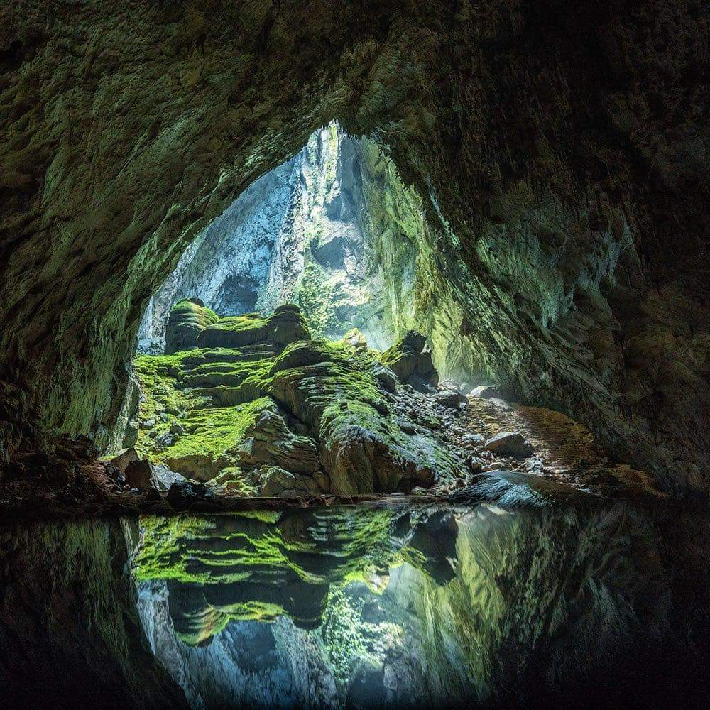
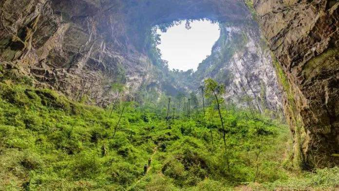
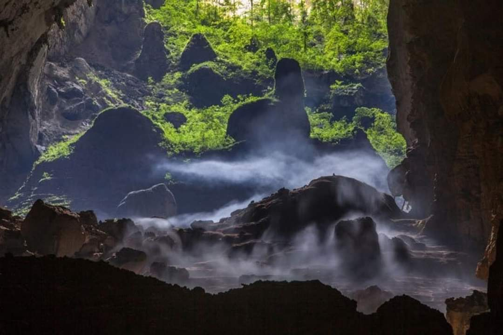
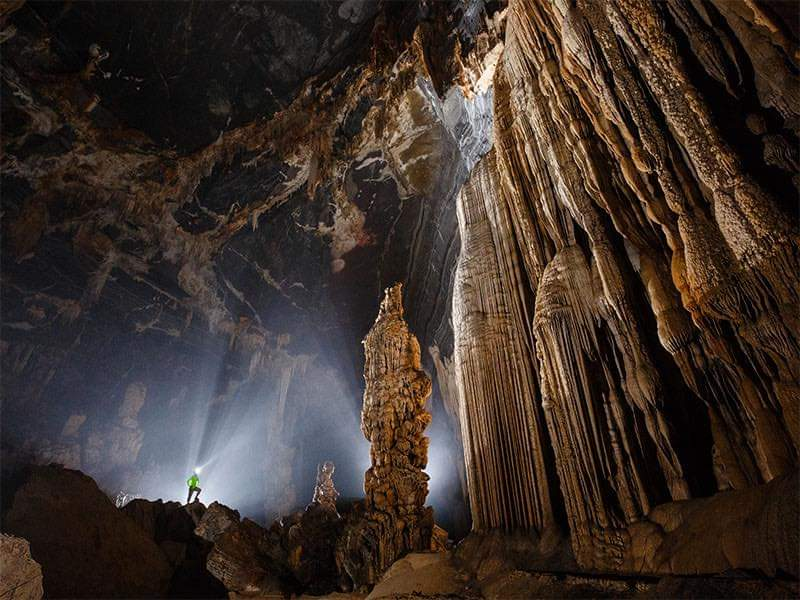
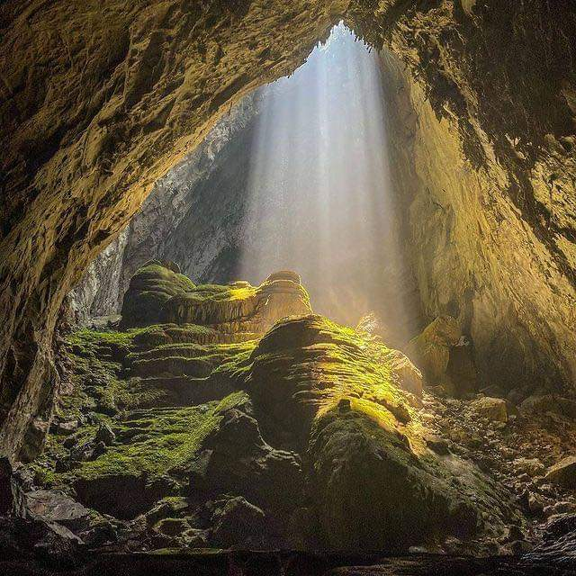

# About

World's largest cave by volume

# Details

## Identification

- **Feature type:** Cave
- **Source:** Google

## Cave and exploration data

- **Vertical access:** Yes

# Additional Notes

In 2019, the expedition team of the world’s best cave diving expert (who participated in the rescue operation of the children's soccer team in Tham Luang - Chiang Rai, Thailand) led by Mr Howard carried out an expedition to find this connection. After nearly a week of surveying the expedition team discovered an underground passage at the depth of 90 meters. Unfortunately, due to the limitation of diving equipment for that great depth, the expedition had to be suspended.

# References

- **Google:** https://goo.gl/maps/pUjjSjb9hmifc9FVA
- **Official Page:** https://sondoongcave.info/
- **OxalisAdventures:** https://oxalisadventure.com/underground-river-in-son-doong/

## Images
- 
- 
- 
- 
- 
