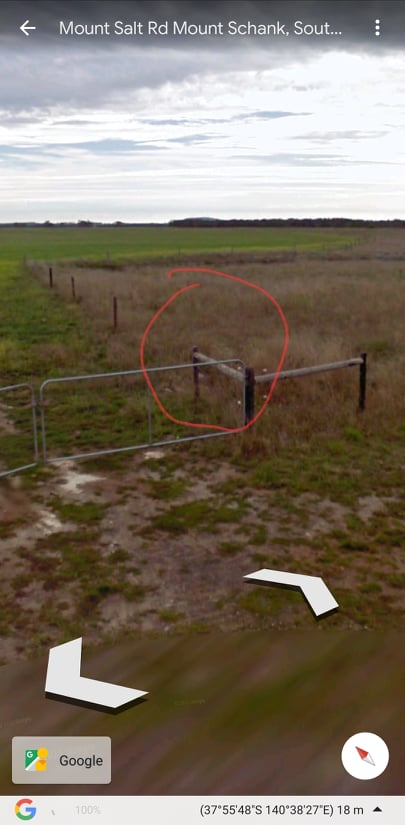

# About

Hole identified by CA

# Details

## Cave and exploration data

- **Vertical access:** No
- **Exploration potential:** Medium
- **Disabled access potential:** Low

# References

## Images
- 
