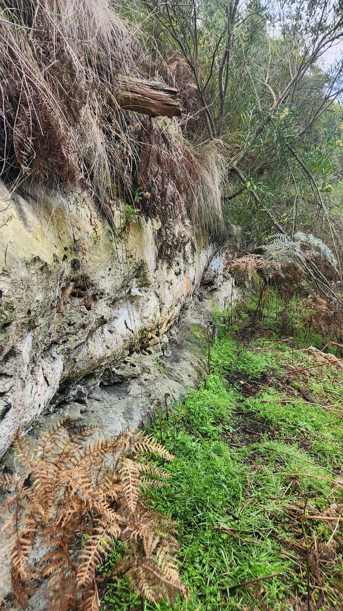
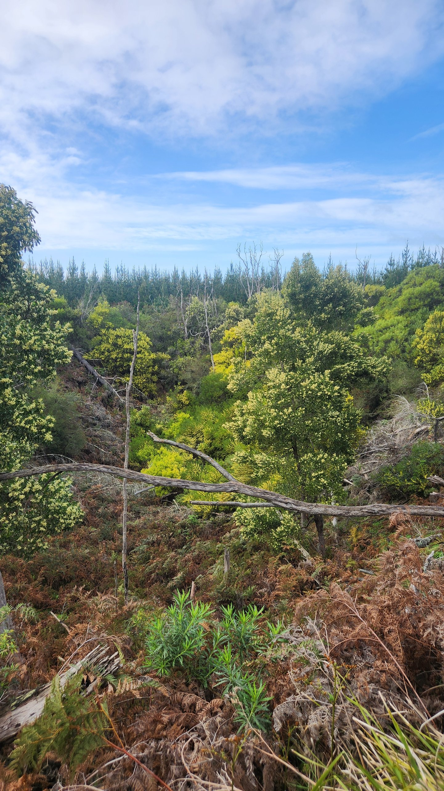
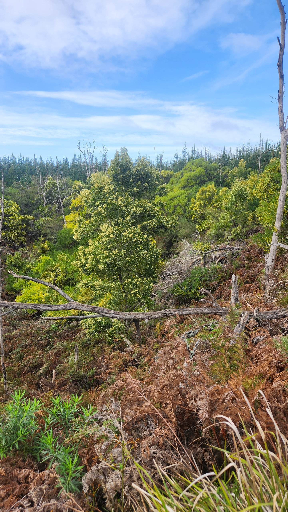
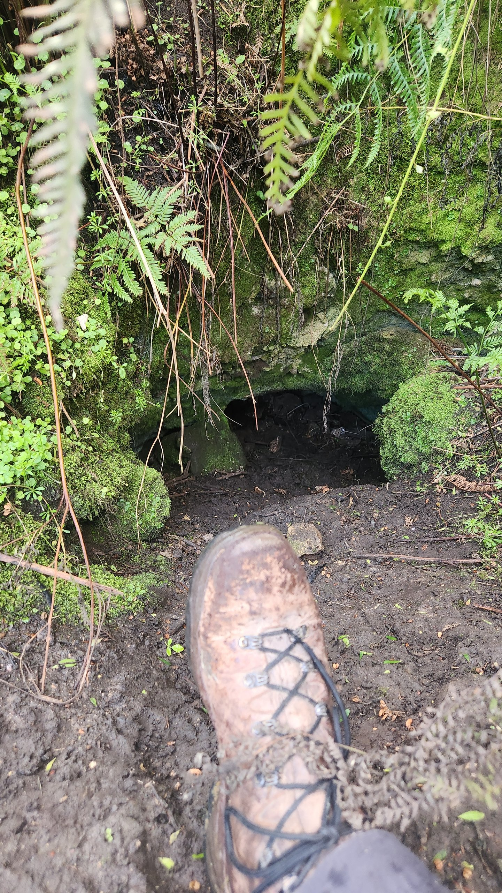

# Details

## Identification

- **Reference:** L0054
- **Source:** Forestry SA

## Cave and exploration data

- **Exploration potential:** High

## Access and warnings

Forestry

# References

- **LSECR:** Page 118
- **Forestry SA:** L0054, Thin Roof: N, Fence: R. Dimensions: ? . Features: Very wide& deep; improve barriers

## Images
- 
- 
- 
- 
