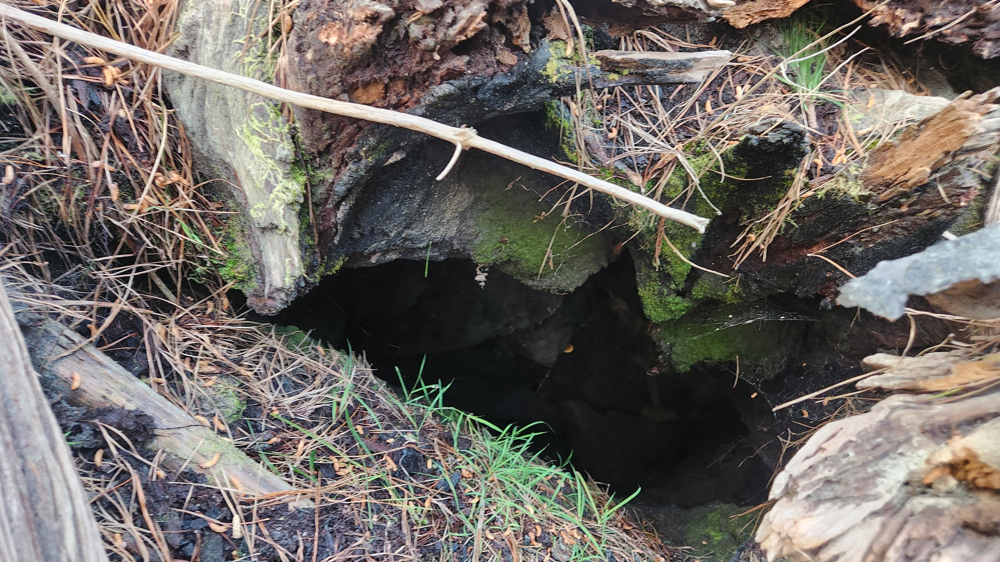
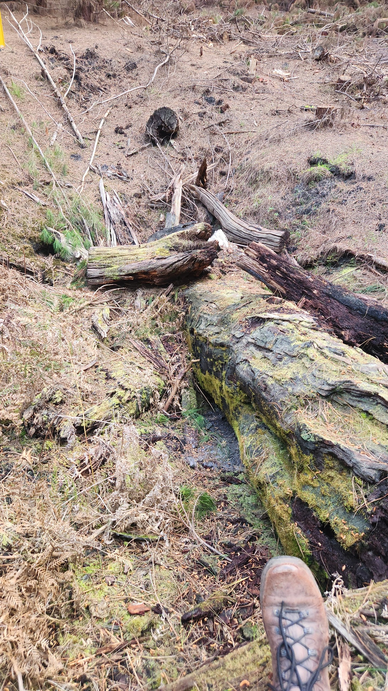
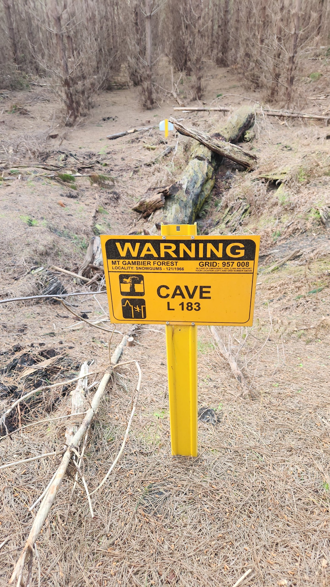

# About

Simple Solution tube

# Details

## Identification

- **Feature type:** SolutionTube
- **Reference:** L0183
- **Source:** Forestry SA

## Cave and exploration data

- **Exploration potential:** High

## Access and warnings

Forestry

# References

- **LSECR:** Page 356
- **Forestry SA:** L0183, Thin Roof: N, Fence: R. Dimensions: 2m x 8m deep. Features: Remove huge logs b/c dangerous

## Images
- 
- 
- 
