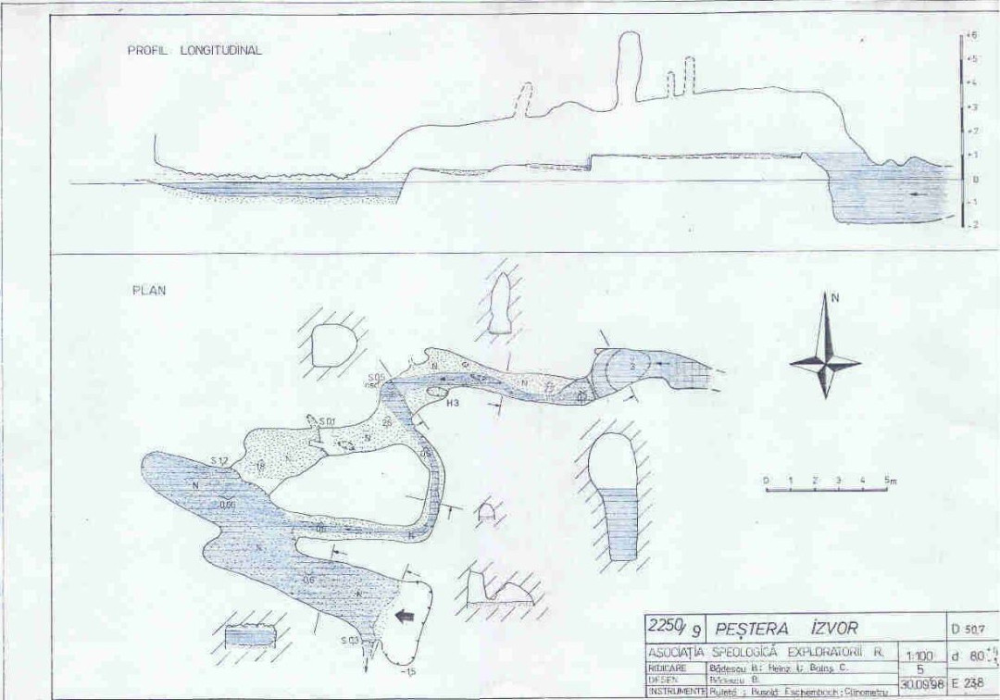
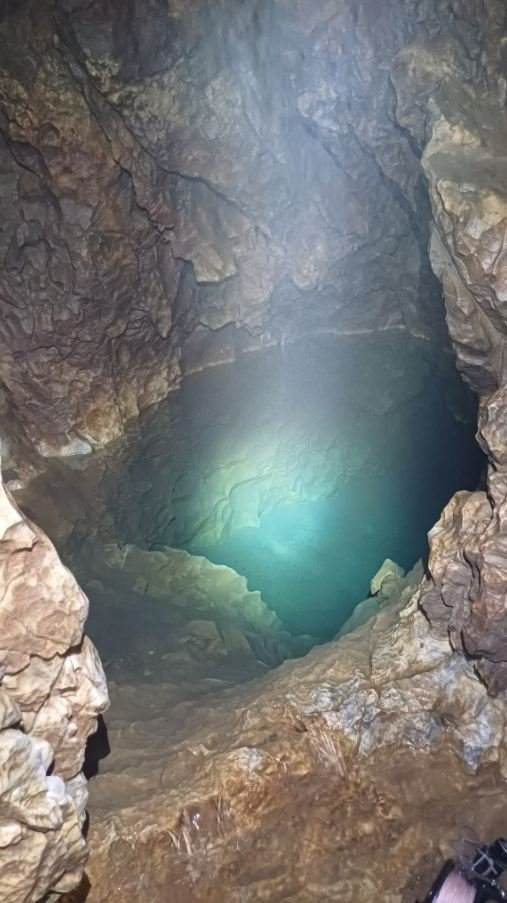

# Details

## Identification

- **Feature type:** Cave
- **Source:** https://en.wikipedia.org/wiki/List_of_longest_cave_by_country

## Cave and exploration data

- **Goes to water:** Yes
- **Surveyed length:** 3932 m

# Maps

- 

# References

- **Facebook:** https://www.facebook.com/Speologii/posts/pfbid02n6zCBfMFnb7sKodbY4jicV9fRzFtSgqa2hRBrSmb2GzmbR52d7p5VwPfLwEekBJ6l
- **Facebook Video:** https://www.facebook.com/watch/?ref=saved&v=1132559685391173

## Images
- 
- 
