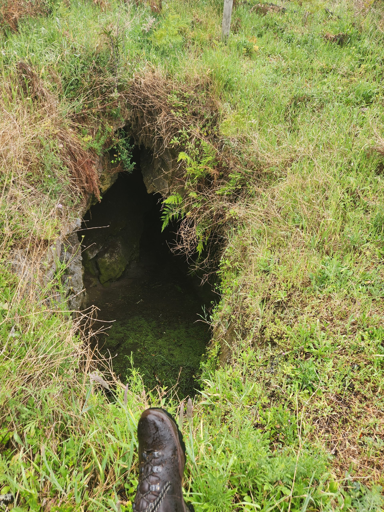
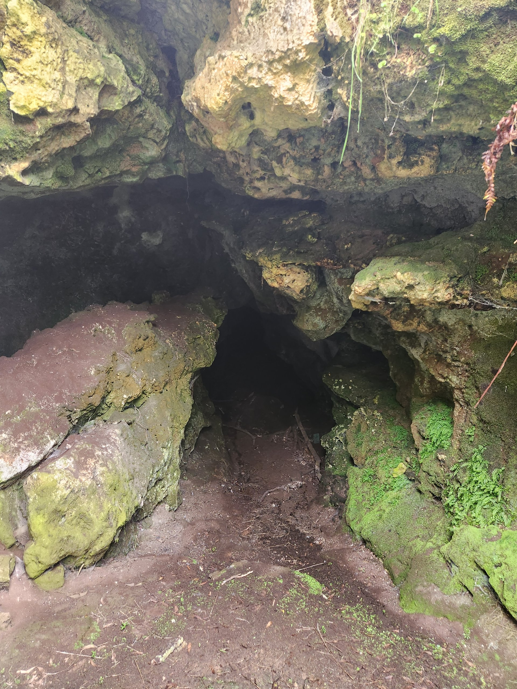
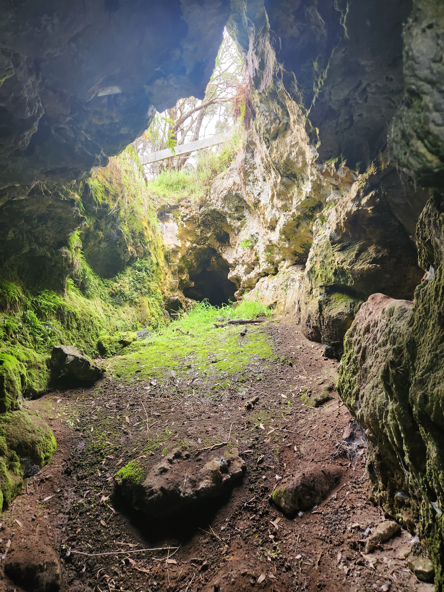
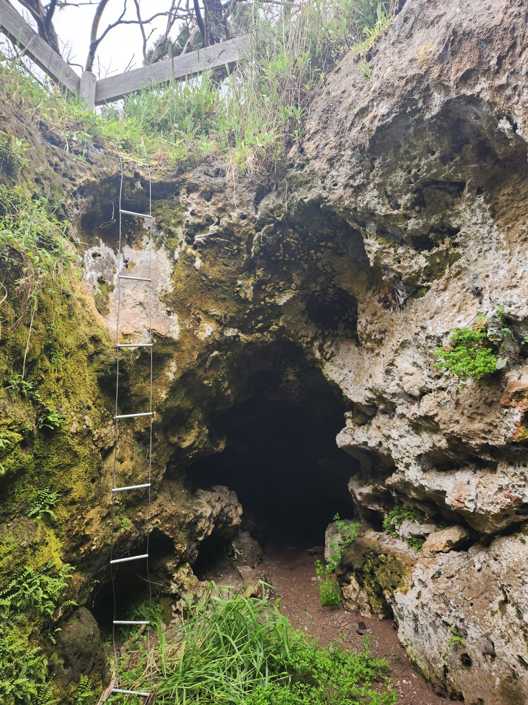
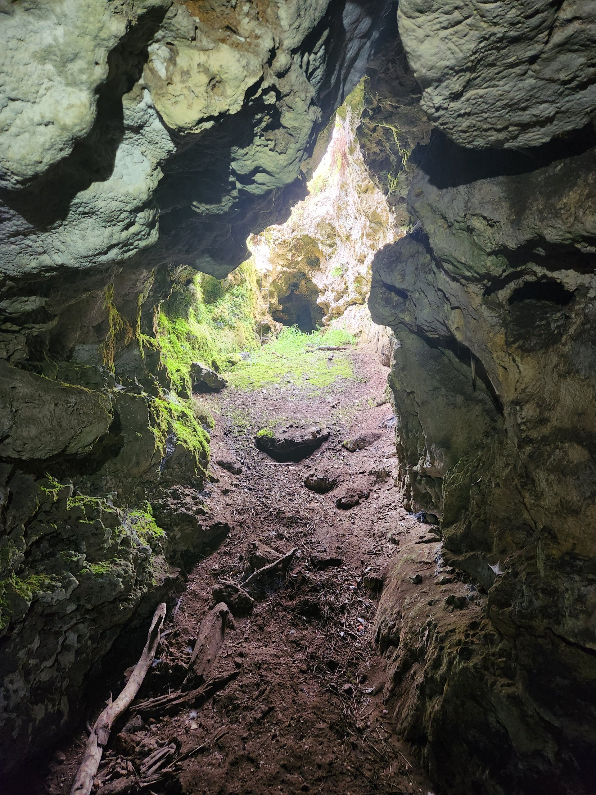

# About

BC: 2m drop into open cavern leading to a 7 meter cave about 1m wide and 1.5m high.  Closes down into a collapse

# Details

## Identification

- **Feature type:** Cave
- **Reference:** L0339
- **Source:** Forestry SA

## Cave and exploration data

- **Vertical access:** Yes
- **Exploration potential:** Medium

## Access and warnings

Forestry

# References

- **Forestry SA:** L0339, Thin Roof: Y, Fence: R. Dimensions: ?. Features: Needs gate; remove dead tree

## Images
- 
- 
- 
- 
- 
