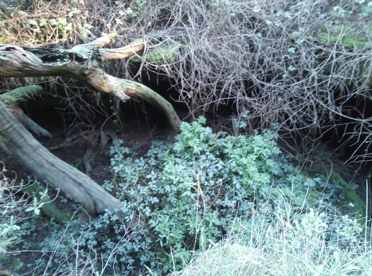
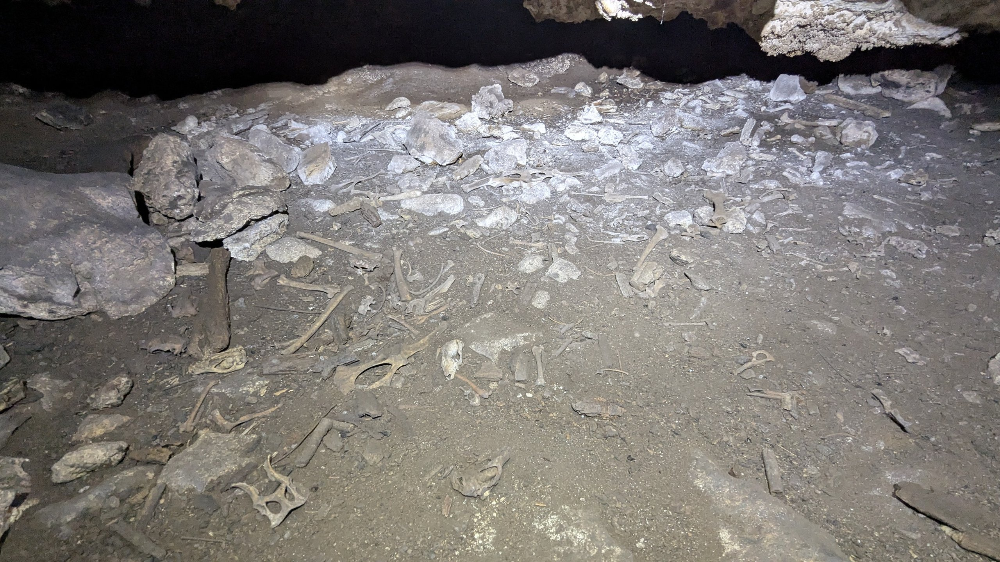
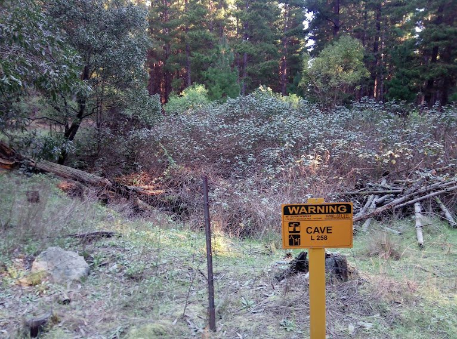

# About

2021-Aug: MW visited on foot & photographed. Large cave sourrounded by small wire fence, marked by yellow Forestry signs with "L258", and extensive vegetation. Worth further investigation with wire ladder.

2024-DEC: MW visited on foot with wire ladder. Gorgeous cavern area at the bottom of a 4m vertical drop. Small cave/drain on Eastern side full of animal bones

# Details

## Identification

- **Feature type:** Cave
- **Reference:** L0258
- **Source:** Forestry SA

## Cave and exploration data

- **Vertical access:** Yes
- **Tourism potential:** Medium
- **Goes to water:** No
- **Surveyed length:** 4 m

## Access and warnings

Forestry

## Amenities

- **hasShowers:** No
- **hasToilets:** No
- **hasPhone:** Yes

# References

- **LSECR:** Page 504
- **Forestry SA:** L0258, Thin Roof: Y, Fence: Y. Dimensions: 9 x 5 x 3m window. Features:  Some decoration present

## Images
- 
- 
- 
