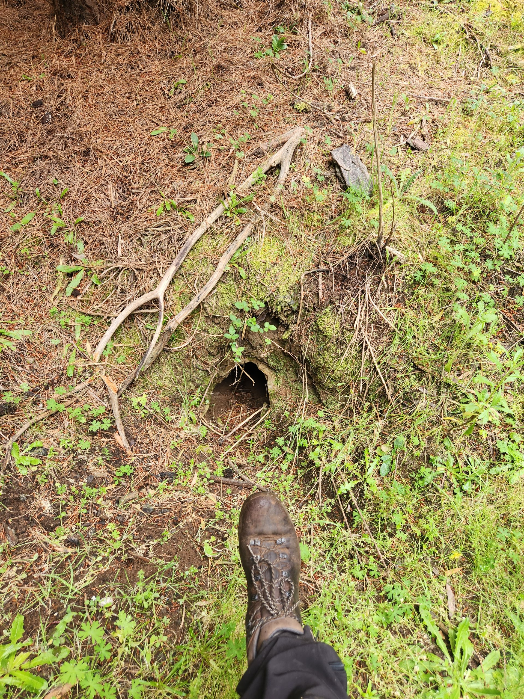
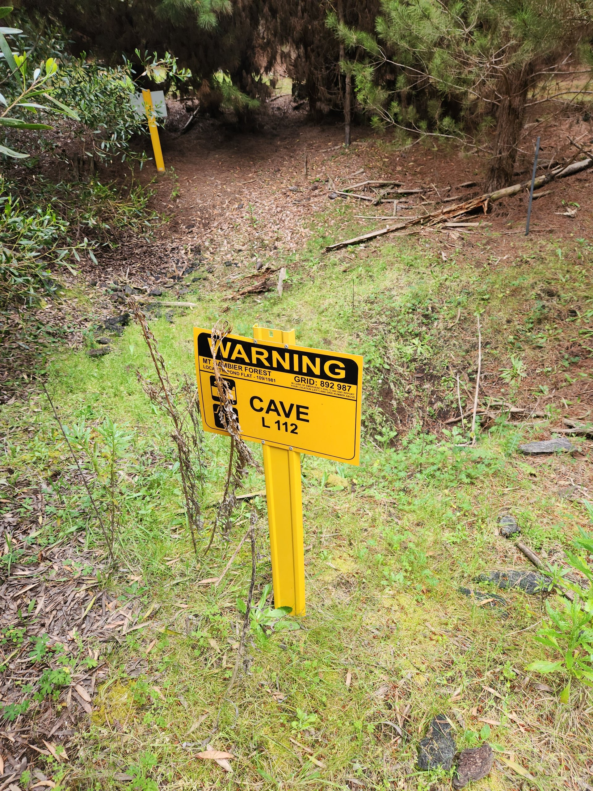
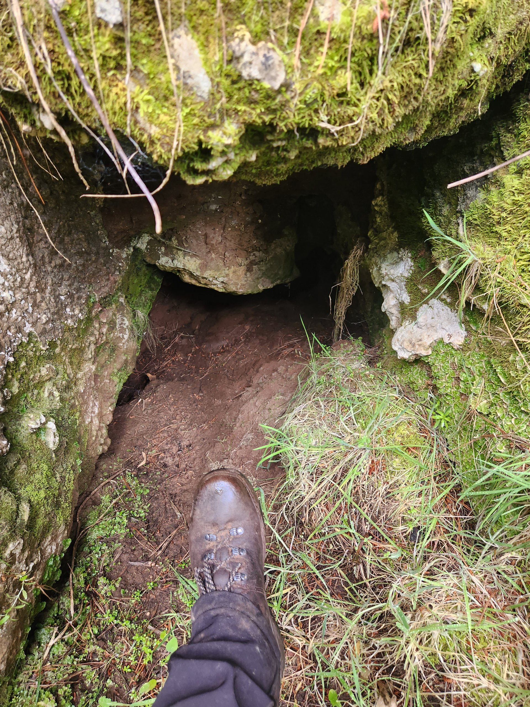
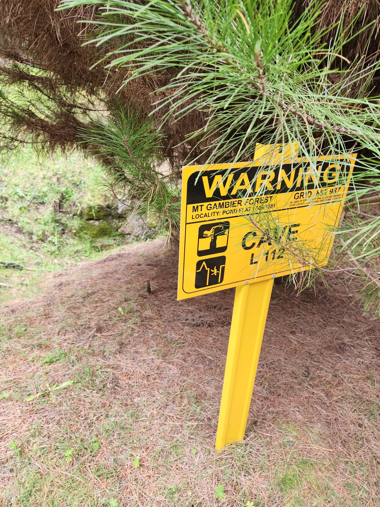

# About

Main Entrance is located at L0112k

# Details

## Identification

- **Feature type:** RockyOutcrop
- **Reference:** L0112a
- **Source:** Forestry SA

## Access and warnings

Forestry

# References

- **LSECR:** Page 222
This small cave was first entered by D. Williams and local speleologist Fred W. Aslin on 7th Oct- ober 1967, who learnt of its existence from a Mr. Jack Thompson of nearby Yahl in July of that year
The entrance is a short solution tube or roof window-style hole which is about one metre across, dropping through 1.5 metres of limestone to the floor which lies 4m below. The cave is about 15 metres long overall and it is divided into two chambers about 6m long each with a short con striction between them. Each chamber is about 2.5 metres high and wide, and the floor generally consisted of red earth fill, which was "much excavated and burrowed in by wombats and rabbits"
Further possibilities for extending the known cave appear to be remote.
- **Forestry SA:** L0112, Thin Roof: N, Fence: R. Dimensions: 100m long. Features: URGENT FENCING!!!

## Images
- 
- 
- 
- 
