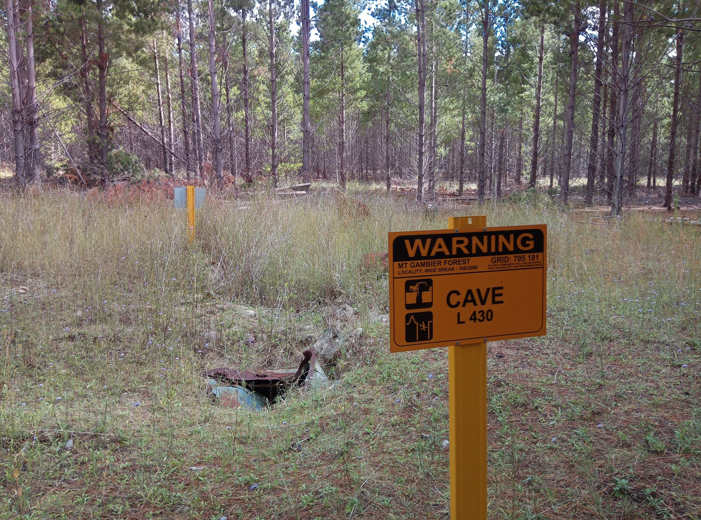
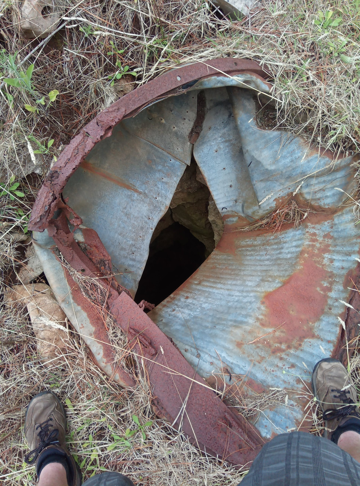
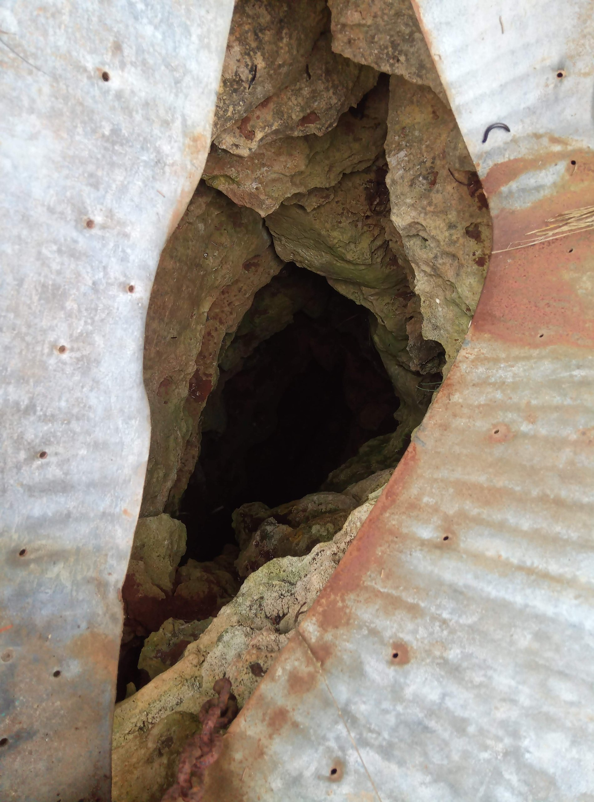

# About

2019-Dec: MW walked around forest checking clear spots identified from satellite imagery. Found sign with "L430" and solution tube covered with corrugated sheeting. Further investigation required (dry caving potential with vertical access)

# Details

## Identification

- **Feature type:** SolutionTube
- **Reference:** L0430
- **Source:** Forestry SA

## Cave and exploration data

- **Vertical access:** Yes
- **Exploration potential:** High

## Access and warnings

Forestry

# References

- **Forestry SA:** L0430, Thin Roof: N, Fence: N. Dimensions: 0.8m diam tube. Features: Fossils; bones and a wetta. May want to restrict access due until significance

## Images
- 
- 
- 
