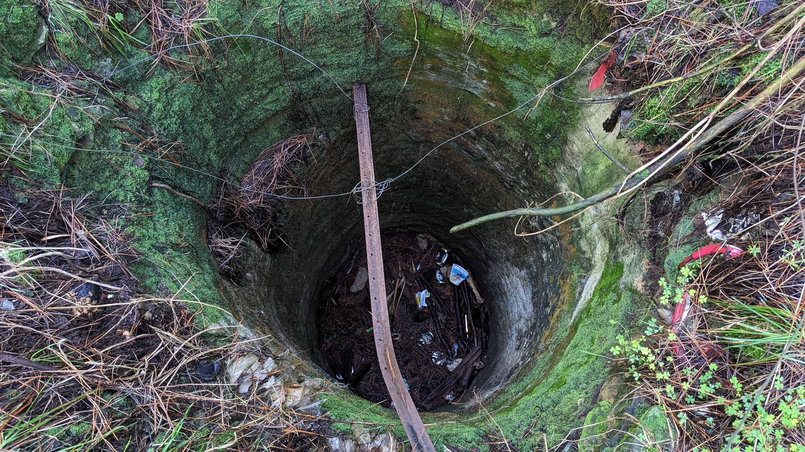
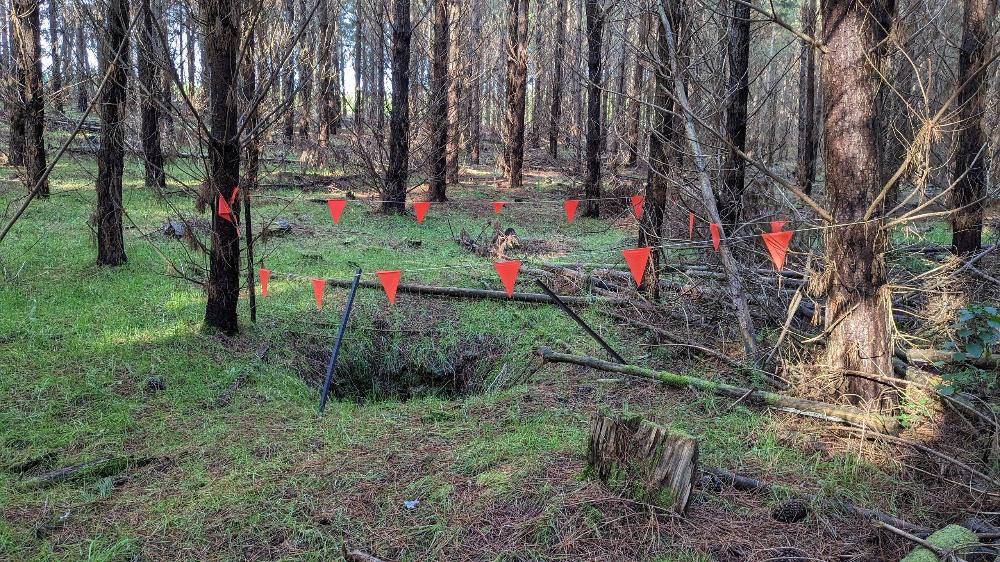

# About

Checked by MW 15-07-2023

# Details

## Identification

- **Feature type:** SolutionTube
- **Reference:** L1023GPS
- **Source:** Forestry SA

## Cave and exploration data

- **Vertical access:** Yes
- **Disabled access potential:** Low
- **Goes to water:** No

## Access and warnings

Forestry

# References

- **Forestry SA:** L1023, Thin Roof: N, Fence: N. Dimensions: 0.9 x approx. 4m deep. Features: Shaft opened after slash removed over entrance, polished sides. Approx. 1, diametre - GPS point logged with tractor GPS - possible old well

## Images
- 
- 
