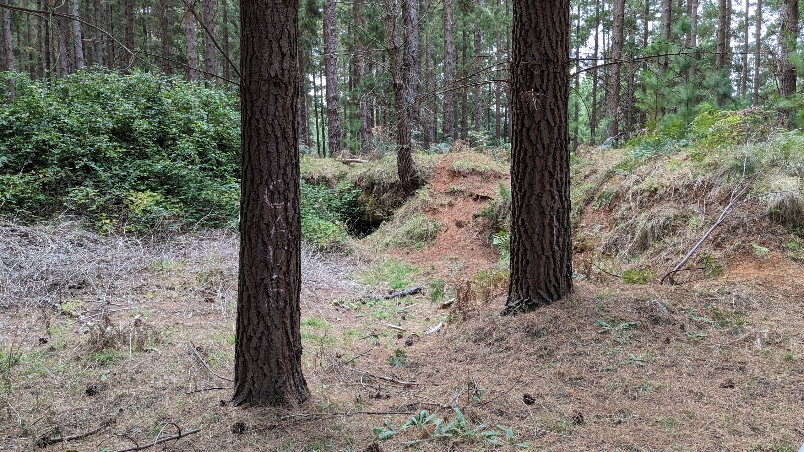
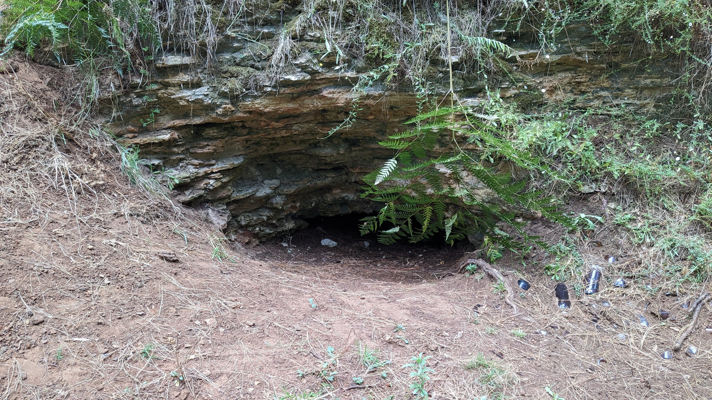
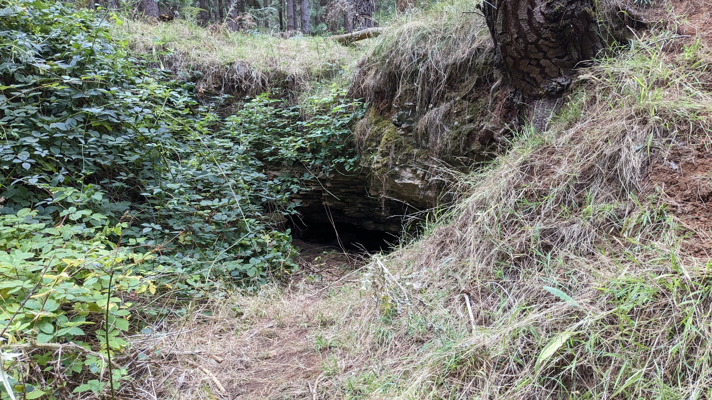

# About

Small cave with two leads. Western lead squeezes to nothing. Northern lead is tight but possible to wriggle in - looks like an active animal burrow, backed out without checking full extent

# Details

## Identification

- **Feature type:** RockyOutcrop
- **Reference:** L1026
- **Source:** Forestry SA

## Cave and exploration data

- **Vertical access:** No
- **Exploration potential:** Low
- **Tourism potential:** Low
- **Goes to water:** No

## Access and warnings

Forestry

# References

- **Forestry SA:** L1026, Thin Roof: N, Fence: N. Dimensions: ?. Features: Sunken depression with exposed limestone ledges undercut into hill

## Images
- 
- 
- 
