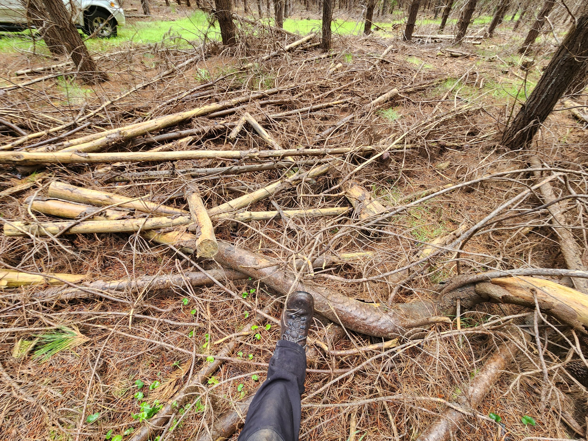
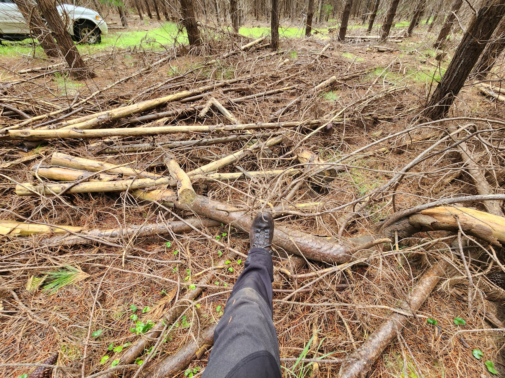

# About

BC 14/10/2023: location looks like there maybe a sinkhole but covered in branches,  needs a lot of clearing and digging

# Details

## Identification

- **Feature type:** Sinkhole
- **Reference:** L1028
- **Source:** Forestry SA

## Cave and exploration data

- **Exploration potential:** Medium

## Access and warnings

Forestry

# References

- **Forestry SA:** L1028, Thin Roof: N, Fence: Y. Dimensions: 1m diametre x 4m deep. Features: ?

## Images
- 
- 
