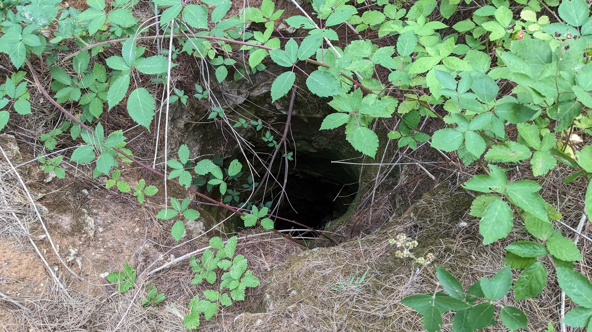
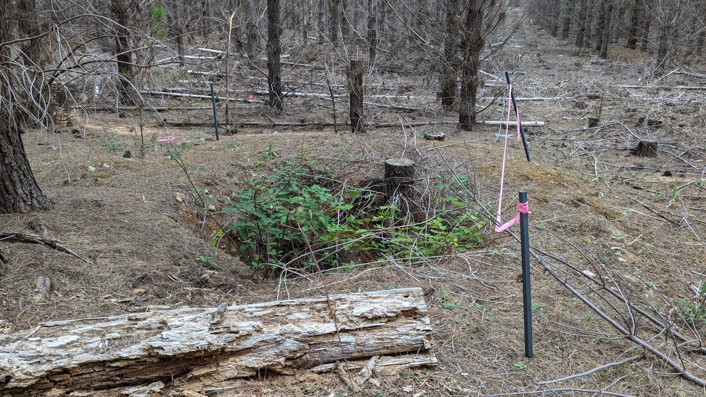

# About

Deep solution tube (+10m?) with blackberry bushes around entrance. Well worth a 2nd look with wire rope ladder and/or SRT gear

# Details

## Identification

- **Feature type:** SolutionTube
- **Reference:** L1030
- **Source:** Forestry SA

## Cave and exploration data

- **Vertical access:** Yes
- **Exploration potential:** Medium

## Access and warnings

Forestry

# References

- **Forestry SA:** L1030, Thin Roof: N, Fence: N. Dimensions: ?. Features: Has logs around tube

## Images
- 
- 
