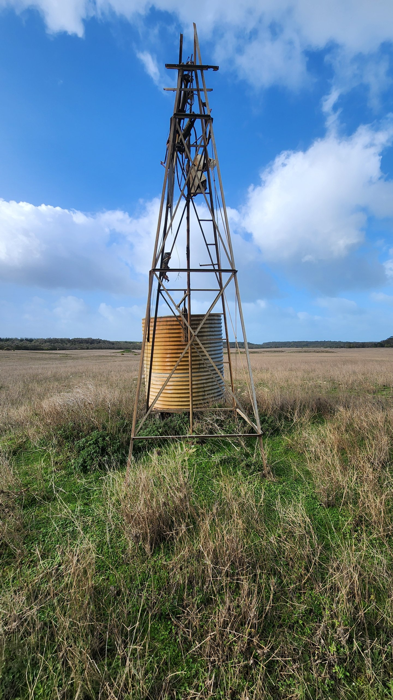
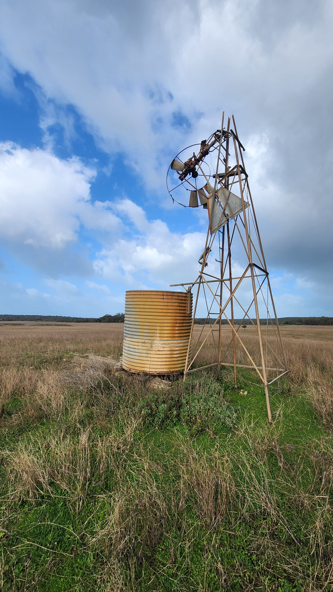

# Details

## Identification

- **Feature type:** NotFound
- **Reference:** L1031
- **Source:** Forestry SA

## Access and warnings

Forestry

# References

- **Forestry SA:** L1031, Thin Roof: ?, Fence: ?. Dimensions: ?. Features: ?

## Images
- 
- 
