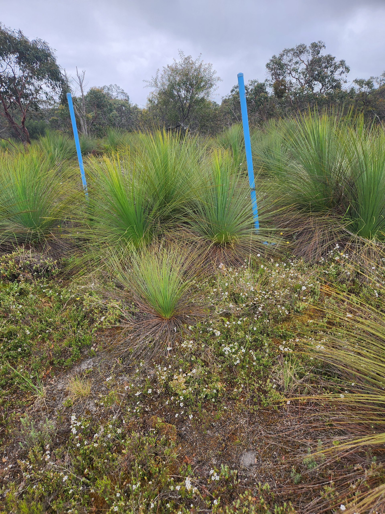
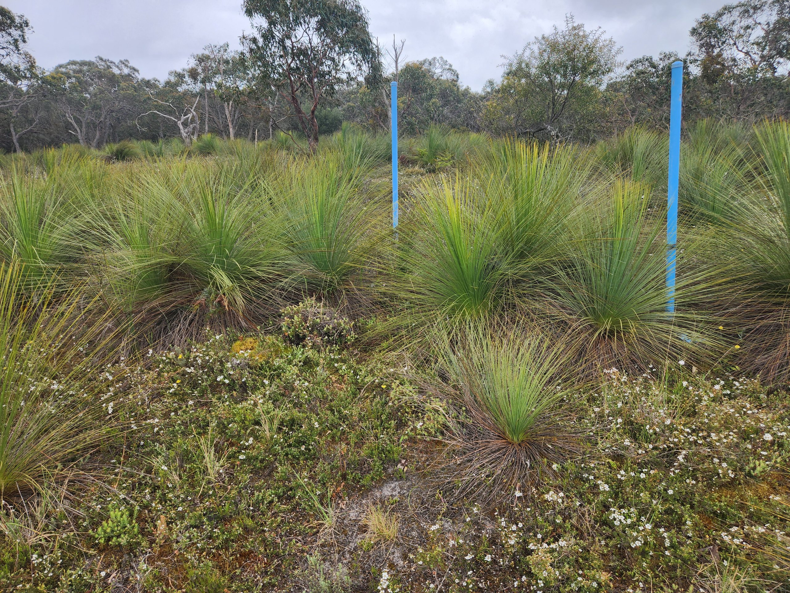

# About

BC 13/10/2023: Nothing interesting found

# Details

## Identification

- **Feature type:** NotFound
- **Reference:** L1033
- **Source:** Forestry SA

## Access and warnings

Forestry

# References

- **Forestry SA:** L1033, Thin Roof: ?, Fence: ?. Dimensions: ?. Features: ?

## Images
- 
- 
