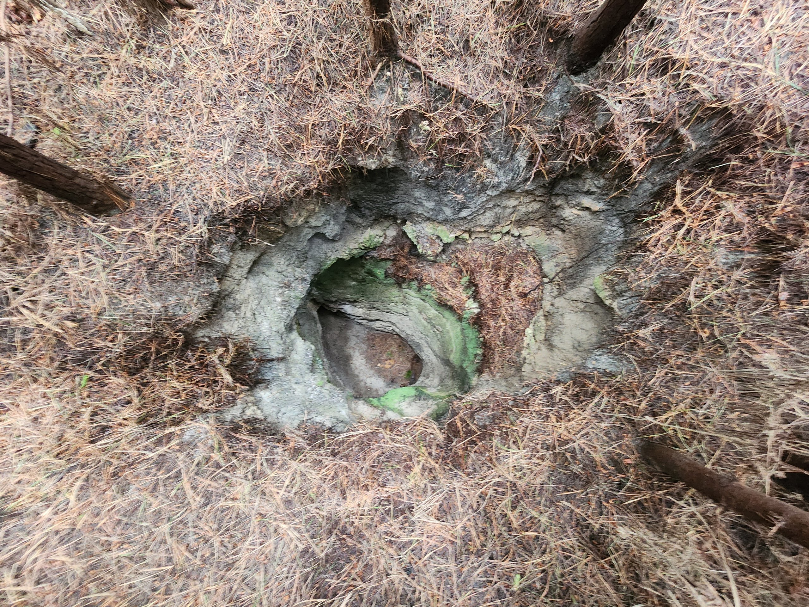
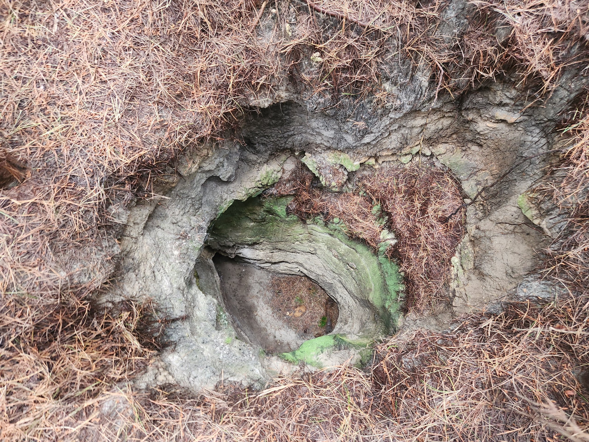

# About

BC 13/10/2023: 6m deep solution tube approx 2m diameter

# Details

## Identification

- **Feature type:** SolutionTube
- **Reference:** L1039
- **Source:** Forestry SA

## Cave and exploration data

- **Vertical access:** Yes
- **Exploration potential:** Medium

## Access and warnings

Forestry

# References

- **Forestry SA:** L1039, Thin Roof: ?, Fence: ?. Dimensions: ?. Features: ?

## Images
- 
- 
