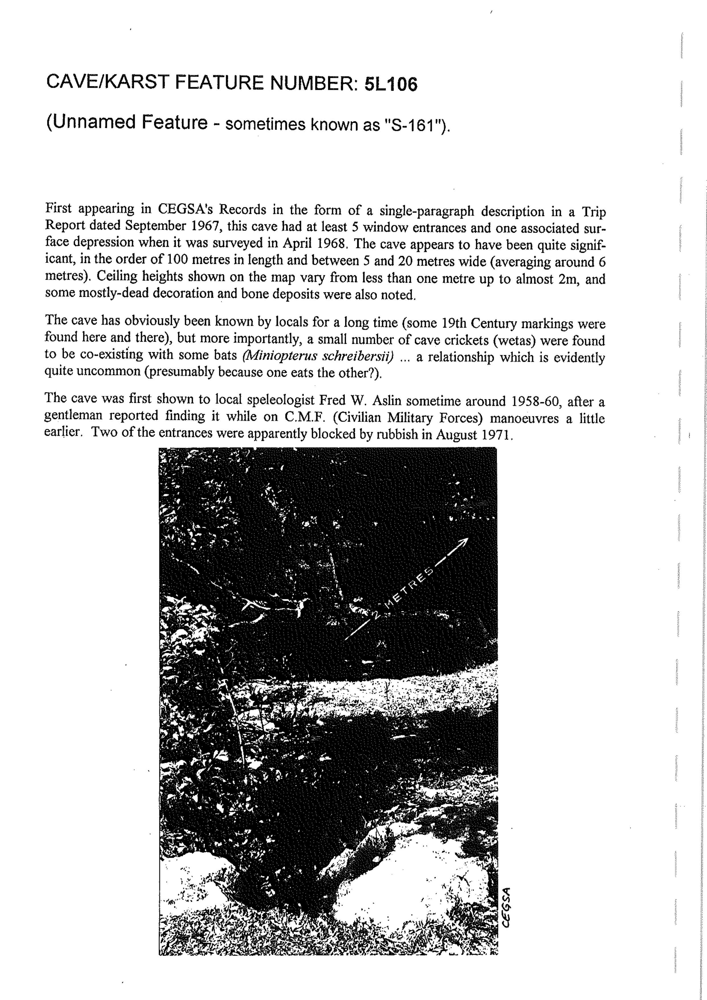
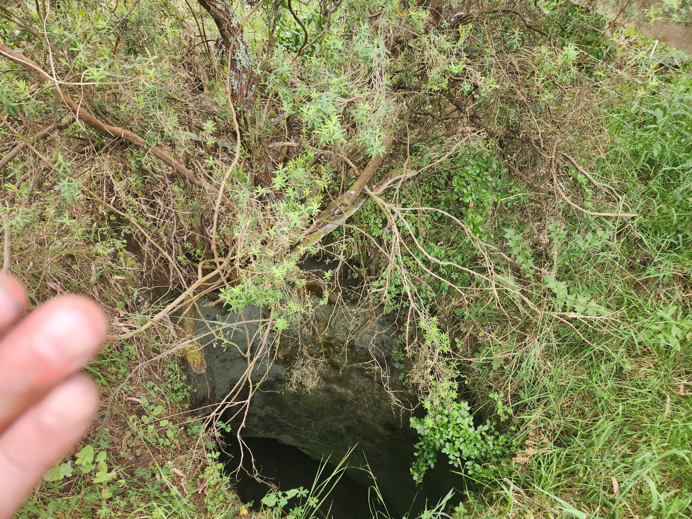
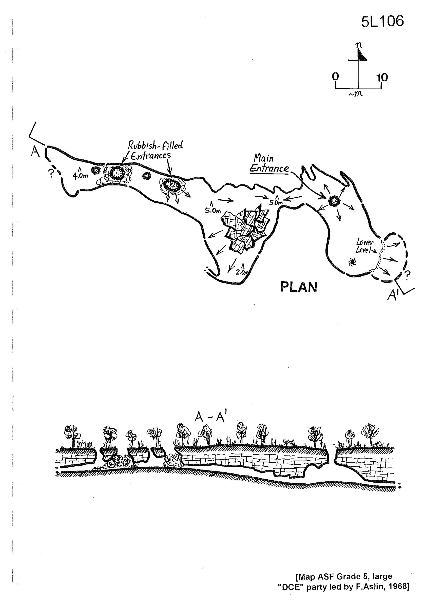
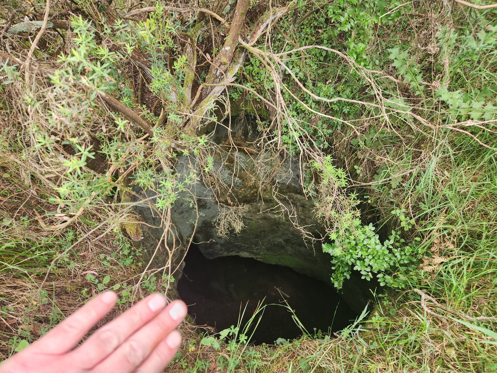
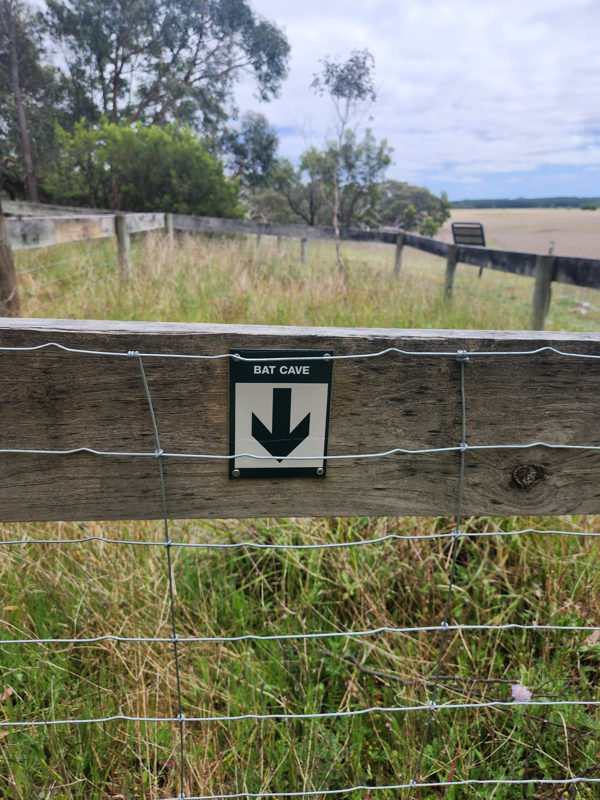
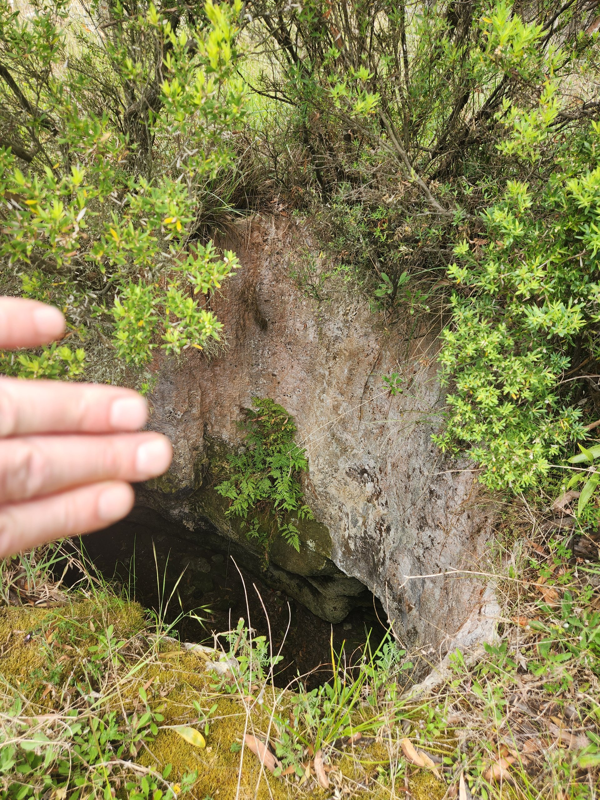
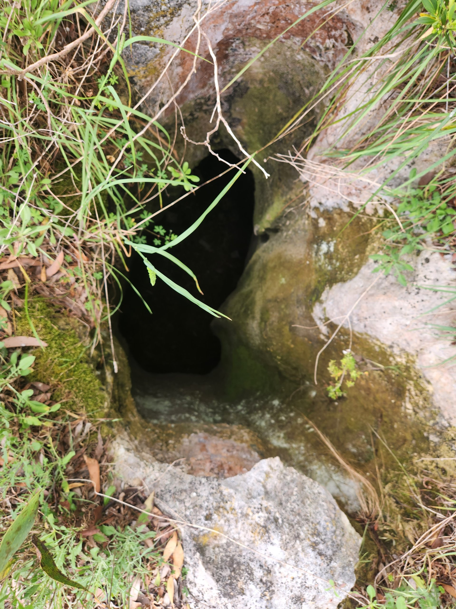
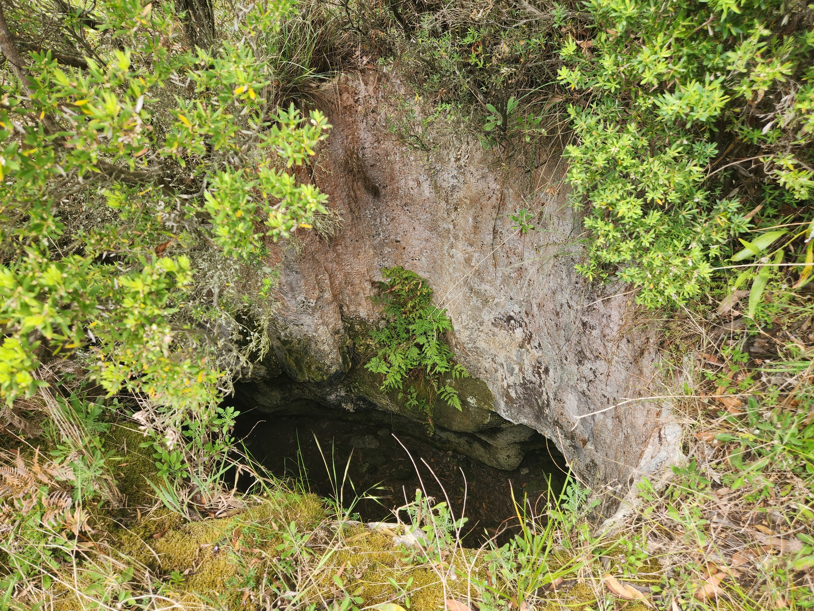

# About

Forestry combined with L920
BC 4/11/2023: Confirmed location, has multiple entries all requiring VA. Appear to be 2-3m drop into the system.

# Details

## Identification

- **Feature type:** Cave
- **Reference:** L0106
- **Source:** Forestry SA

## Cave and exploration data

- **Vertical access:** Yes
- **Exploration potential:** High

## Access and warnings

Forestry

# Additional Notes

First appearing in CEGSA's Records in the form of a single-paragraph description in a Trip Report dated September 1967, this cave had at least 5 window entrances and one associated surface depression when it was surveyed in April 1968. The cave appears to have been quite signif- icant, in the order of 100 metres in length and between 5 and 20 metres wide (averaging around 6 metres). Ceiling heights shown on the map vary from less than one metre up to almost 2m, and some mostly-dead decoration and bone deposits were also noted.
The cave has obviously been known by locals for a long time (some 19th Century markings were found here and there), but more importantly, a small number of cave crickets (wotas) were found to be co-existing with some bats (Miniopterus schreibersi)... a relationship which is evidently quite uncommon (presumably because one eats the other?).
The cave was first shown to local speleologist Fred W. Aslin sometime around 1958-60, after a gentleman reported finding it while on C.M.F. (Civilian Military Forces) manoeuvres a little earlier. Two of the entrances were apparently blocked by rubbish in August 1971.
- **Forestry SA:** L0106, Thin Roof: N, Fence: Y. Dimensions: 100m length. Features: bats/ bone/ frogs/ nails/ blue tongue lizard. 5 large roof windows; fenced '99

First appearing in CEGSA's Records in the form of a single-paragraph description in a Trip Report dated September 1967, this cave had at least 5 window entrances and one associated sur- face depression when it was surveyed in April 1968. The cave appears to have been quite signif- icant, in the order of 100 metres in length and between 5 and 20 metres wide (averaging around 6 metres). Ceiling heights shown on the map vary from less than one metre up to almost 2m, and some mostly-dead decoration and bone deposits were also noted.
The cave has obviously been known by locals for a long time (some 19th Century markings were found here and there), but more importantly, a small number of cave crickets (wotas) were found to be co-existing with some bats (Miniopterus schreibersi)... a relationship which is evidently quite uncommon (presumably because one eats the other?).
The cave was first shown to local speleologist Fred W. Aslin sometime around 1958-60, after a gentleman reported finding it while on C.M.F. (Civilian Military Forces) manoeuvres a little earlier. Two of the entrances were apparently blocked by rubbish in August 1971.

# References

- **LSECR:** Page 210

## Images
- 
- 
- 
- 
- 
- 

## Images
- 
- 
- 

