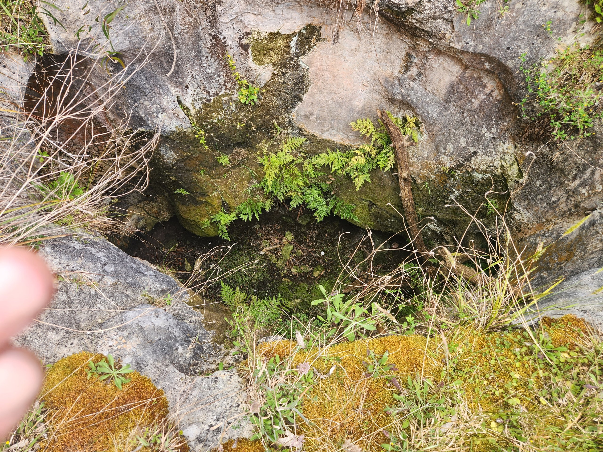
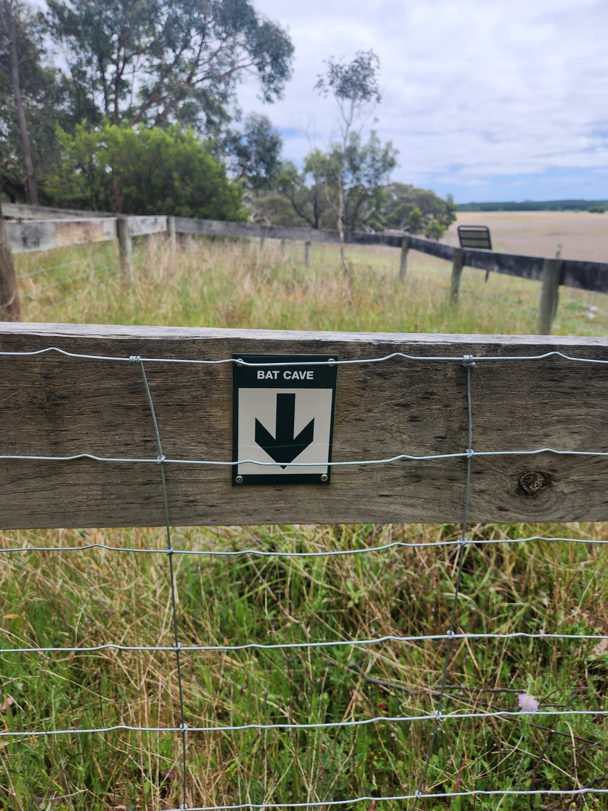
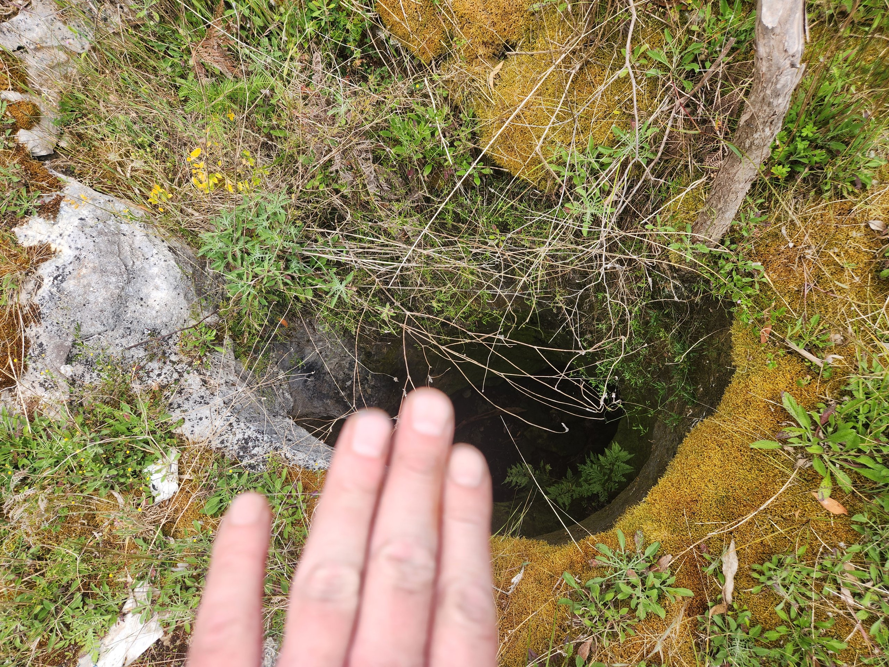
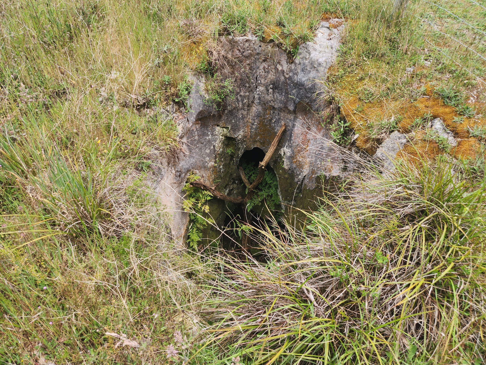
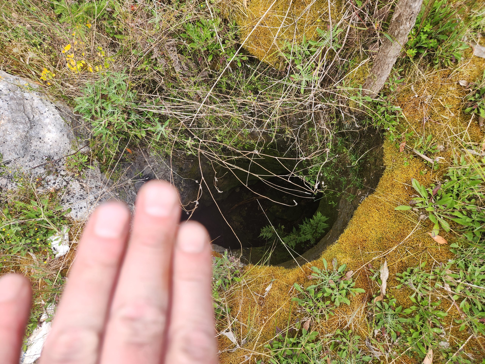

# About

BC 4/11/2023: Fenced off leading to a 2m+ drop into the cave.

# Details

## Identification

- **Feature type:** Cave

## Cave and exploration data

- **Vertical access:** Yes
- **Exploration potential:** High

# References

## Images
- 
- 
- 
- 
- 
