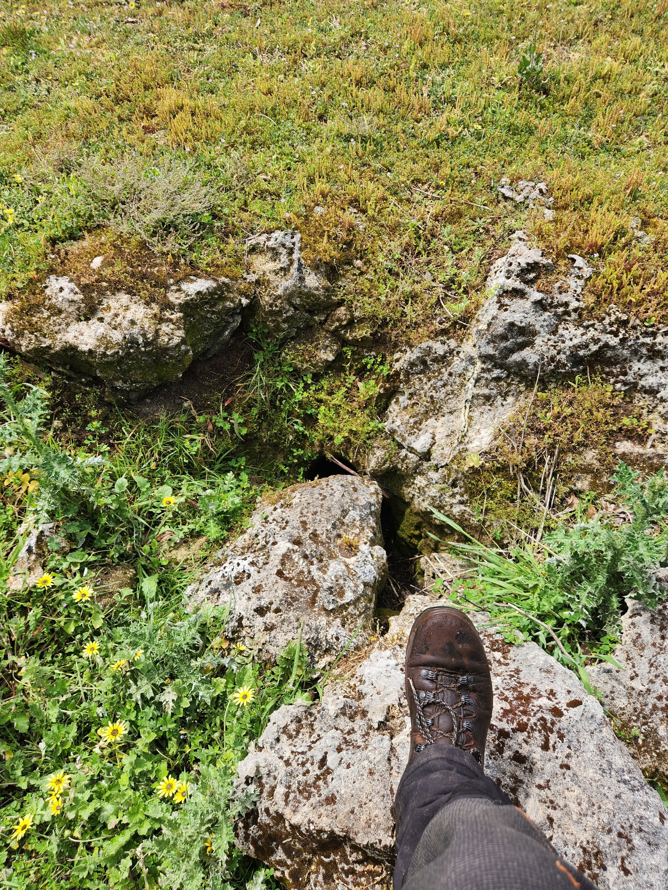
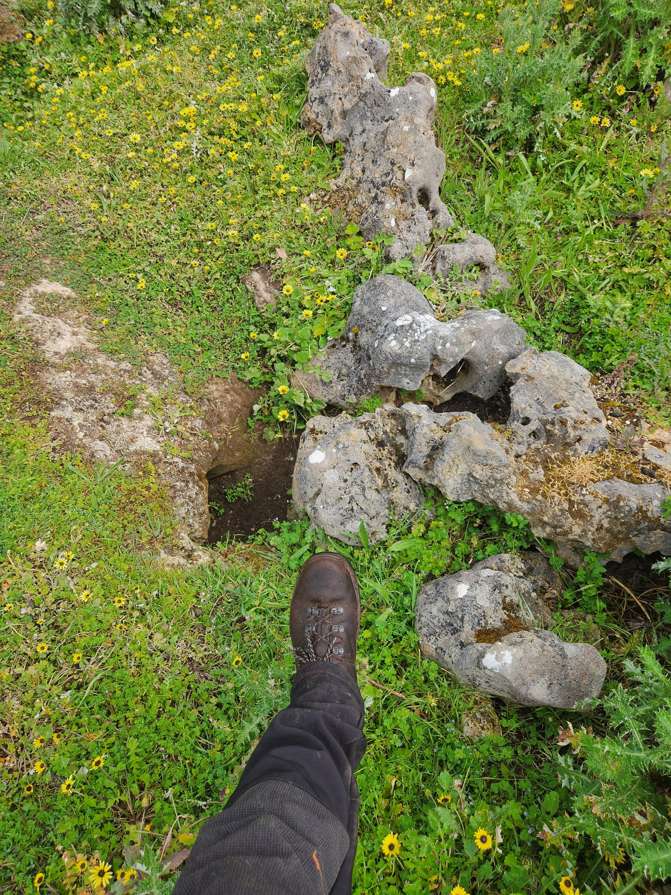
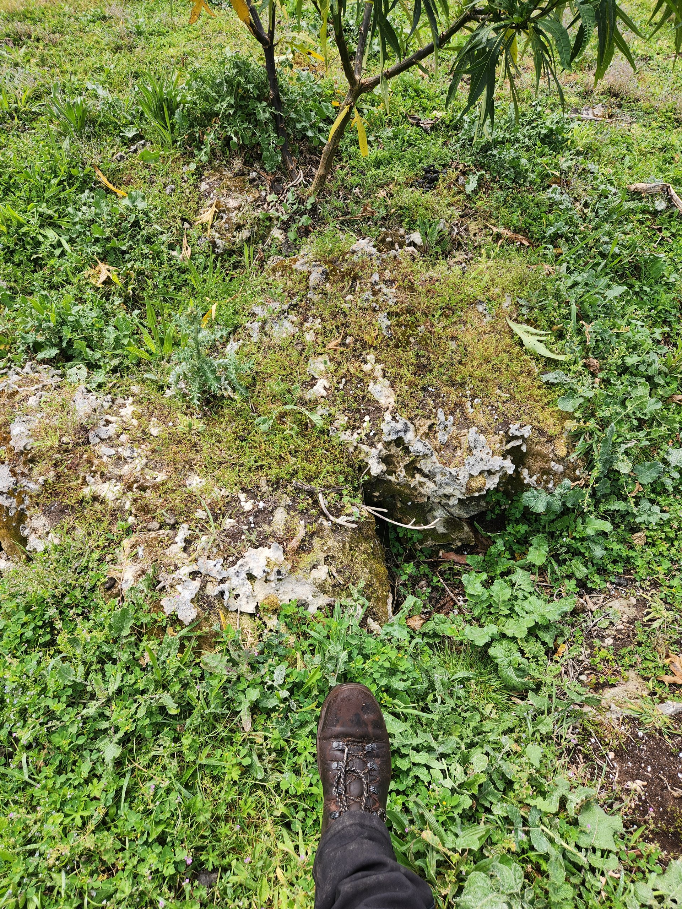
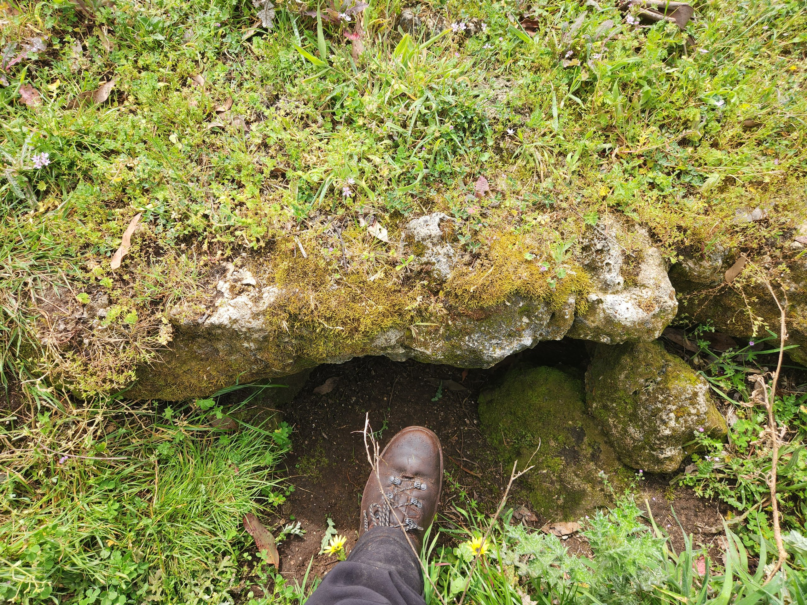
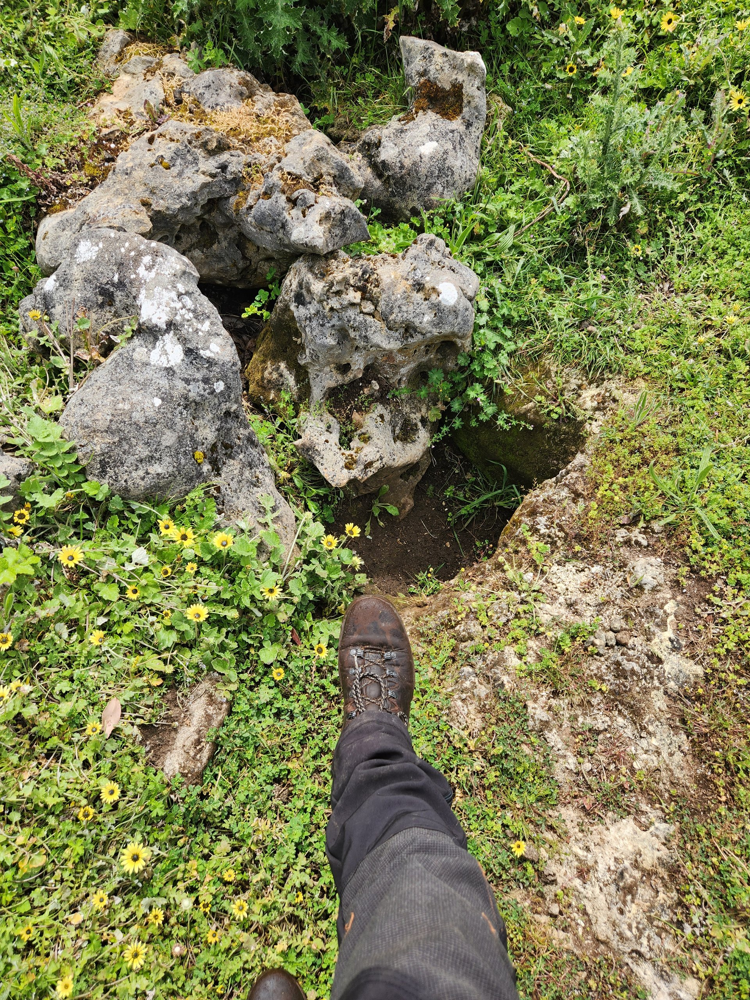
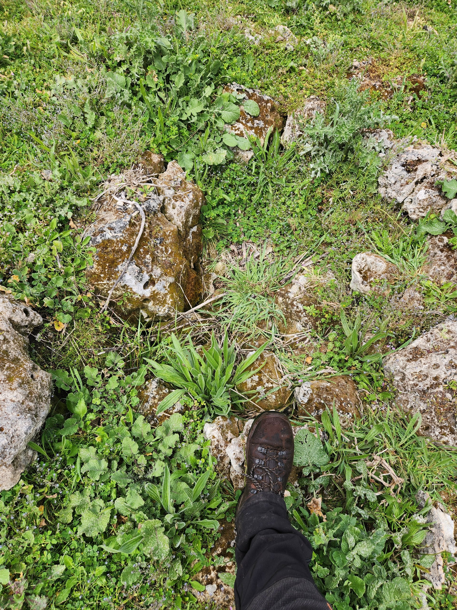

# About

BC 13/10/2023: Small doline surrounded by rocky outcrops with no entrance big enough to get in. Would require digging for further investigation

# Details

## Identification

- **Feature type:** RockyOutcrop
- **Reference:** L1061
- **Source:** Forestry SA

## Cave and exploration data

- **Exploration potential:** Medium

## Access and warnings

Forestry

# References

- **Forestry SA:** L1061, Thin Roof: ?, Fence: N. Dimensions: Entrance in small doline. Features: T. Horn Located Dec 14 as part of conservation feature survey.

## Images
- 
- 
- 
- 
- 
- 
