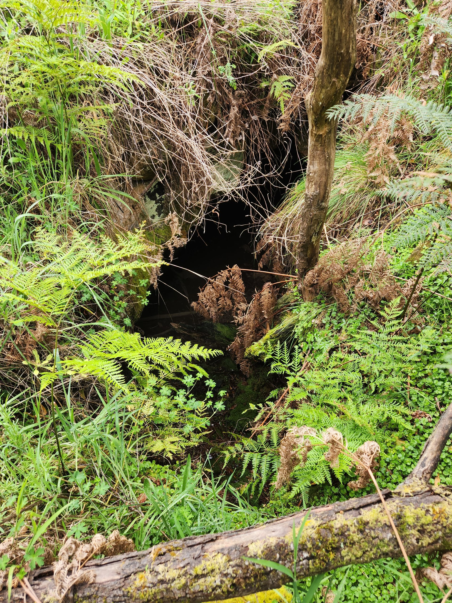
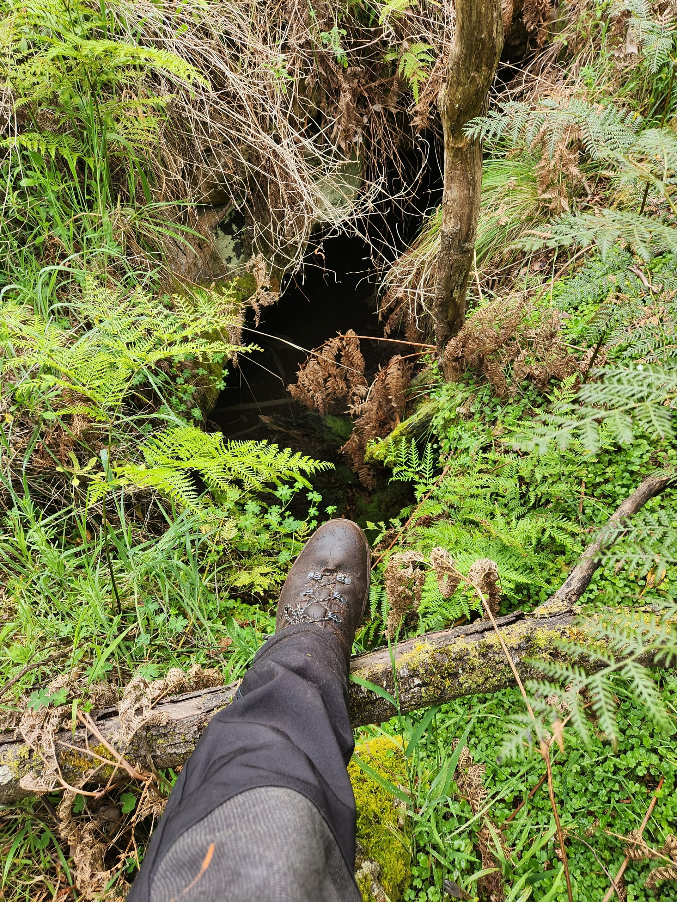
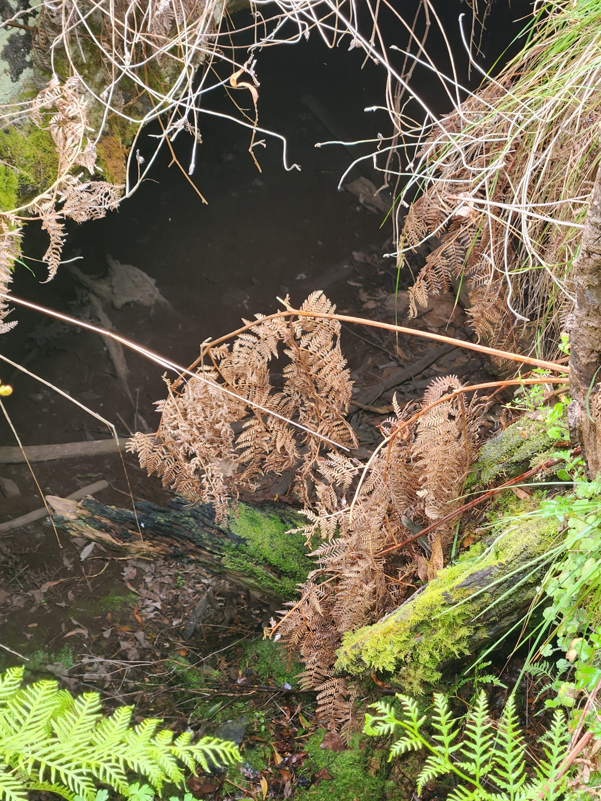
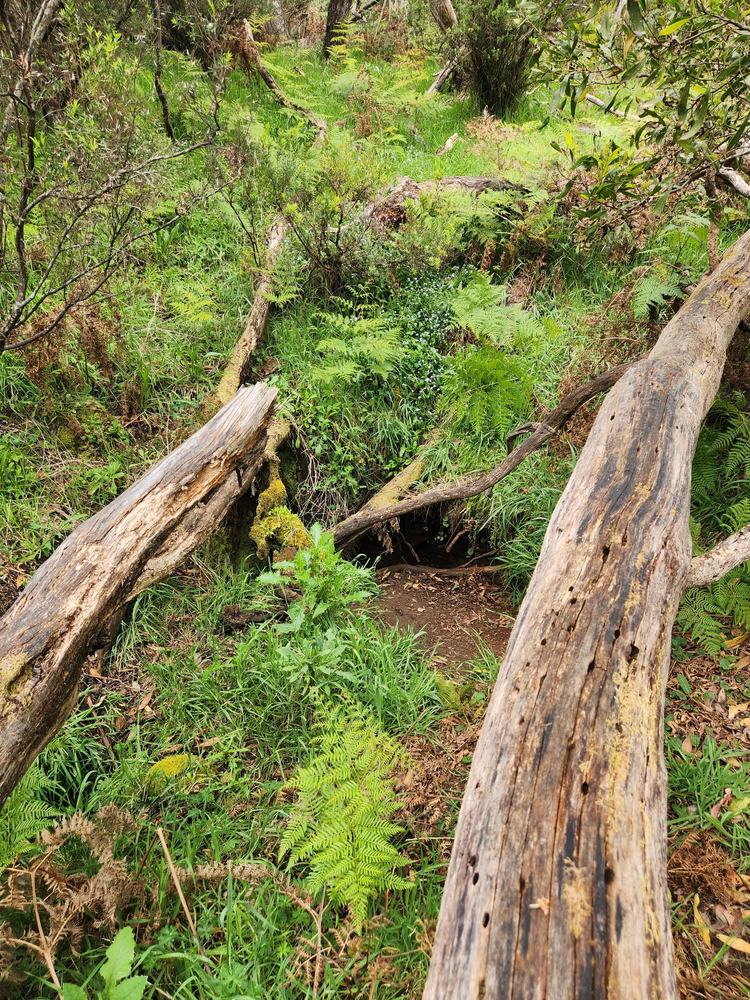
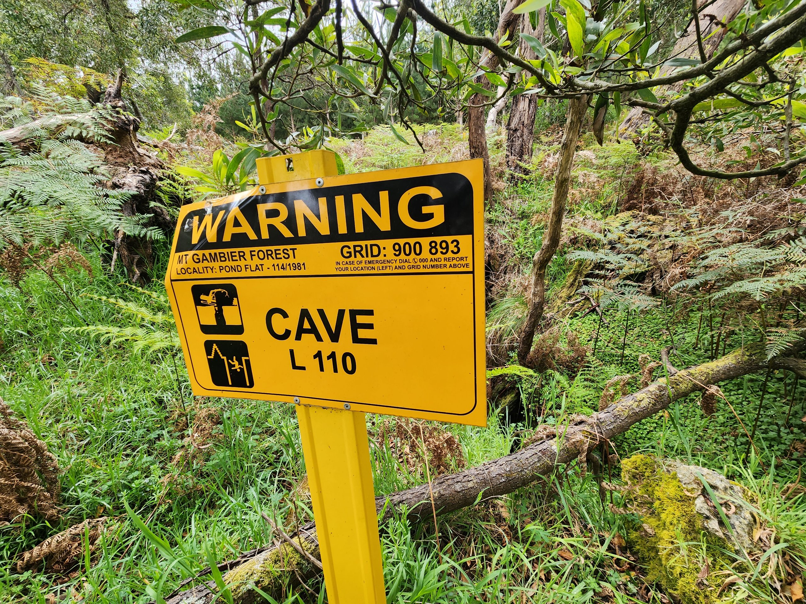

# About

BC 13/10/2023:  1.5m drop into open cave.  Signed L110.

# Details

## Identification

- **Feature type:** Cave

## Cave and exploration data

- **Exploration potential:** Medium

# References

## Images
- 
- 
- 
- 
- 
