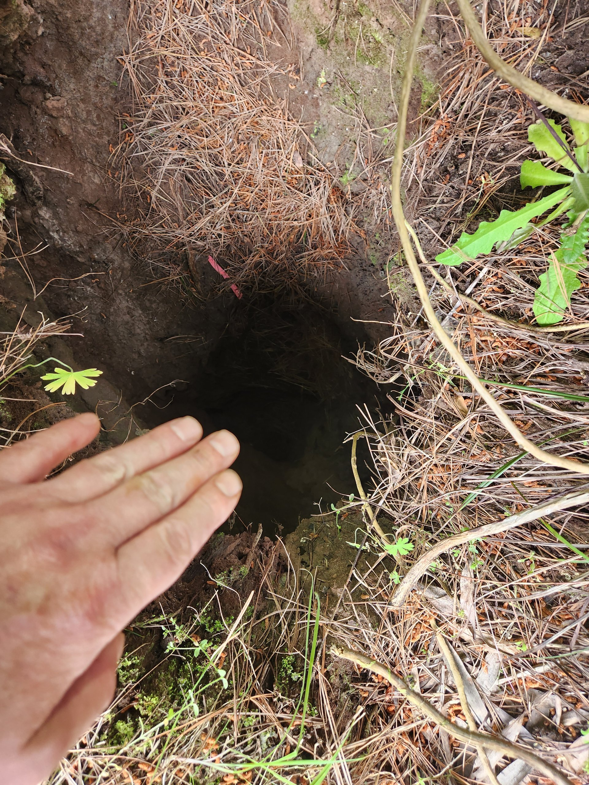
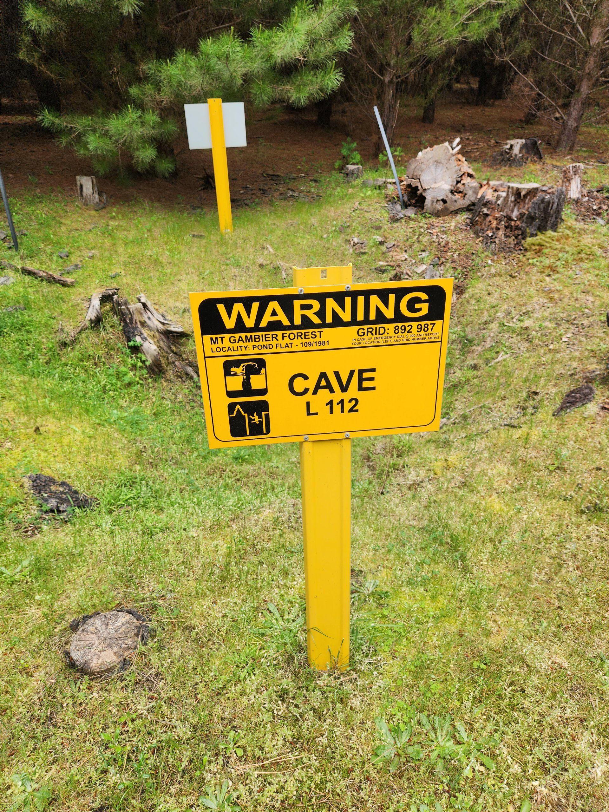
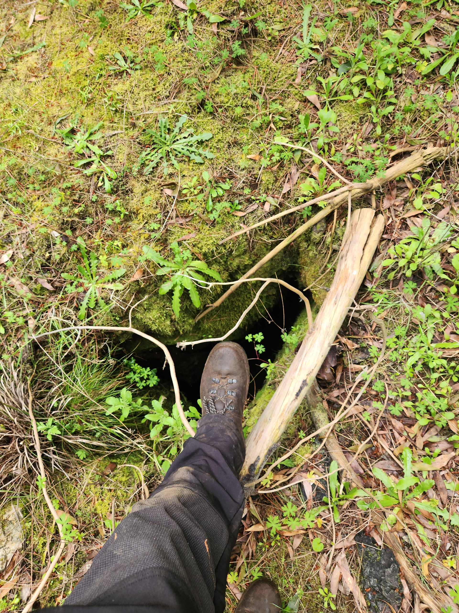
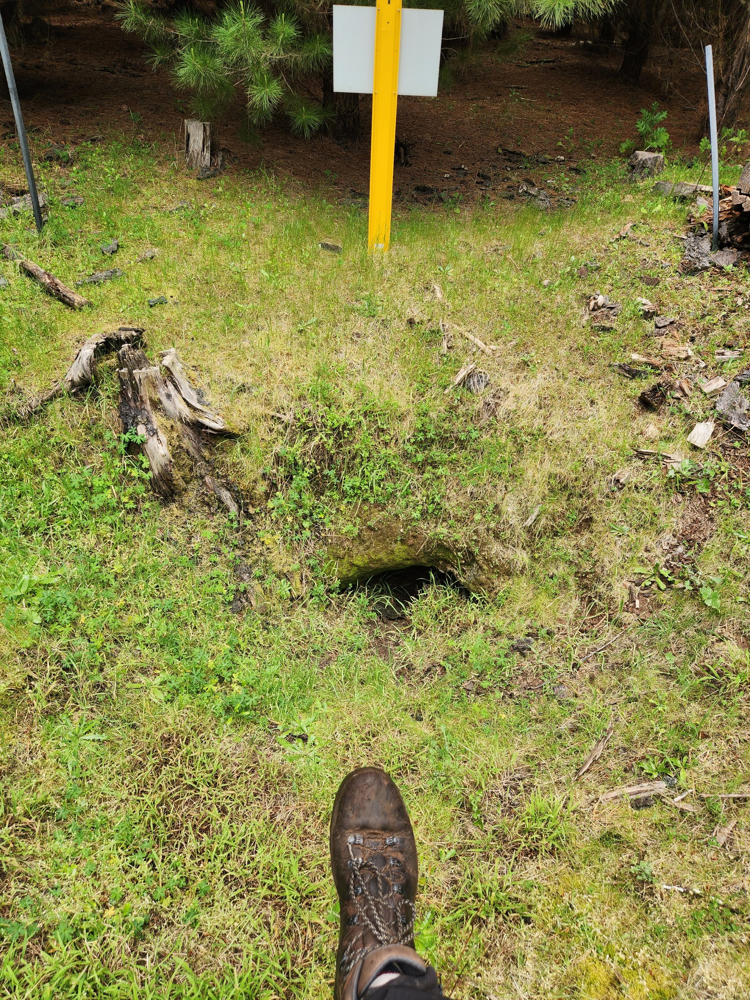

# About

BC 13/10/2023: 60cm x 80cm entrance to 5m drop into a cave.

# Details

## Identification

- **Feature type:** Cave
- **System name:** L112

## Cave and exploration data

- **Vertical access:** Yes
- **Exploration potential:** High

# References

## Images
- 
- 
- 
- 
