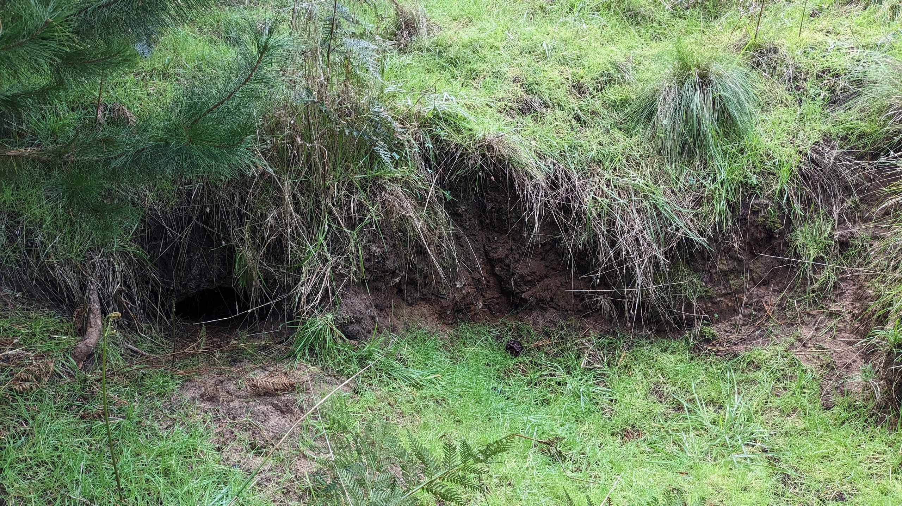
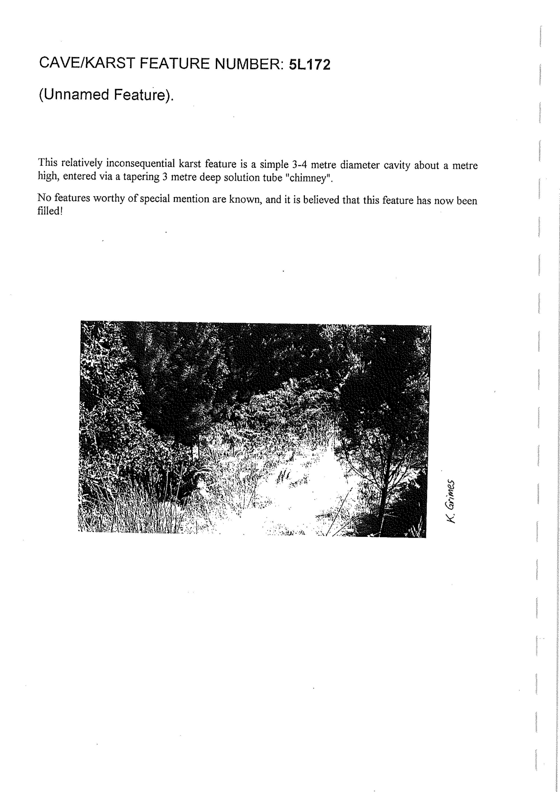
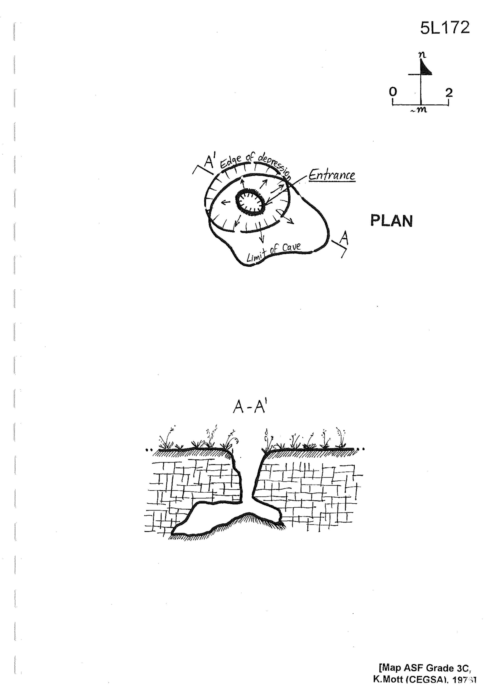
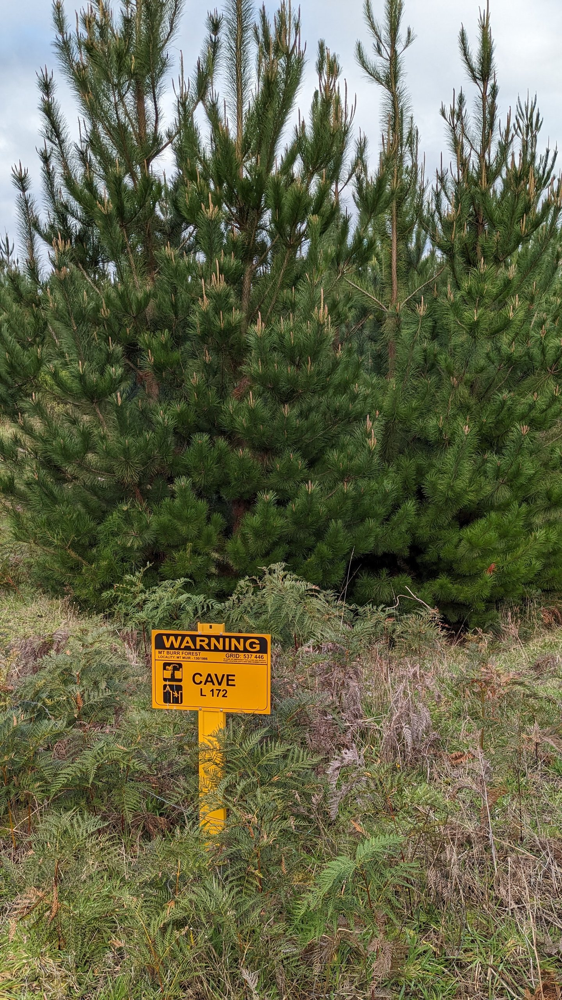
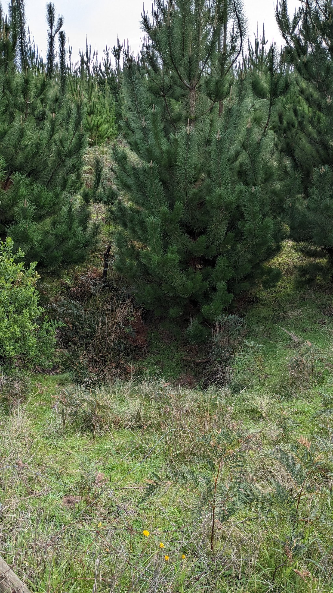

# About

Checked 23-06-2023 by MW

# Details

## Identification

- **Feature type:** Depression
- **Reference:** L0172
- **Source:** Forestry SA

## Cave and exploration data

- **Vertical access:** No
- **Disabled access potential:** Low
- **Goes to water:** No

## Access and warnings

Forestry

# Additional Notes

CAVE/KARST FEATURE NUMBER: 5L172
([Unnamed Feature]()).
This relatively inconsequential karst feature is a simple 3-4 metre diameter cavity about a metre high, entered via a tapering 3 metre deep solution tube "chimney". No features worthy of special mention are known, and it is believed that this feature has now been filled!
- **Forestry SA:** L0172, Thin Roof: N, Fence: R. Dimensions: 4m diam x 3m deep. Features: Tube blocked

# References

- **LSECR:** Page 334

## Images
- 
- 
- 
- 
- 
