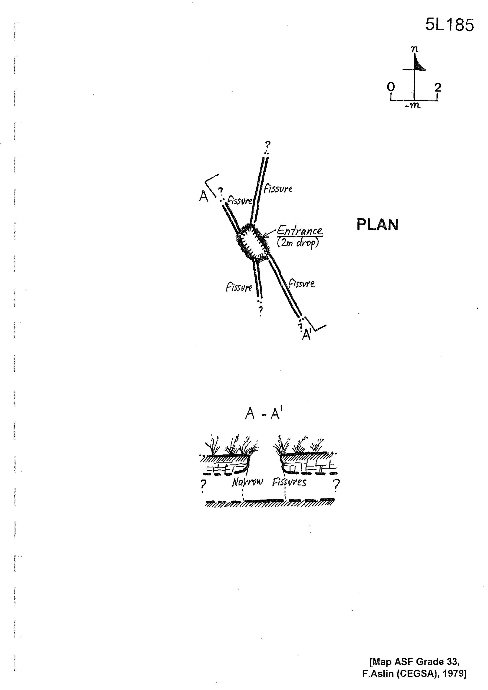
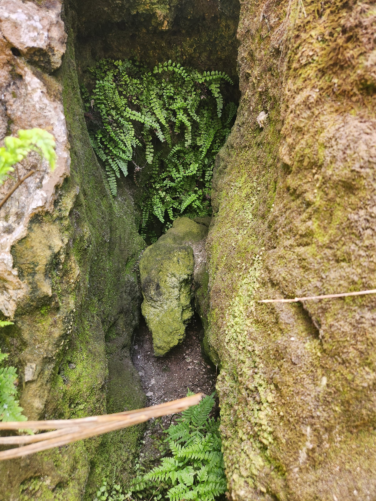
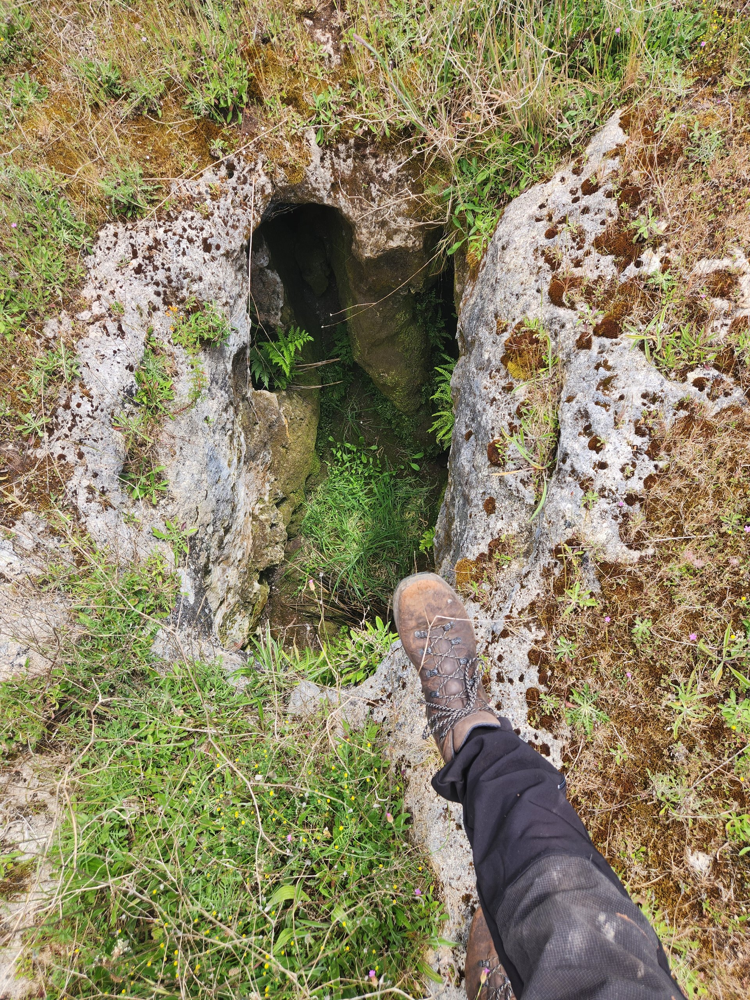
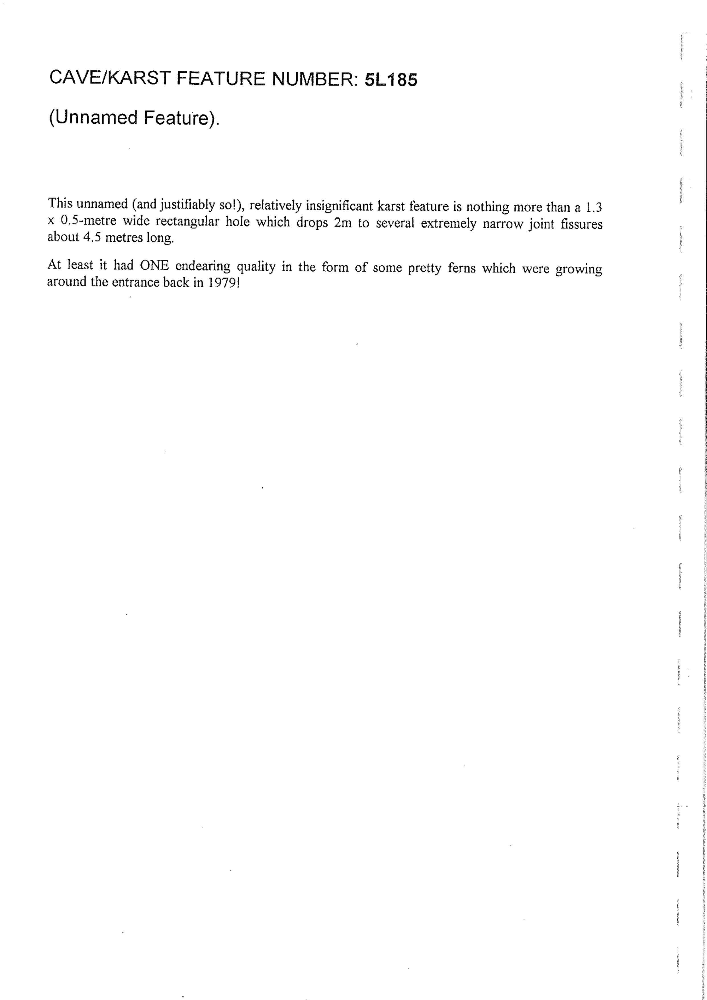
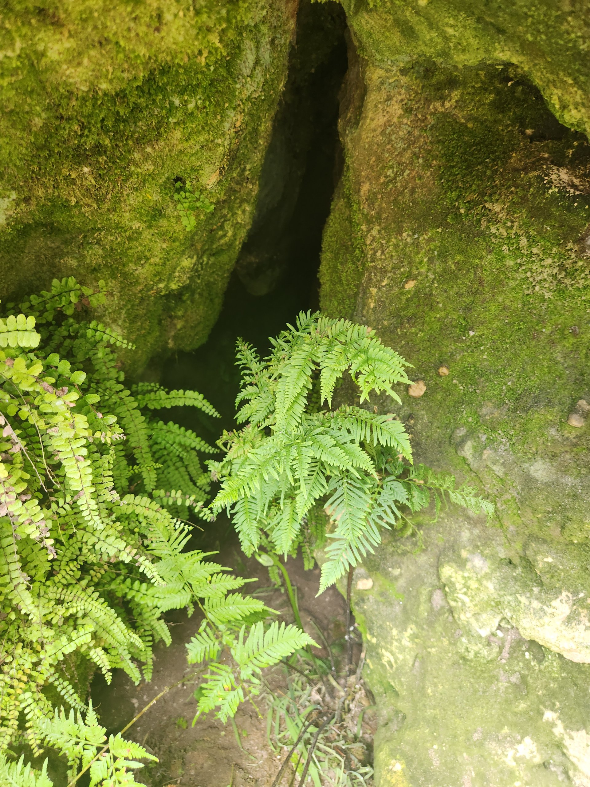

# About

BC 4/11/2023: 1.5m x 0.5m rectangular cave about 2m deep. Narrow fissures at each end that do not appear to go anywhere.

# Details

## Identification

- **Feature type:** Cave
- **Reference:** L0185
- **Source:** Forestry SA

## Cave and exploration data

- **Vertical access:** No
- **Exploration potential:** Low

## Access and warnings

Forestry

# Additional Notes

This unnamed (and justifiably so!), relatively insignificant karst feature is nothing more than a 1.3 x 0.5-metre wide rectangular hole which drops 2m to several extremely narrow joint fissures about 4.5 metres long.
At least it had ONE endearing quality in the form of some pretty ferns which were growing around the entrance back in 1979!
- **Forestry SA:** L0185, Thin Roof: N, Fence: N. Dimensions: 1m x 2m deep. Features: Fern, 50m from L919

# References

- **LSECR:** Page 360

## Images
- 
- 
- 
- 
- 
