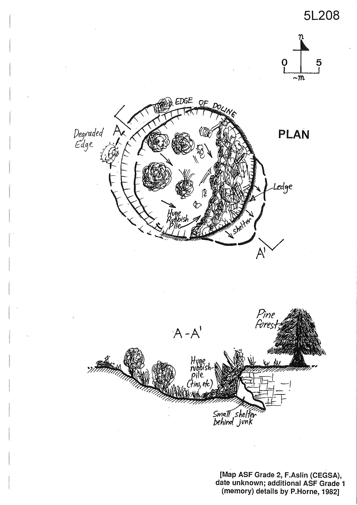
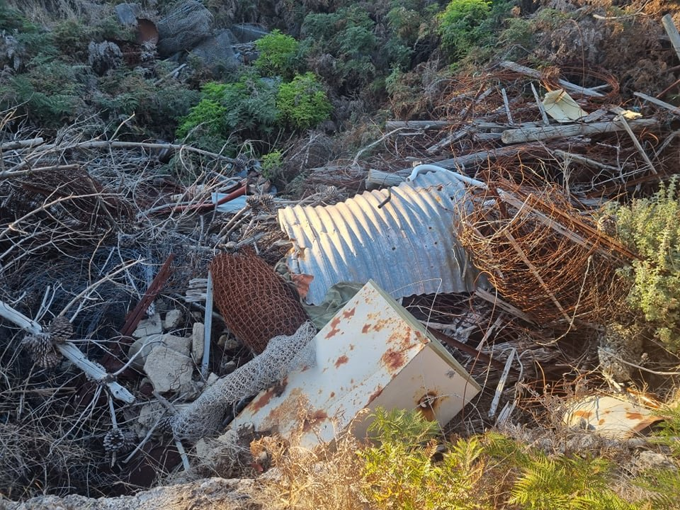
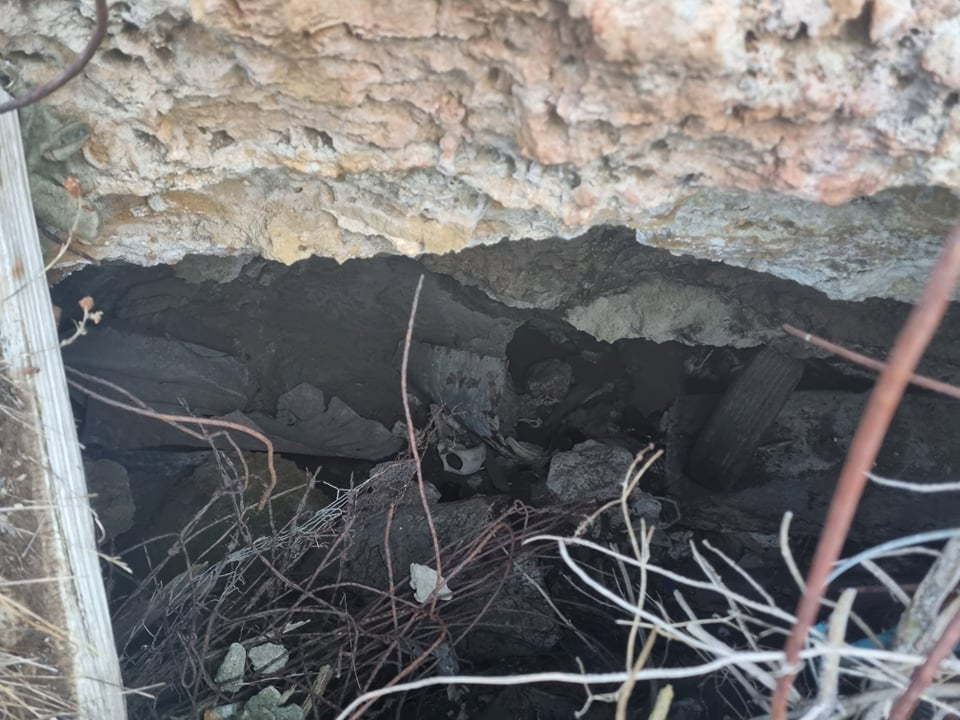
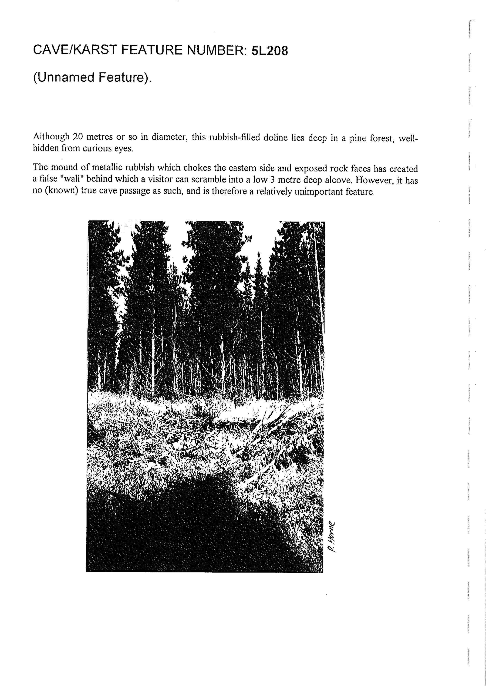
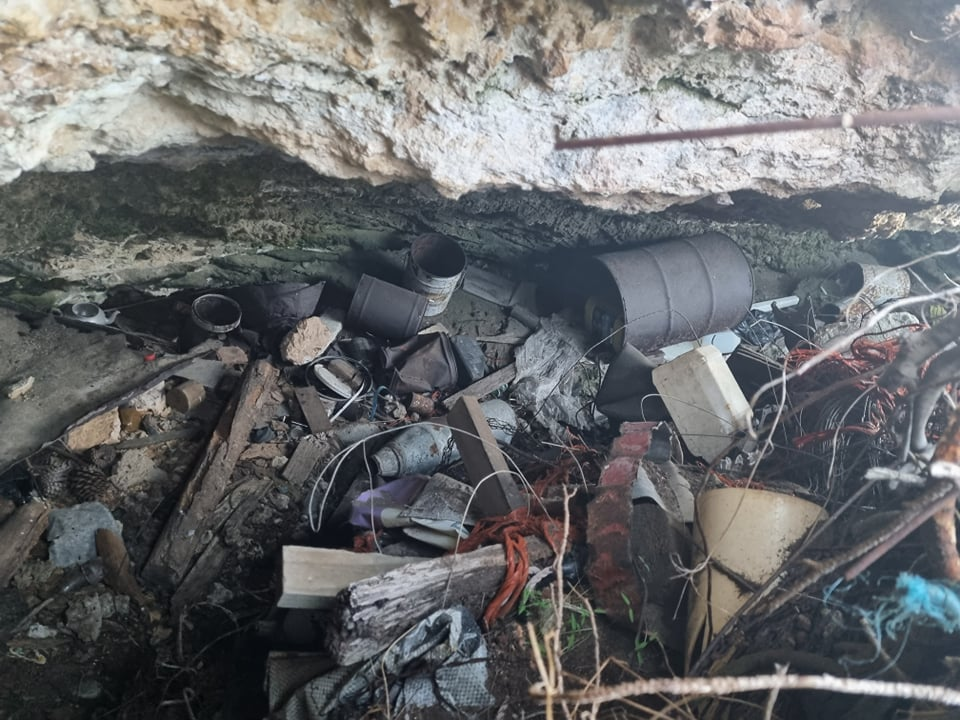

# About

2022-Mar: CA visited on foot - doline filled with rubbish, possible lead but unlikely

# Details

## Identification

- **Feature type:** Depression
- **Reference:** L0208
- **Source:** Forestry SA

## Cave and exploration data

- **Vertical access:** No
- **Exploration potential:** Low
- **Goes to water:** No

## Access and warnings

Forestry

# Additional Notes

Although 20 metres or so in diameter, this rubbish-filled doline lies deep in a pine forest, well hidden from curious eyes. The mound of metallic rubbish which chokes the eastern side and exposed rock faces hhas created a false "wall" behind which a visitor can scramble into a low 3 meter deep alcove. However, it has no (known) true cave passage as such, and is therefore a relatively unimportant feature.
- **Forestry SA:** L0208, Thin Roof: N, Fence: N. Dimensions: 20m diameter. Features: rubbish filled doline

# References

- **LSECR:** Page 404

## Images
- 
- 
- 
- 
- 
