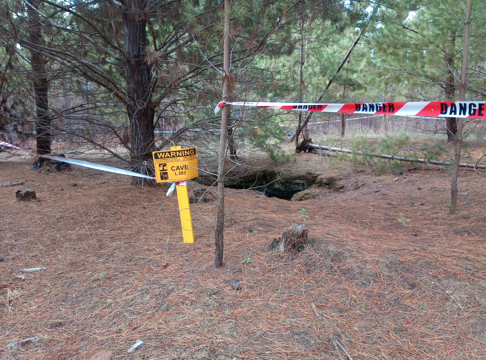
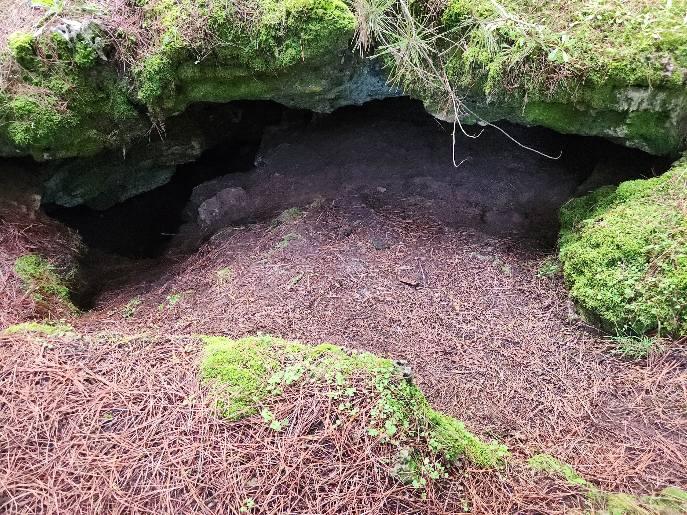
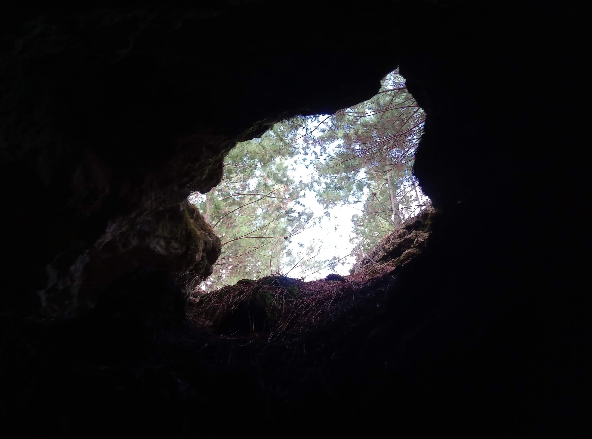
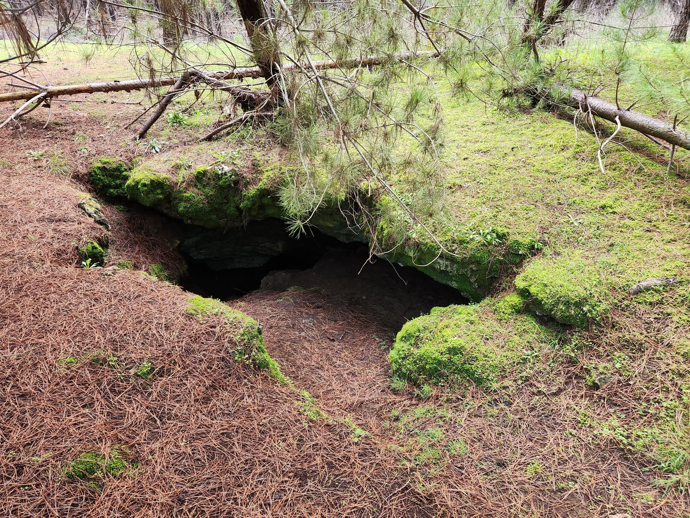
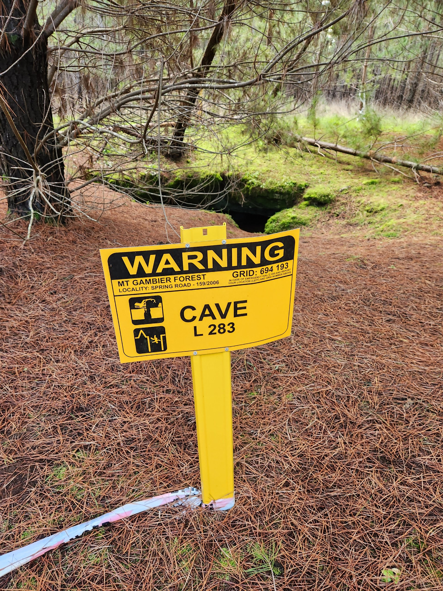
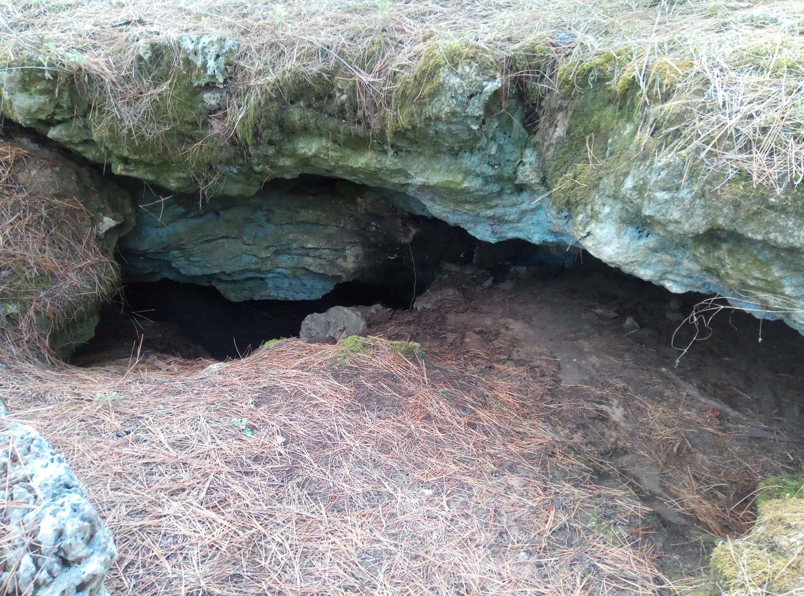

# About

2019-Dec: MW walked around forest checking clear spots identified from satellite imagery. Forestry sign showing "L283" with significant dry cave found with moonmilk. Further investigation required (dry caving) with hollow noises heard from rocks at bottom of cave

2023-July: MW, BC & NB revisited with caving gear. Several leads found all worth further investigation, will require lots of rock being pulled up and out of chokes

# Details

## Identification

- **Feature type:** Cave
- **Reference:** L0283
- **Source:** Forestry SA

## Cave and exploration data

- **Vertical access:** No
- **Exploration potential:** Medium
- **Tourism potential:** Medium
- **Disabled access potential:** Low
- **Goes to water:** No

## Access and warnings

Forestry

# References

- **LSECR:** Page 554
Hard to find in the middle of a bracken fern-infested pine forest, this feature is accessed via a 4 by 1.5 metre vertical roof collapse which leads down and around in an anticlockwise direction to a 45-degree slope with numerous boulders.
The cavern extends to the south of the entrance chamber for about 10m or so and has quite a lot
of moonmilk on the ceiling in places.
Several low flatteners were also observed but not pushed during the initial visit by the author (with Maurice Parry and Greg Bulling) in May 1988, and these might be worth exploring further. The cave was pointed out by Woods and Forests personnel at that time.
- **Forestry SA:** L0283, Thin Roof: N, Fence: R. Dimensions: 2m X 6m long. Features: Moonmilk (MM)  single chamber 2m high/ extends 6m inside

## Images
- 
- 
- 
- 
- 
- 
