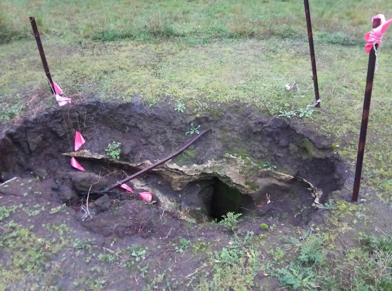
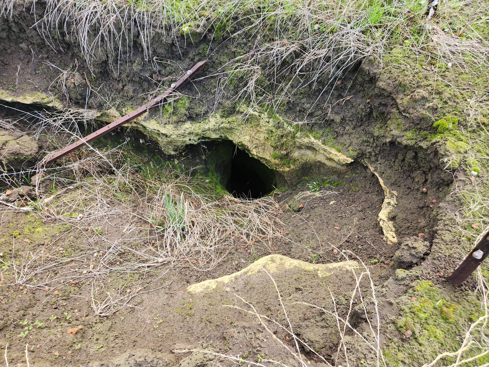
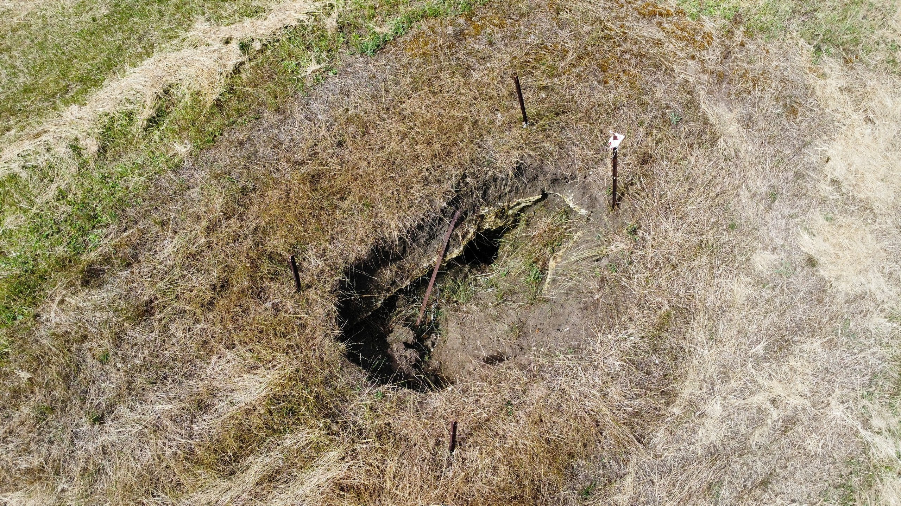
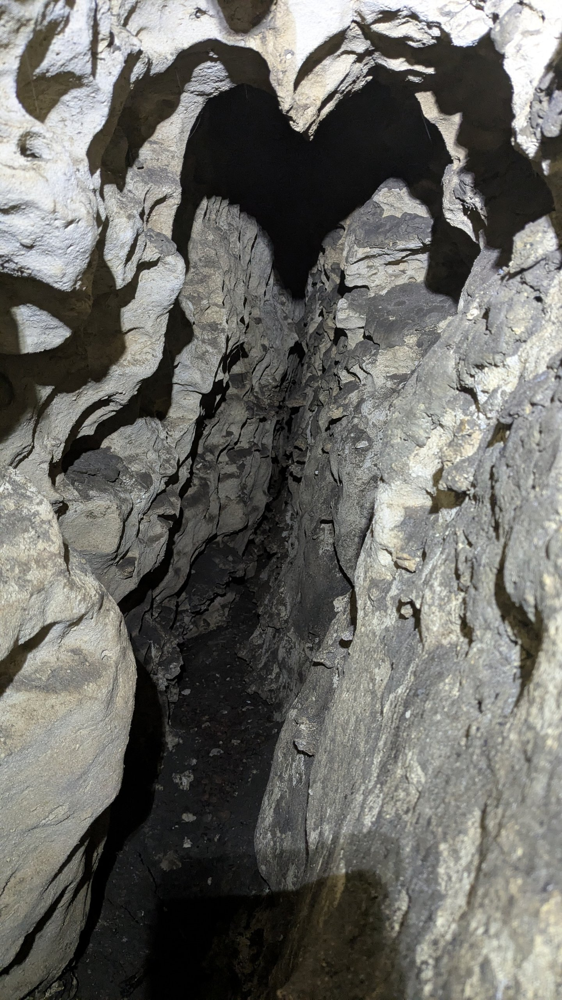
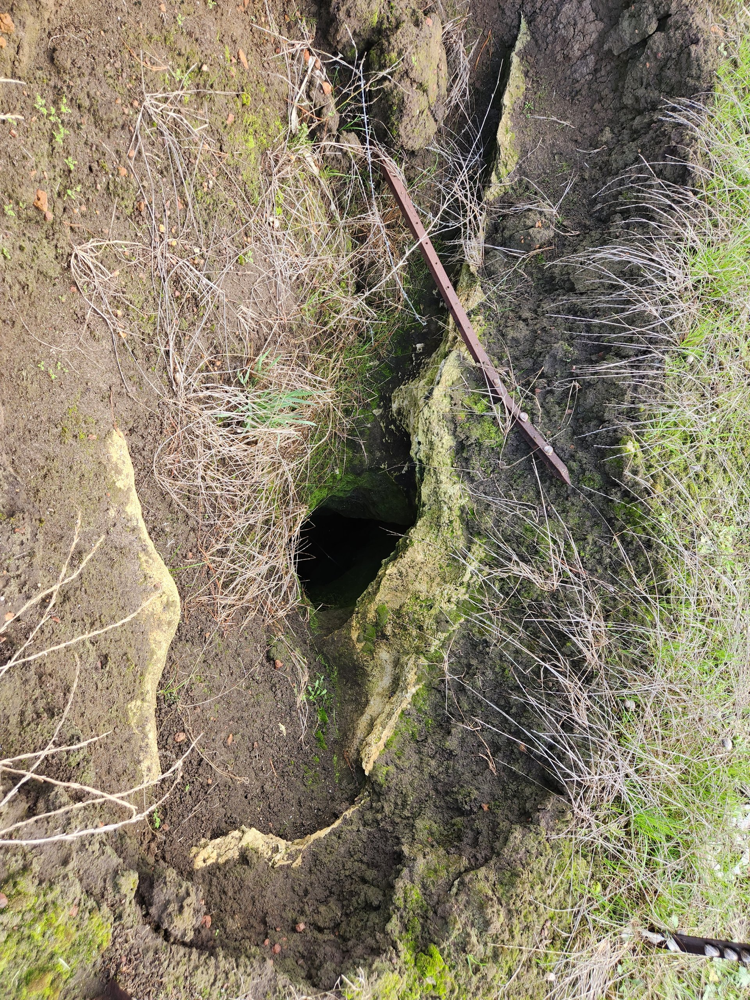

# About

2021-Aug: MW visited on foot while investigating L079. Tight entrance but apprears to have relatively easy access. Rain flowing into solution tube making significant noise hitting pool of water below. Worth returning with wetsuit & 7s

2024-DEC: MW visited on foot and photographed. Site is now completely dry, and is just a small and simple fissure cave (max 30cm wide) with no leads

# Details

## Identification

- **Feature type:** SolutionTube
- **Reference:** L0308
- **Source:** Forestry SA

## Cave and exploration data

- **Vertical access:** No
- **Goes to water:** No

## Access and warnings

Forestry

## Amenities

- **hasShowers:** No
- **hasToilets:** No
- **hasPhone:** Yes

# References

- **LSECR:** Page 592
[Unnamed Cave](): 0.6m diam. hole drops 3m to narrow joint cave 20m long; water at SE
- **Forestry SA:** L0308, Thin Roof: N, Fence: R. Dimensions: 1m diam solution tube drops 3m to cave. Features:  Narrow cave with water at SE end, Av Height 3m

## Images
- 
- 
- 
- 
- 
