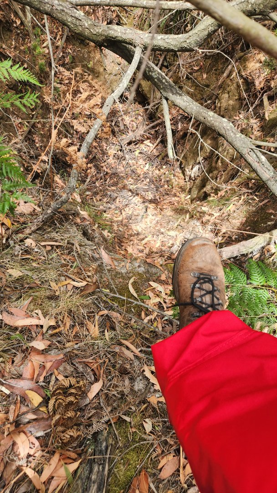
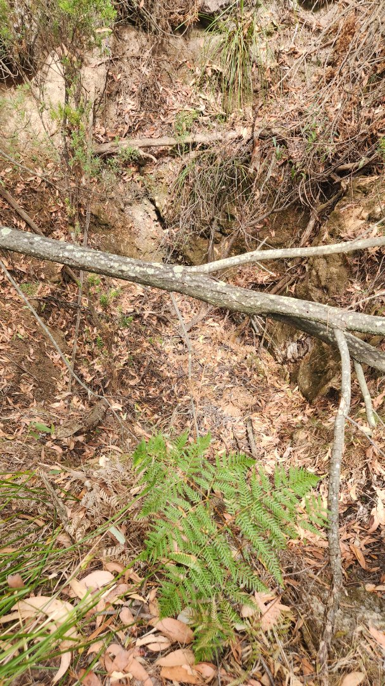
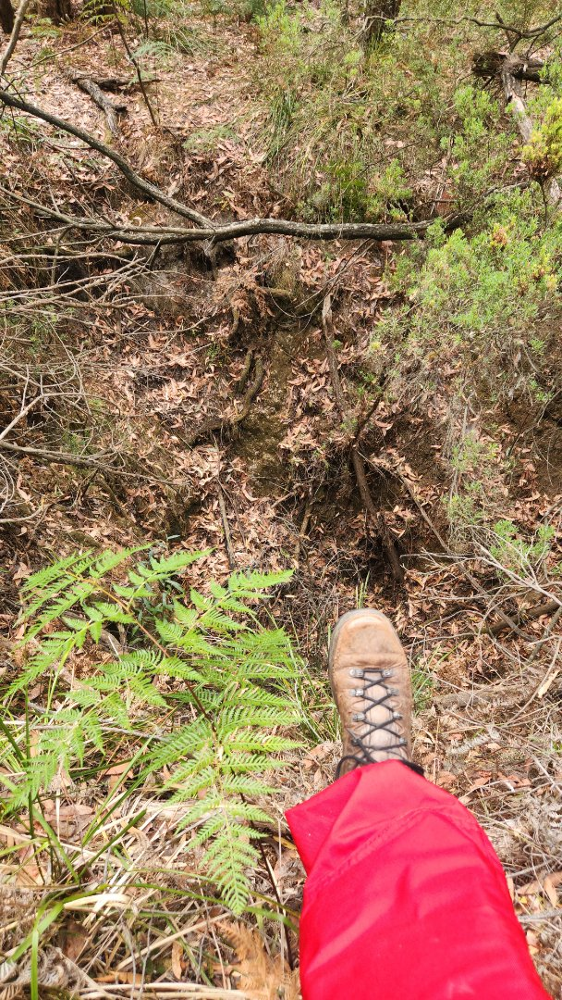
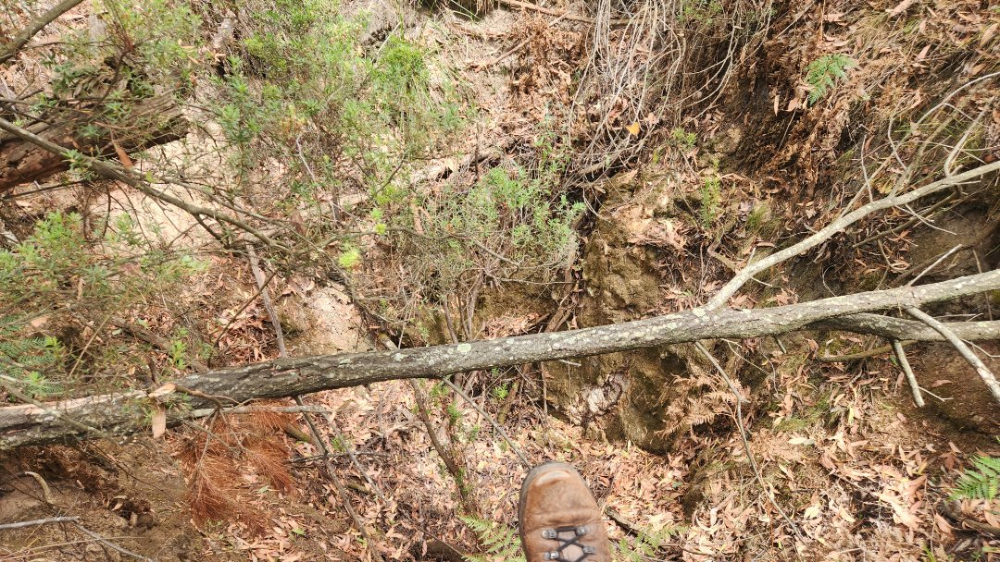

# Details

## Identification

- **Feature type:** Depression
- **Reference:** L0319
- **Source:** Forestry SA

## Access and warnings

Forestry

# References

- **LSECR:** Page 592
[Unnamed Feature](): Doline 5.3m across and 5m deep - no known cave.
- **Forestry SA:** L0319, Thin Roof: ?, Fence: ?. Dimensions: ?. Features: ?

## Images
- 
- 
- 
- 
