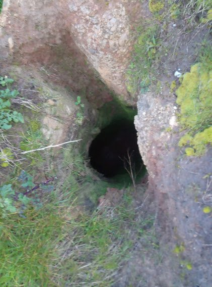
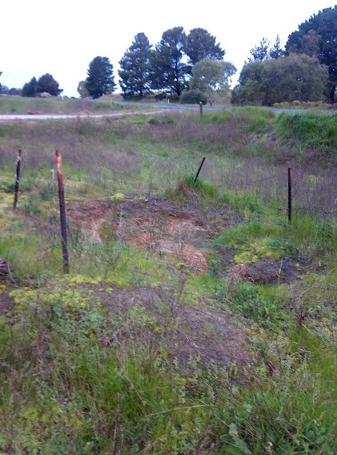

# About

2021-Aug: MW visted and photographed. Small solution tube with no devvelopment

# Details

## Identification

- **Feature type:** SolutionTube
- **Reference:** L0341
- **Source:** Forestry SA

## Cave and exploration data

- **Vertical access:** No
- **Goes to water:** No

## Access and warnings

Forestry

# References

- **Forestry SA:** L0341, Thin Roof: N, Fence: N. Dimensions: 1.7x2.5m kidney shape tube depth 1.6m. Features: Base is filled with sand and pine debris

## Images
- 
- 
