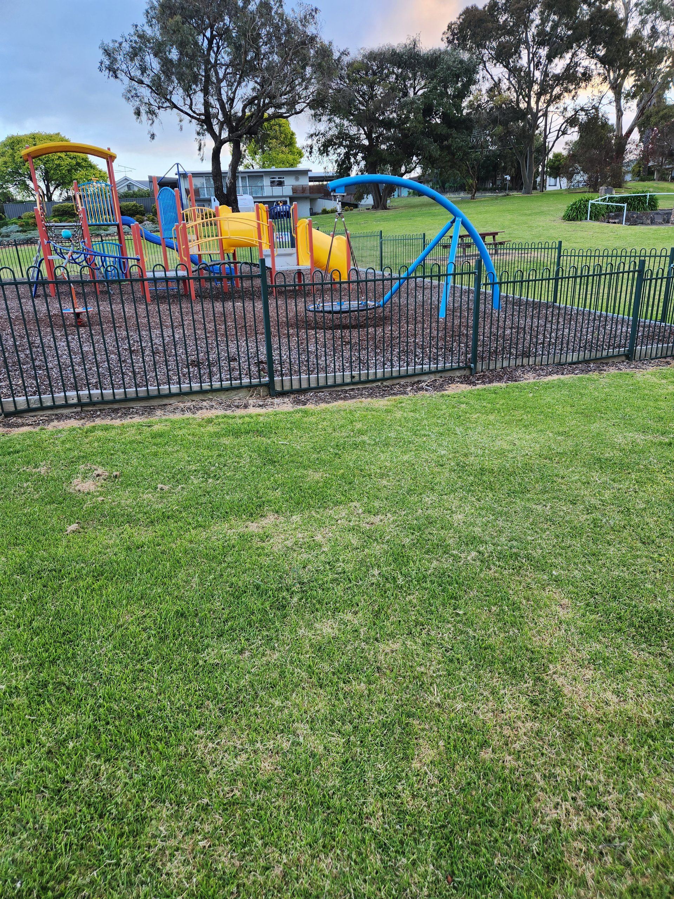

# About

BC 4/11/2023: No sign of anything. Possibly destroyed under playground

# Details

## Identification

- **Feature type:** NotFound
- **Reference:** L0393
- **Source:** Forestry SA

# References

## Images
- 
