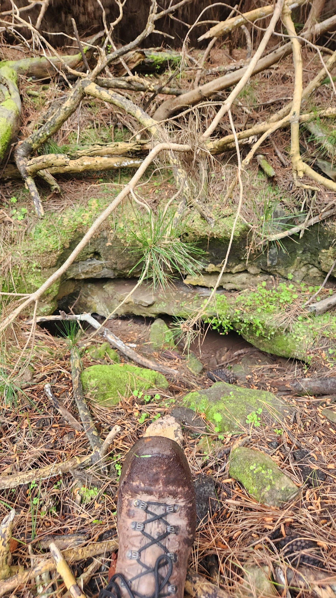
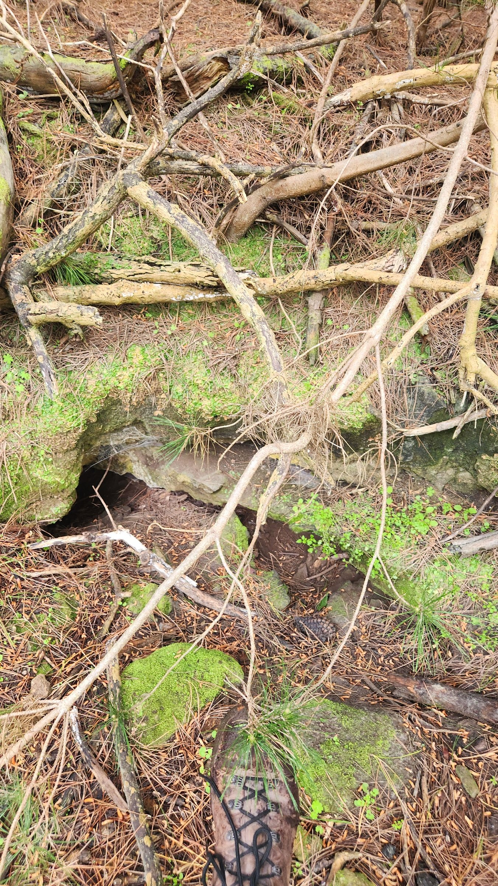

# About

near L930 (20m away)

# Details

## Identification

- **Feature type:** RockyOutcrop
- **Reference:** L0423
- **Source:** Forestry SA

## Cave and exploration data

- **Exploration potential:** Low

## Access and warnings

Forestry

# References

- **Forestry SA:** L0423, Thin Roof: N, Fence: R. Dimensions: ?. Features:  Along road; near L930 (20m away)

## Images
- 
- 
