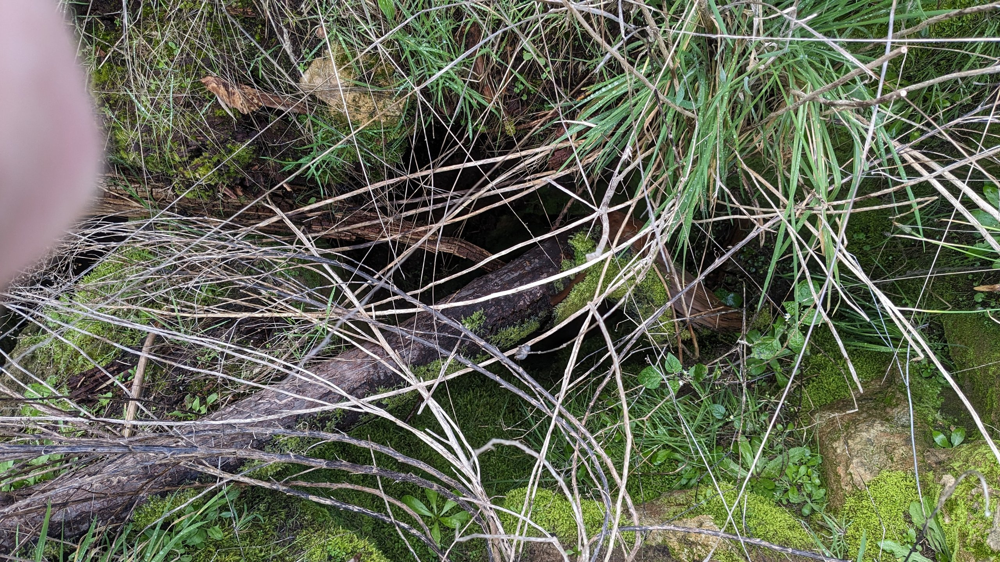
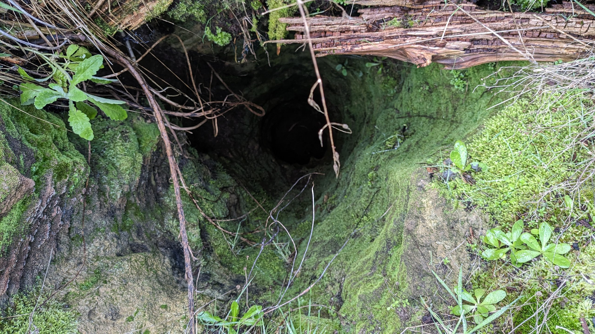
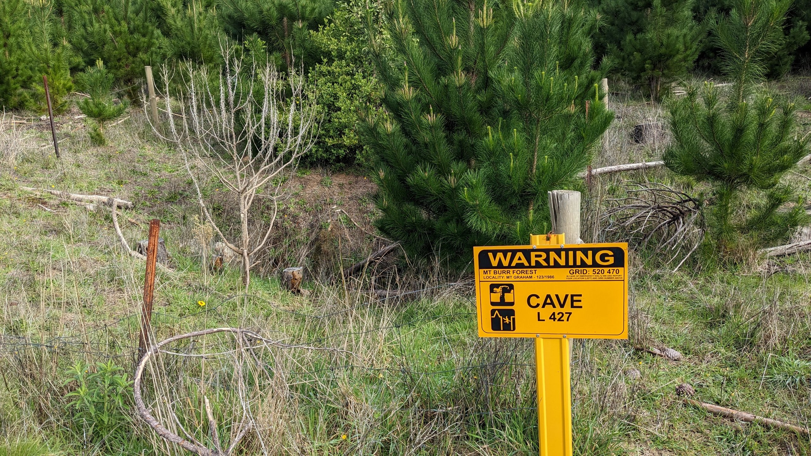

# About

Dual solution tubes, worth investigating with a wire ladder and/or tripod

# Details

## Identification

- **Feature type:** SolutionTube
- **Reference:** L0427
- **Source:** Forestry SA

## Cave and exploration data

- **Vertical access:** Yes
- **Tourism potential:** Low
- **Goes to water:** No

## Access and warnings

Forestry

## Amenities

- **hasShowers:** No
- **hasToilets:** No
- **hasPhone:** No

# References

- **Forestry SA:** L0427, Thin Roof: N, Fence: Y. Dimensions: Doline 4m x 2m - 3 solution tube entranc. Features: N 0.8m diam Middle 0.9m daiam S 0.8m diam x 5.6m d

## Images
- 
- 
- 
