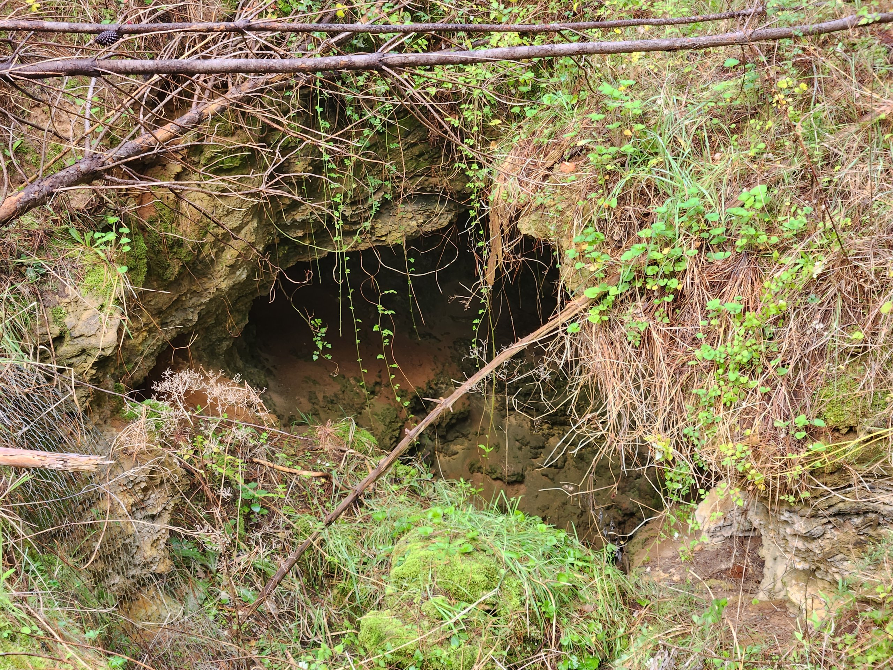
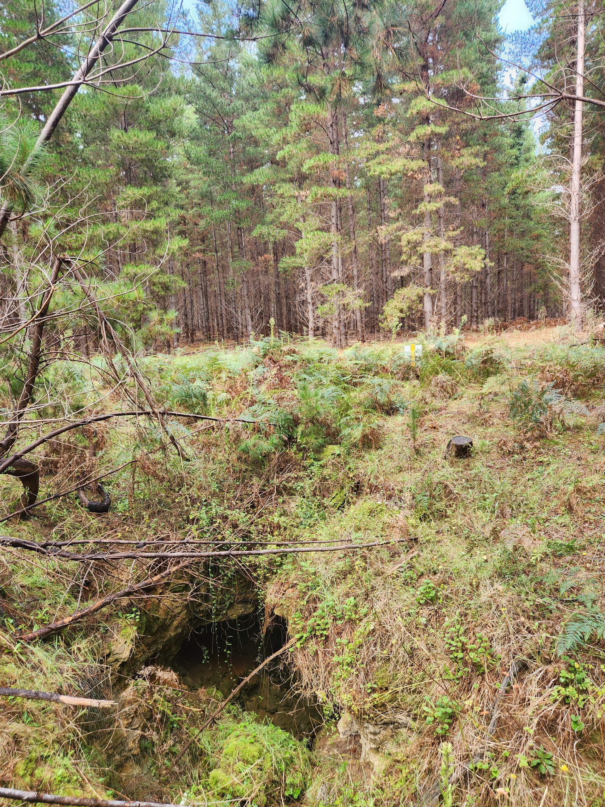
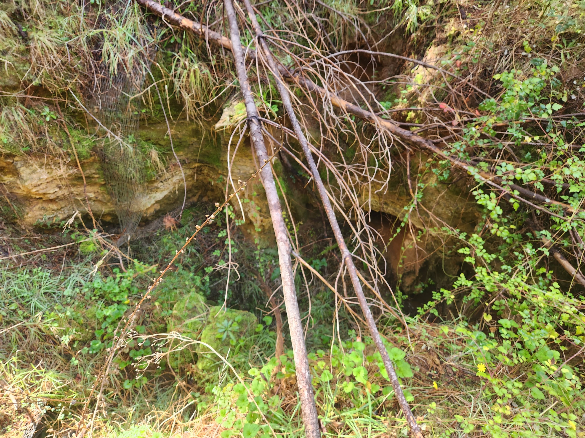
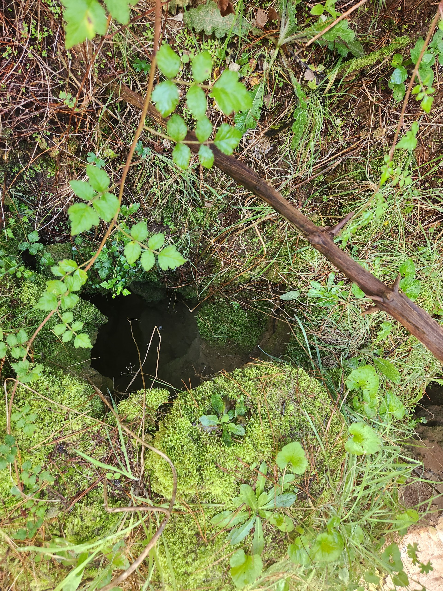
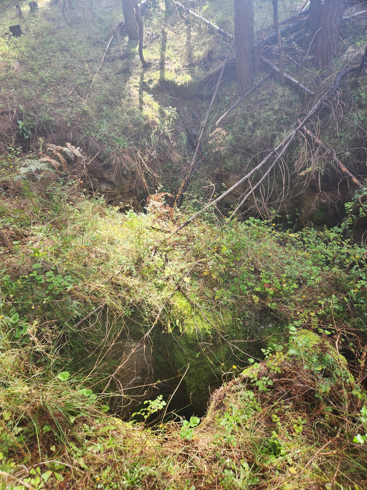

# Details

## Identification

- **Feature type:** Cave
- **Reference:** L0439
- **Source:** Forestry SA

## Cave and exploration data

- **Exploration potential:** High

## Access and warnings

Forestry

# References

- **Forestry SA:** L0439, Thin Roof: ?, Fence: ?. Dimensions: ?. Features: ?

## Images
- 
- 
- 
- 
- 
- 
