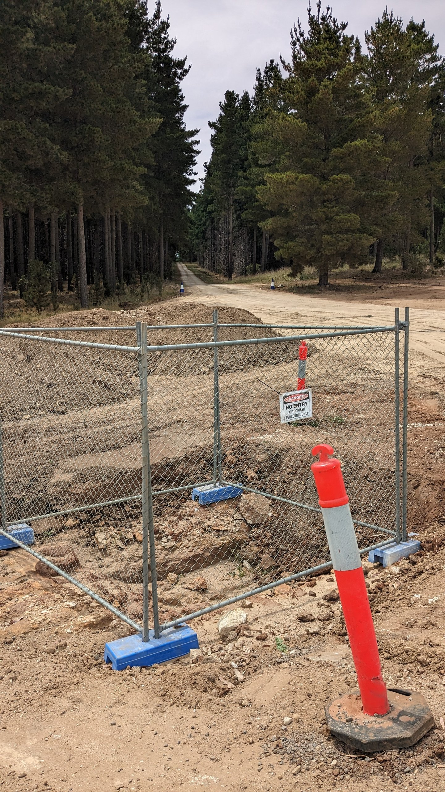

# About

2023-Nov: Location confirmed by MW. Small entrance, likely to require winch/SRT.

2024-DEC: Revisited by MW on foot and photographed. Site entrance has been destroyed by roadworks and all fencing removed

# Details

## Identification

- **Feature type:** Destroyed

## Cave and exploration data

- **Vertical access:** Yes

## Amenities

- **hasShowers:** No
- **hasToilets:** No
- **hasPhone:** Yes

# References

## Images
- 
- 
