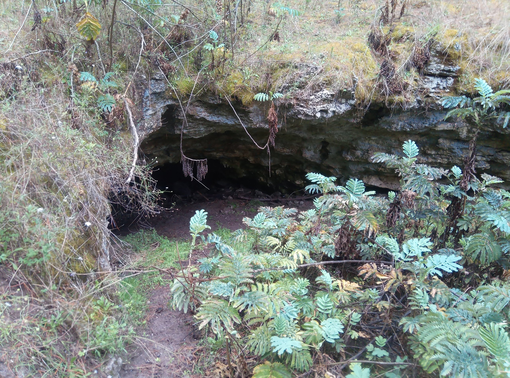
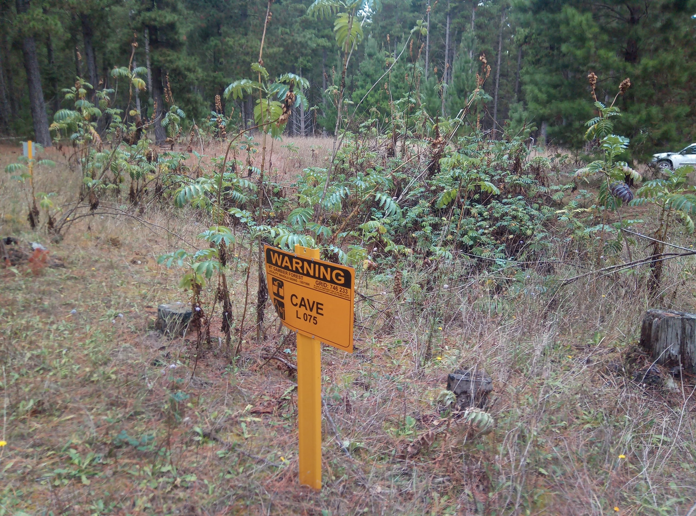
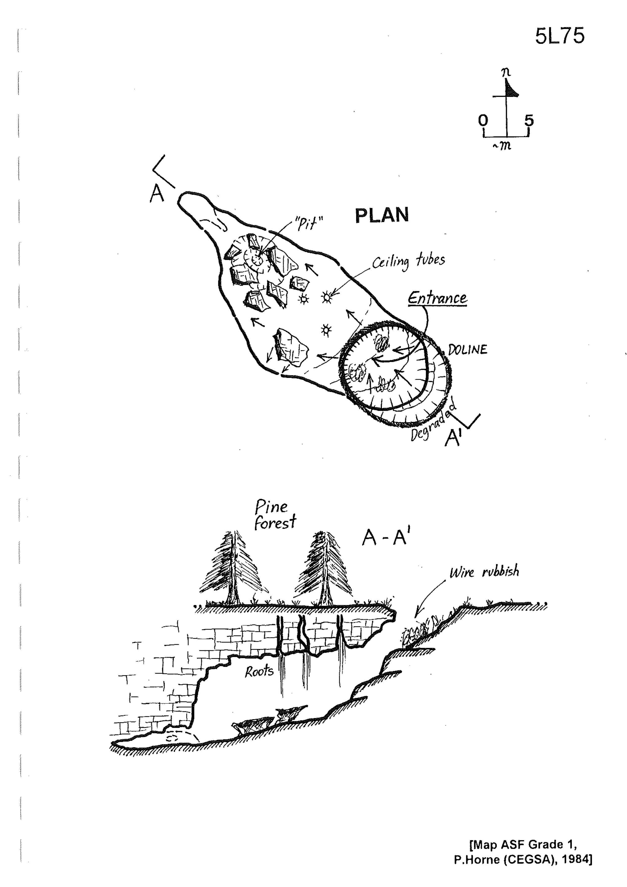
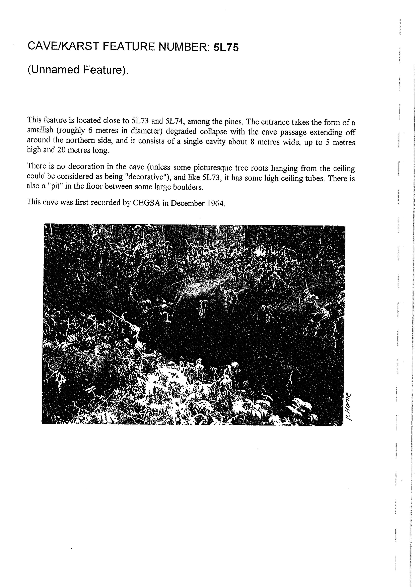

# About

2022-April: BC & MW visited on foot & photographed. Yellow Forestry signposting "L075". Large but simple dry cave with no obvious leads. Easy access and no decoration - perfect for a school group to sit and eat lunch out of the sun/rain

# Details

## Identification

- **Feature type:** Cave
- **Reference:** L0075
- **Source:** Forestry SA

## Cave and exploration data

- **Vertical access:** No
- **Tourism potential:** High
- **Disabled access potential:** Medium
- **Goes to water:** No

## Access and warnings

Forestry

# References

- **LSECR:** Page 152
This feature is located close to 5L73 and 51.74, among the pines. The entrance takes the form of a smallish (roughly 6 metres in diameter) degraded collapse with the cave passage extending off around the northern side, and it consists of a single cavity about 8 metres wide, up to 5 metres high and 20 metres long.
There is no decoration in the cave (unless some picturesque tree roots hanging from the ceiling could be considered as being "decorative"), and like 5L73, it has some high ceiling tubes. There is also a "pit" in the floor between some large boulders.
This cave was first recorded by CEGSA in December 1964.
- **Forestry SA:** L0075, Thin Roof: N, Fence: R. Dimensions: 1m high x 4m wide entrance in North face. Features: Fence should encolse solution tube 6-7m north west

## Images
- 
- 
- 
- 
