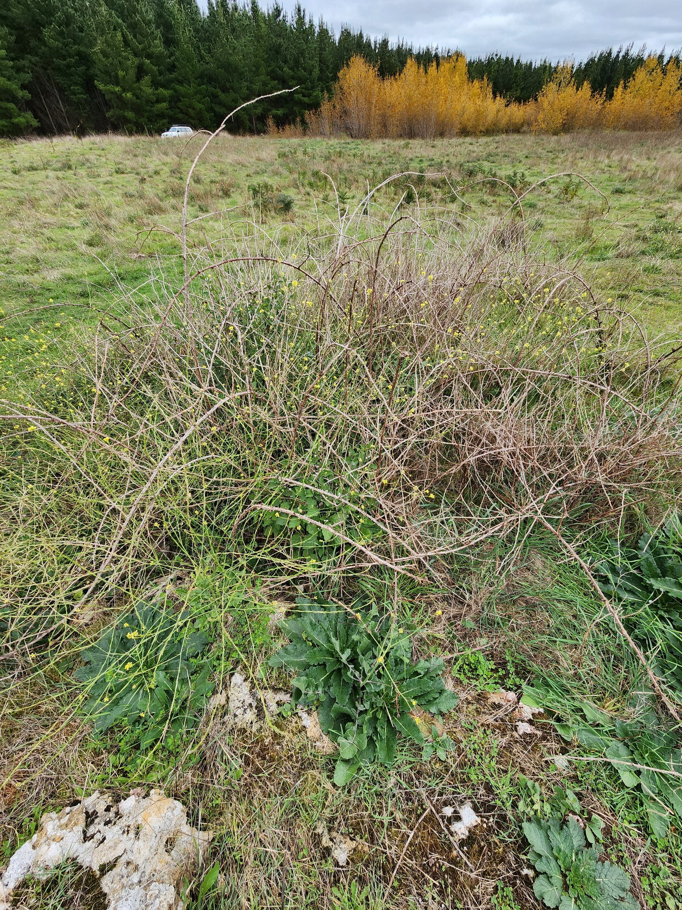

# Details

## Identification

- **Reference:** L0908
- **Source:** Forestry SA

## Access and warnings

Forestry

# References

- **Forestry SA:** L0908, Thin Roof: N, Fence: N. Dimensions: ?. Features: Near rubbish dump

## Images
- 
- 
