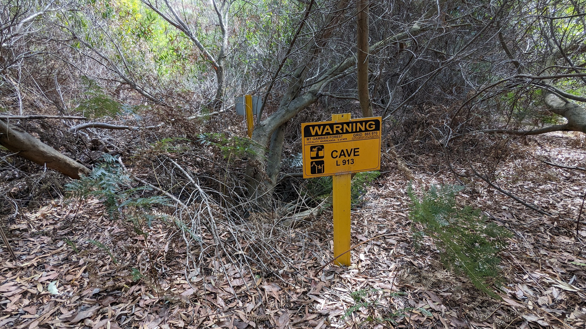
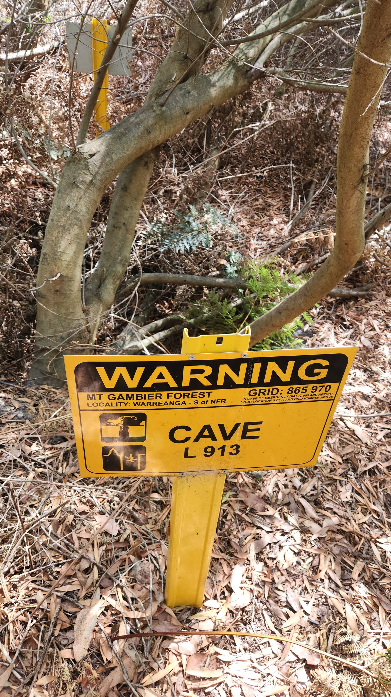

# Details

## Identification

- **Feature type:** Depression
- **Reference:** L0913
- **Source:** Forestry SA

## Cave and exploration data

- **Vertical access:** No
- **Goes to water:** No

## Access and warnings

Forestry

## Amenities

- **hasShowers:** No
- **hasToilets:** No

# References

- **Forestry SA:** L0913, Thin Roof: N, Fence: R. Dimensions: 1.7m diameter. Features:  Near L76; tube falling in July '99

## Images
- 
- 
