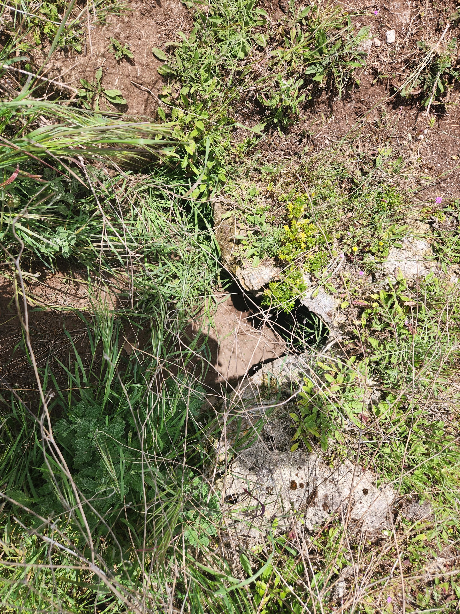
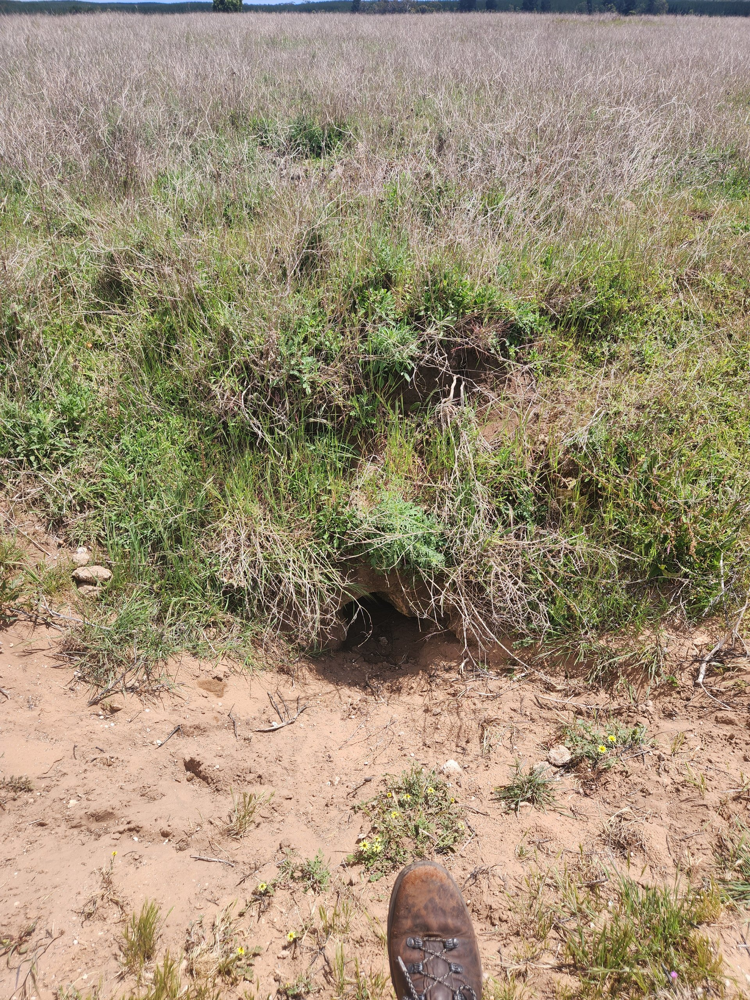
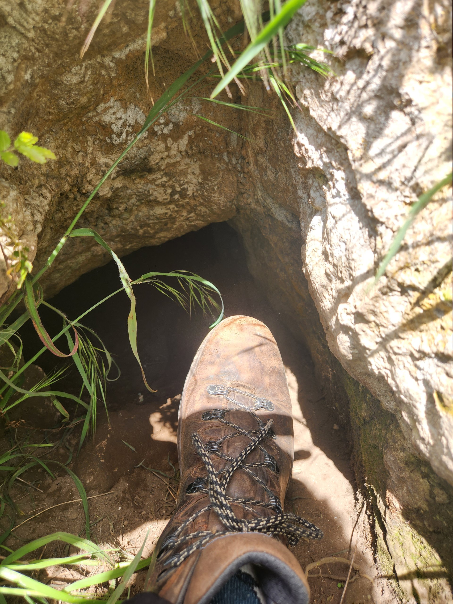

# About

BC 4/11/2023: Small ~30cm entrance , nothing particularly interesting about it

# Details

## Identification

- **Feature type:** RockyOutcrop
- **Reference:** L0919
- **Source:** Forestry SA

## Cave and exploration data

- **Vertical access:** No

## Access and warnings

Forestry

# References

- **Forestry SA:** L0919, Thin Roof: N, Fence: N. Dimensions: ?. Features: 50m from L185

## Images
- 
- 
- 
