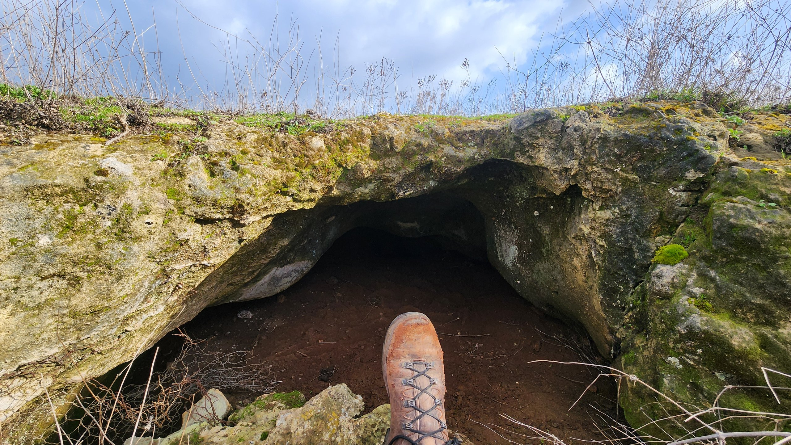
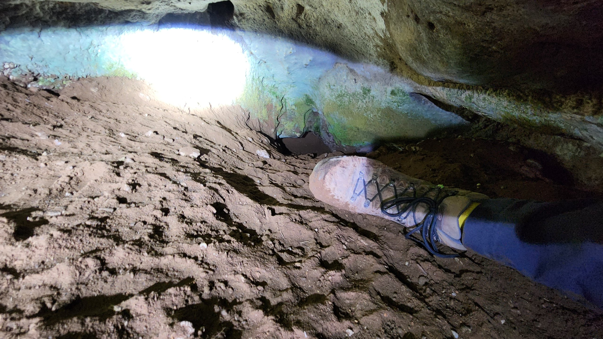

# Details

## Identification

- **Feature type:** Cave
- **Reference:** L0920
- **Source:** Forestry SA

## Cave and exploration data

- **Exploration potential:** Low

## Access and warnings

Forestry

# References

- **Forestry SA:** L0920, Thin Roof: Y, Fence: N. Dimensions: ?. Features: Nil

## Images
- 
- 
