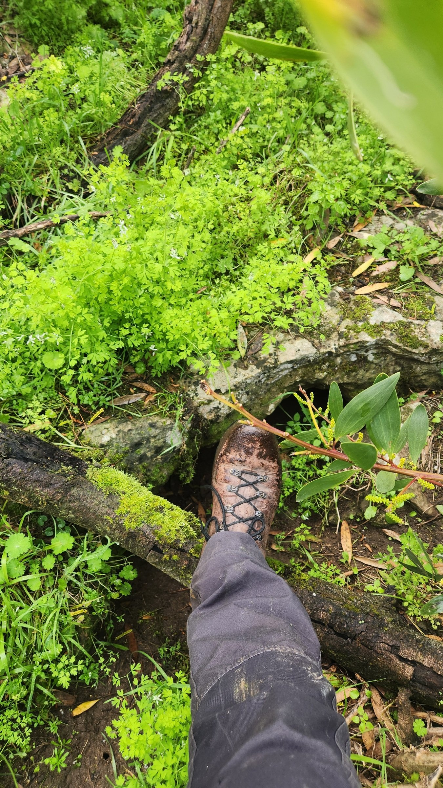
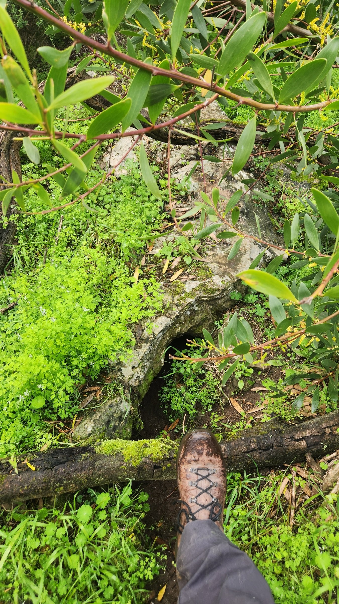
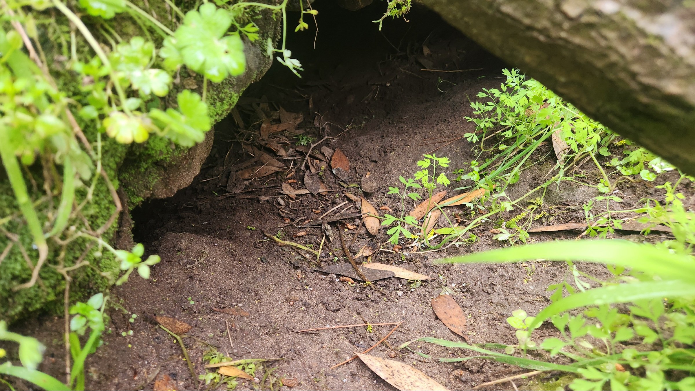

# Details

## Identification

- **Reference:** L0931
- **Source:** Forestry SA

## Access and warnings

Forestry

# References

- **Forestry SA:** L0931, Thin Roof: N, Fence: N. Dimensions: ?. Features: Karst feature; Road Reserve

## Images
- 
- 
- 
