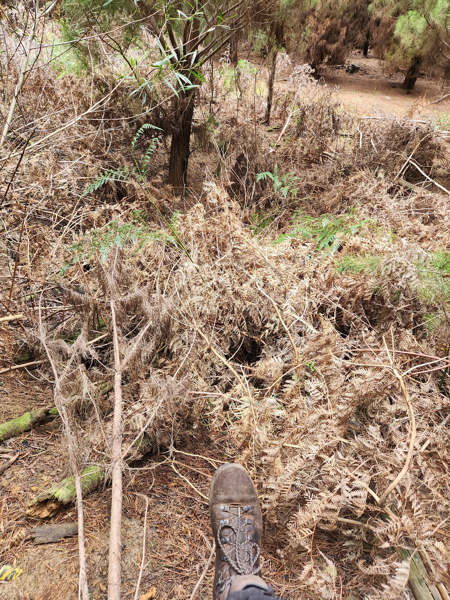
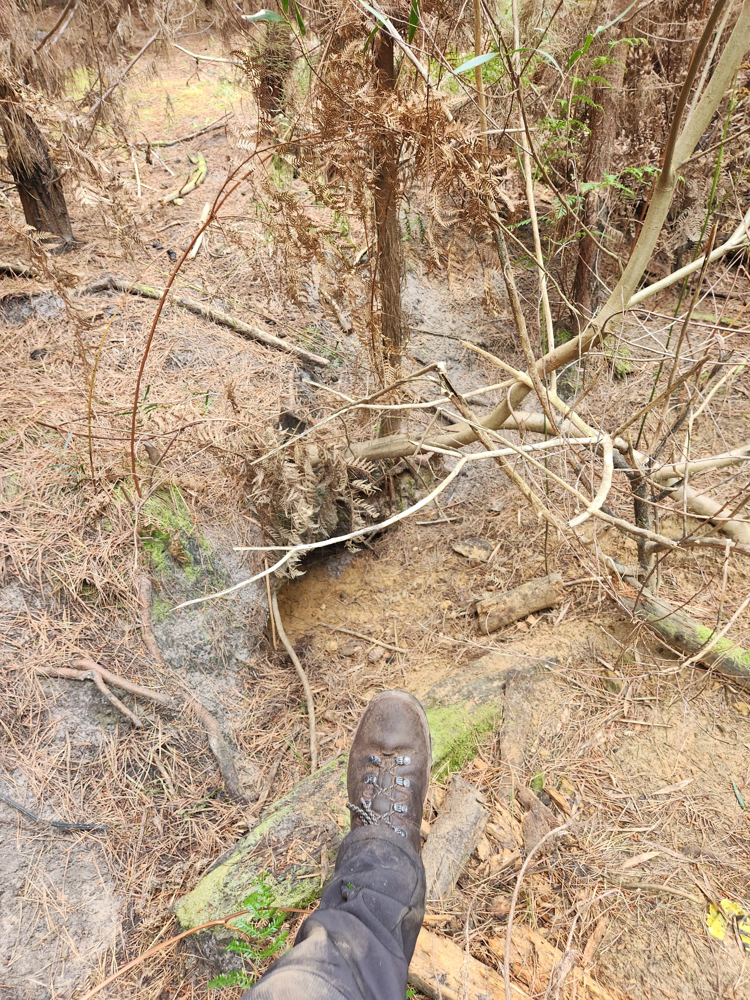
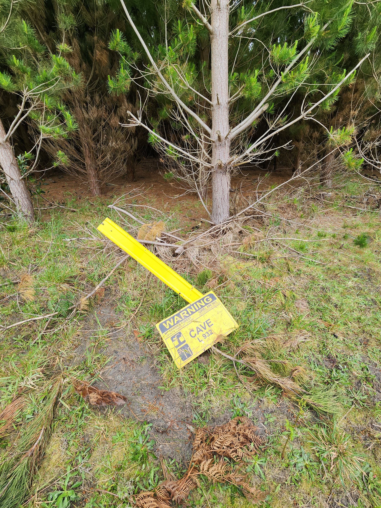

# About

BC 13/10/2023: Depression with some small rocky entrances not big enough to enter.

# Details

## Identification

- **Feature type:** Depression
- **Reference:** L0932
- **Source:** Forestry SA

## Cave and exploration data

- **Exploration potential:** Low

## Access and warnings

Forestry

# References

- **Forestry SA:** L0932, Thin Roof: N, Fence: R. Dimensions: ?. Features: Doline; stumps in entrance

## Images
- 
- 
- 
