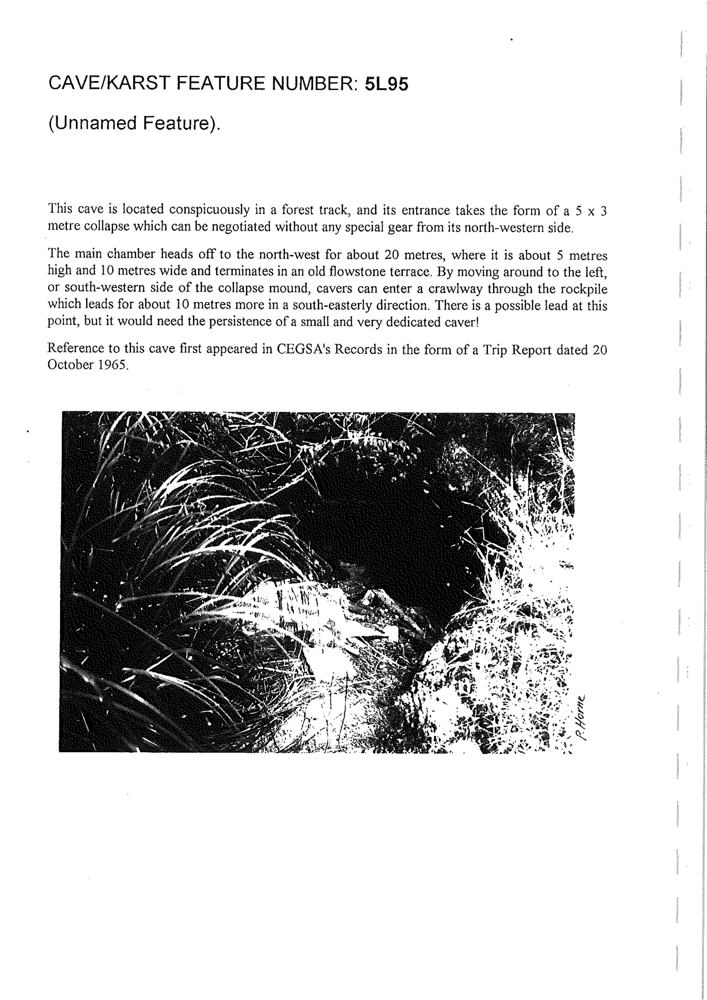
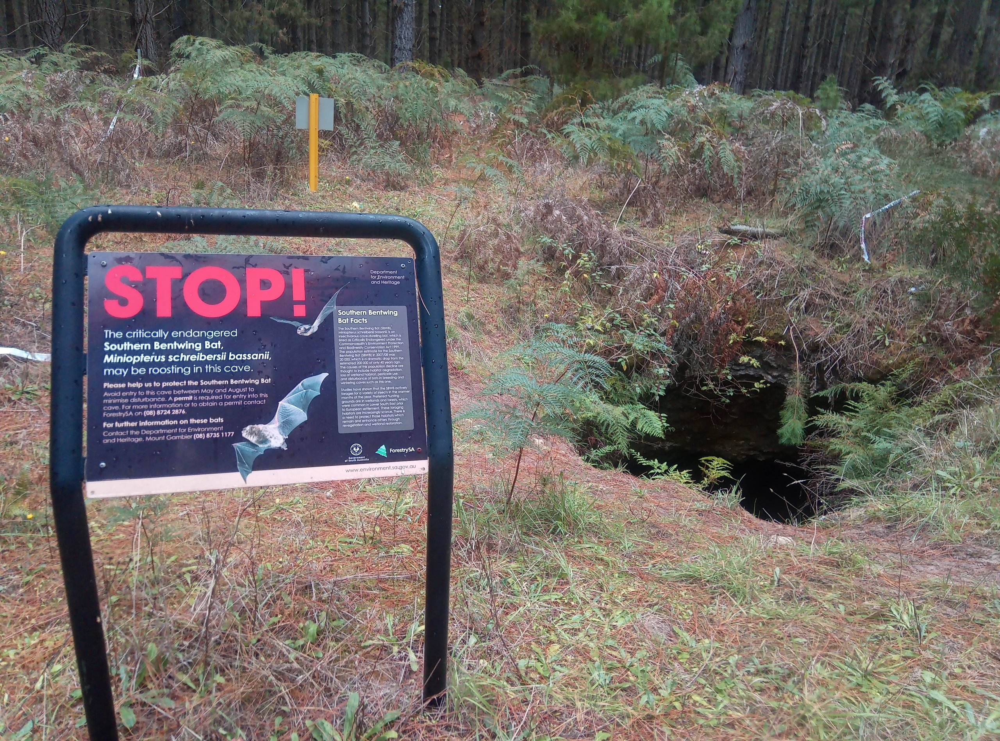
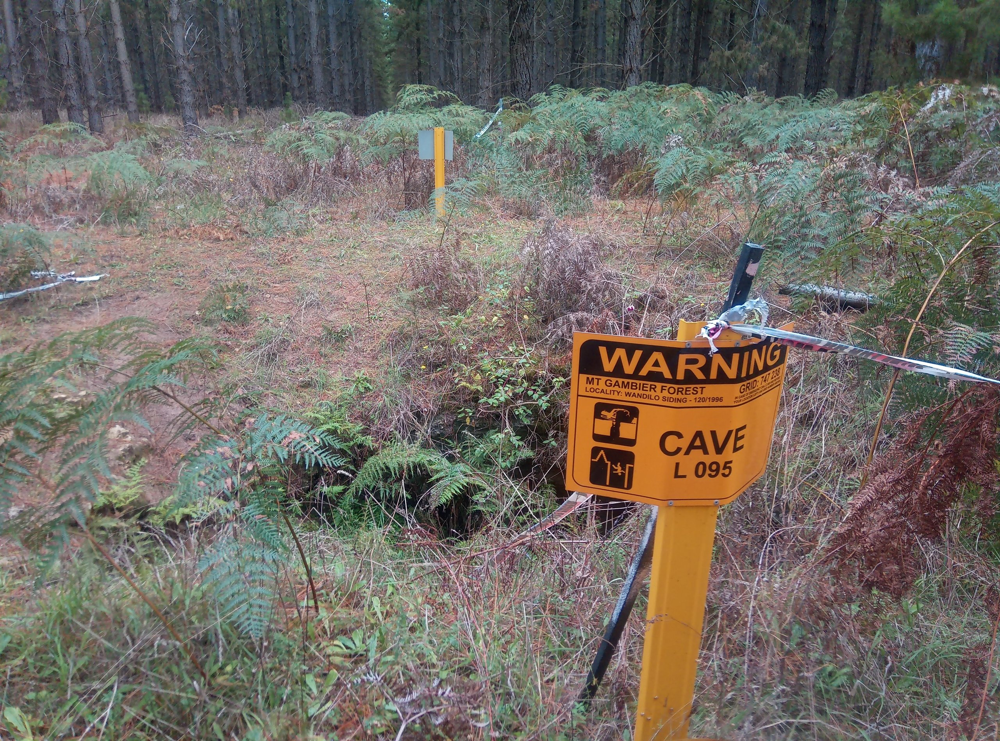
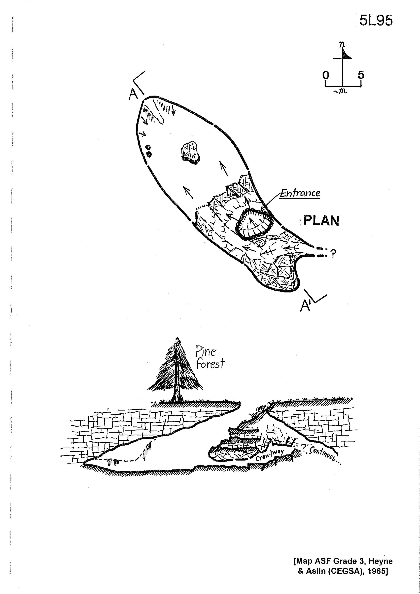

# About

2022-April: MW visited with drone and on foot. Signposted as roosting site for Southern Bentwing Bat. Entrance appears very easy, cave reference book suggests a very small potential lead under the entrance rockpile.

# Details

## Identification

- **Feature type:** Cave
- **Reference:** L0095
- **Source:** Forestry SA

## Cave and exploration data

- **Exploration potential:** High
- **Tourism potential:** Low
- **Goes to water:** No

## Access and warnings

Forestry

# References

- **LSECR:** Page 188
This cave is located conspicuously in a forest track, and its entrance takes the form of a 5 x 3 metre collapse which can be negotiated without any special gear from its north-western side.
The main chamber heads off to the north-west for about 20 metres, where it is about 5 metres high and 10 metres wide and terminates in an old flowstone terrace. By moving around to the left, or south-western side of the collapse mound, cavers can enter a crawlway through the rockpile which leads for about 10 metres more in a south-easterly direction. There is a possible lead at this point, but it would need the persistence of a small and very dedicated caver!
Reference to this cave first appeared in CEGSA's Records in the form of a Trip Report dated 20 October 1965.
- **Forestry SA:** L0095, Thin Roof: N, Fence: R. Dimensions: Entrance 5x3m collapse. Features: Old flow stone. A reasonable dry caving site

## Images
- 
- 
- 
- 
