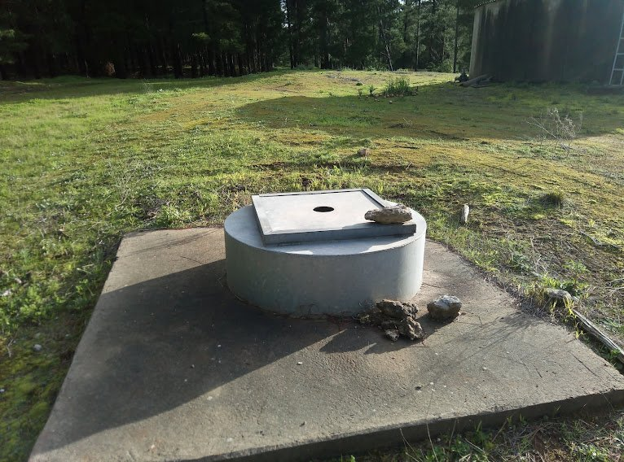
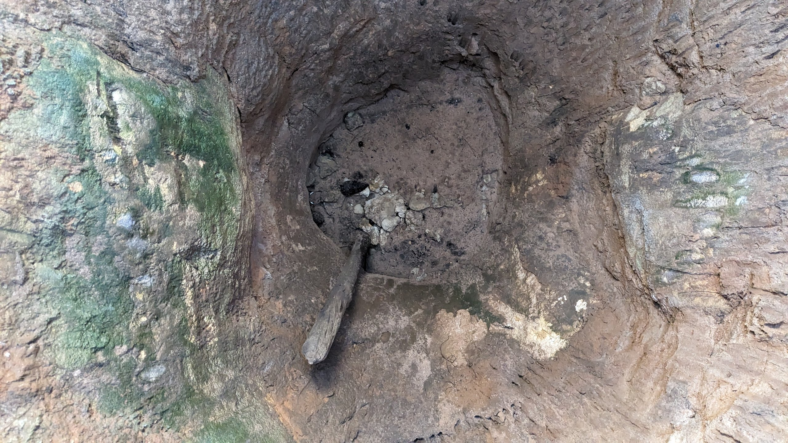

# About

2021-Aug: MW visited on foot and photographed. Raised concrete hatch (sliding steel - no lock?) covering solution tube (no fence), difficult to see anything inside.

2023-Aug: MW and BW checked,  unlocked, and photographed. Solution tube inside hatch has collapsed, no further exploration.

# Details

## Identification

- **Feature type:** SolutionTube
- **Reference:** L0973
- **Source:** Forestry SA

## Cave and exploration data

- **Vertical access:** Yes
- **Exploration potential:** Low
- **Goes to water:** No

## Access and warnings

Forestry

## Amenities

- **hasShowers:** No
- **hasToilets:** No
- **hasPhone:** Yes

# References

- **Forestry SA:** L0973, Thin Roof: N, Fence: Y. Dimensions: 0.5m solution tube. Features: High fencing priority as information stop being developed near by

## Images
- 
- 
