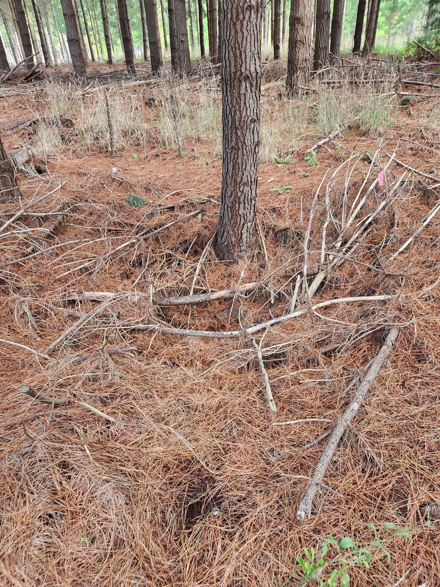
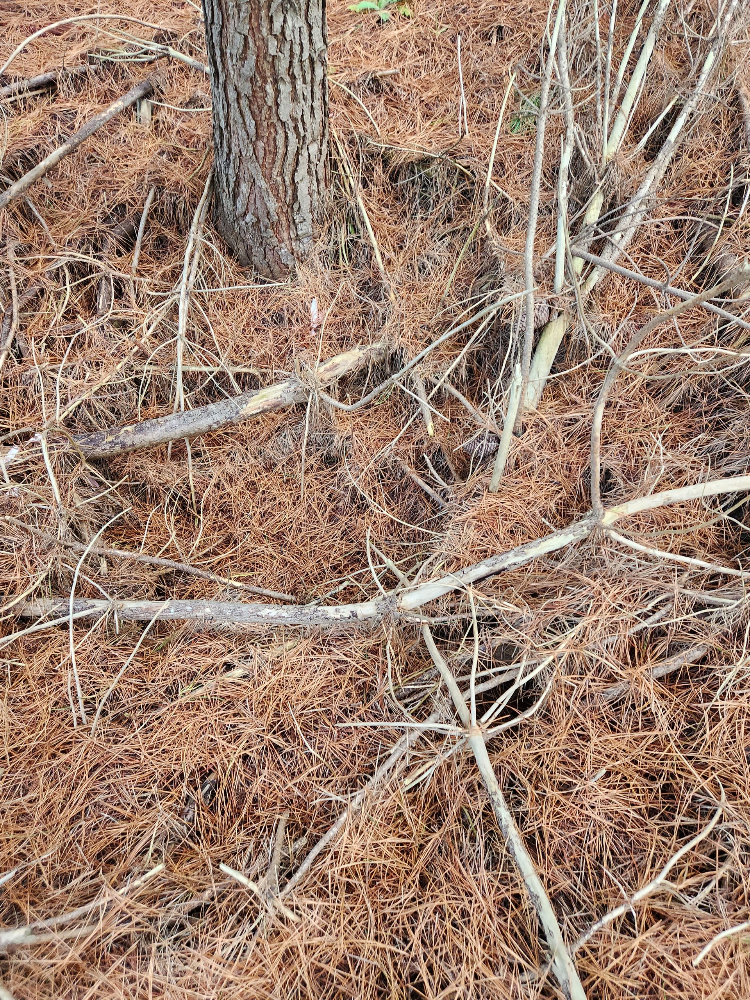

# About

2023-April: BC and MW visited. Tiny depression marked by forestry pink tape

# Details

## Identification

- **Feature type:** Depression
- **Reference:** L0991
- **Source:** Forestry SA

## Cave and exploration data

- **Vertical access:** No
- **Goes to water:** No

## Access and warnings

Forestry

# References

- **Forestry SA:** L0991, Thin Roof: N, Fence: N. Dimensions: 2m diam x 0.5m deep Doline. Features: Offset GPS

## Images
- 
- 
