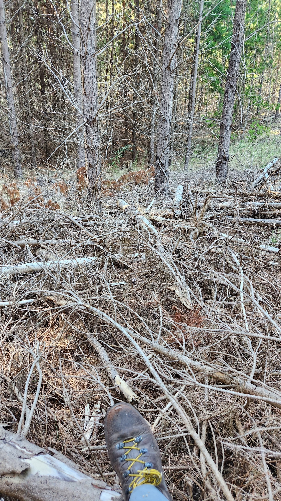
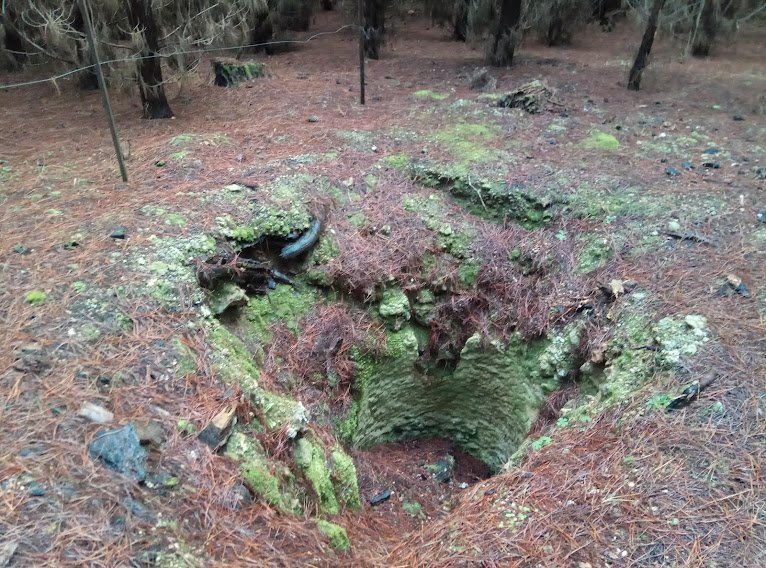

# About

2021-Aug: MW visited and photographed. Collapsed solution tube.
2023-April: BC and MW visited and photographed. Large depression filled with tree offcuts, some rock on western side but no obvious cave or significant karst

# Details

## Identification

- **Feature type:** Depression
- **Reference:** L0992
- **Source:** Forestry SA

## Cave and exploration data

- **Vertical access:** No
- **Disabled access potential:** Low
- **Goes to water:** No

## Access and warnings

Forestry

# References

- **Forestry SA:** L0992, Thin Roof: N, Fence: N. Dimensions: 30x20x3m Doline. Features: ?

## Images
- 
- 
