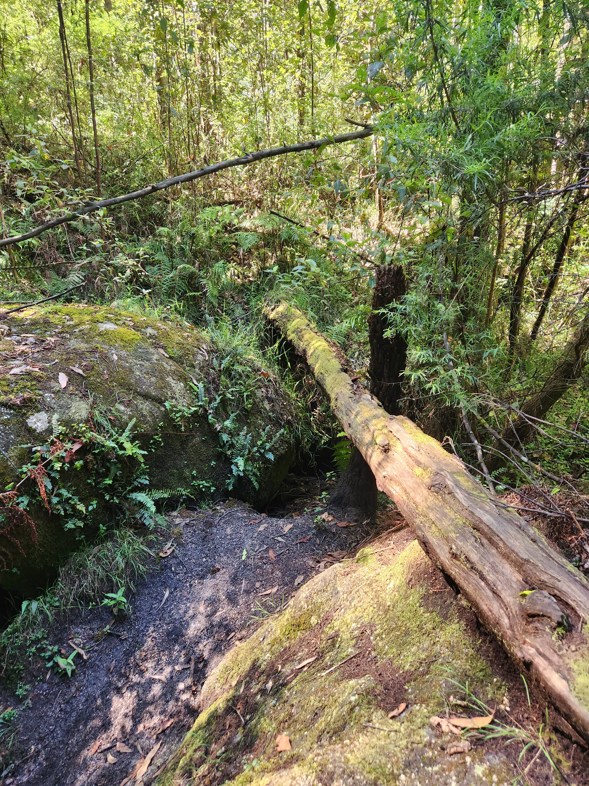
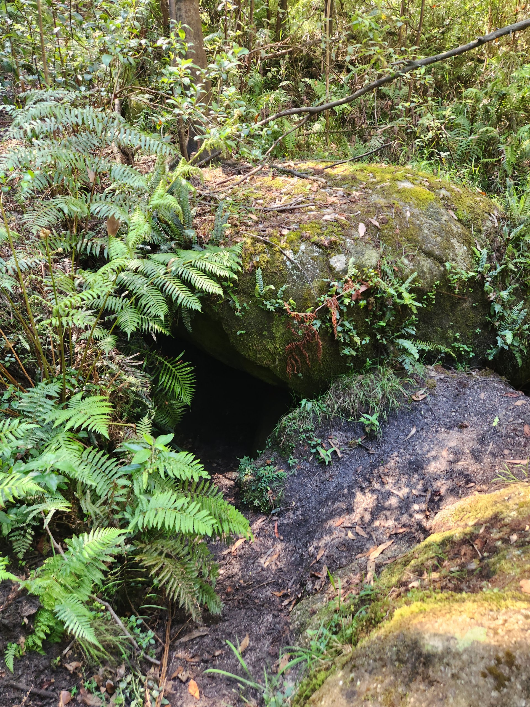
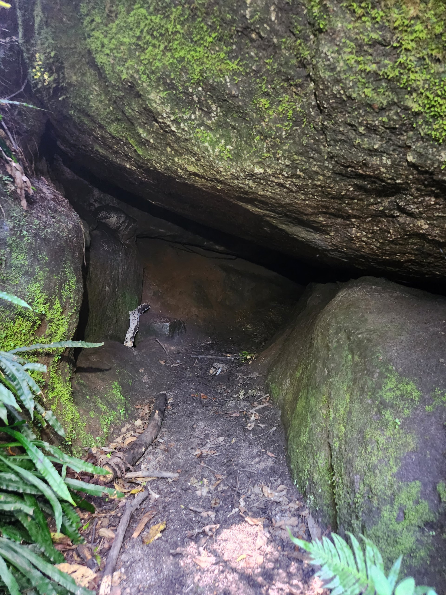

# About

This entrance requires a crawl and then at least an initial drop which would require ropes for safety so was not attempted. There was the sound of a large stream of water running lower in the system

# Details

## Identification

- **Feature type:** Cave
- **System name:** Labertouche Cave

## Cave and exploration data

- **Vertical access:** Yes

# References

## Images
- 
- 
- 
