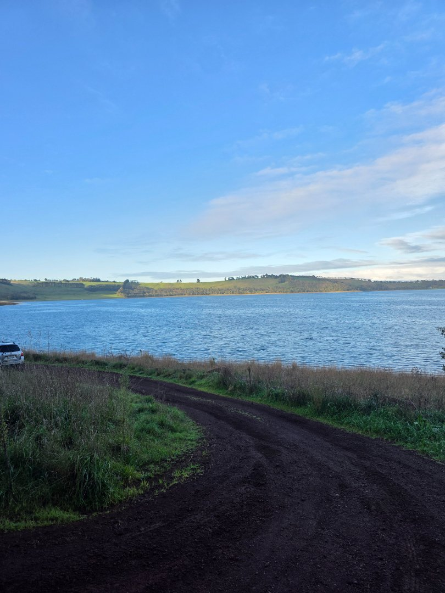
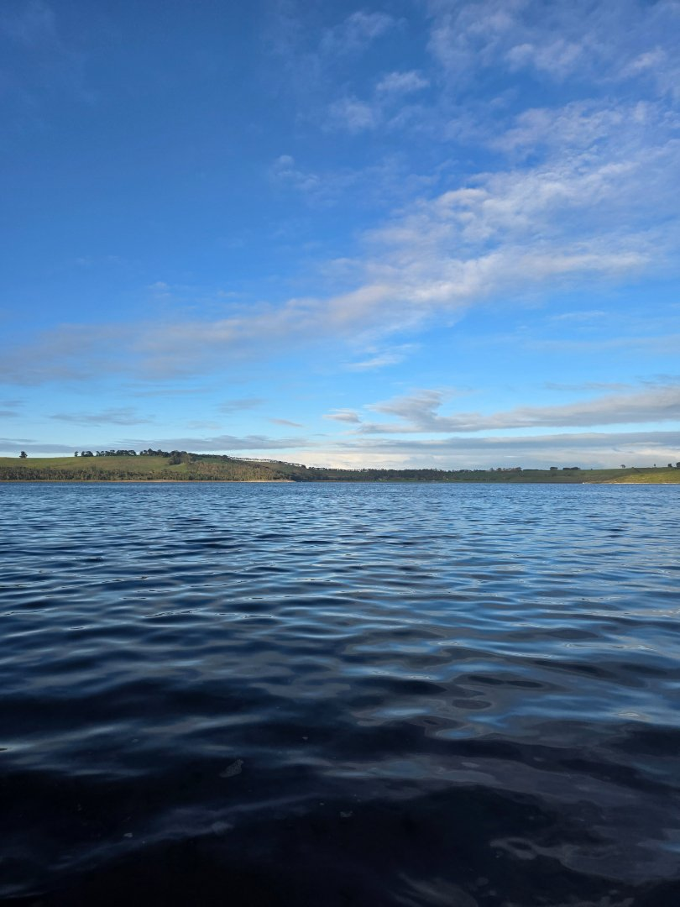
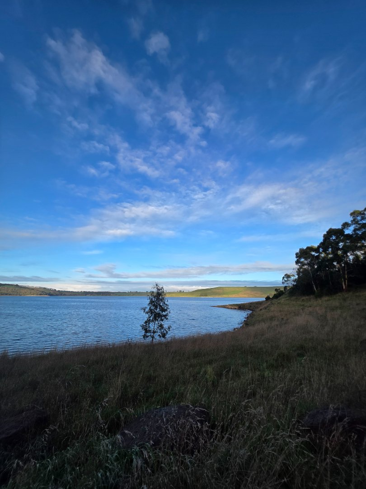

# About

Lake Bullen Merri is a stunning, deep volcanic crater lake located near Camperdown in southwestern Victoria, about a 2.5-hour drive from Melbourne. Famed for its crystal-clear, brackish waters and dramatic scenery, it is a premier destination for fishing, boating, water skiing, and picnicking

Entry is a simple walk off the shore, you get enough depth to swim within 10m or so and then it drops down from 2 - 7m over the next 20-30m. You then hit a ledge that drops to 15m and a reasonably steep descent to around 20m where you will hit another ledge that drops down quickly.

Because of its depth and sheltered position, it serves as an alternative dive site when coastal ocean conditions are too rough. The diving is best between March and October when the water visibility improves (ranging from 3 to 20 meters).

# Details

## Identification

- **Feature type:** Lake

## Cave and exploration data

- **Cave rating:** OpenWater
- **Vertical access:** No
- **Goes to water:** Yes

## Diving data

- **Minimum depth:** 3 m
- **Maximum depth:** 60 m
- **Water type:** Fresh
- **Tidal:** No
- **Entry type:** Shore

## Amenities

- **hasShowers:** No
- **hasToilets:** No
- **hasPhone:** Yes
- **family:** Bad
- **parking:** Outstanding

# References

## Images
- 
- 
- 
