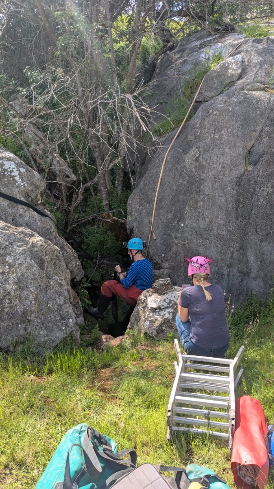
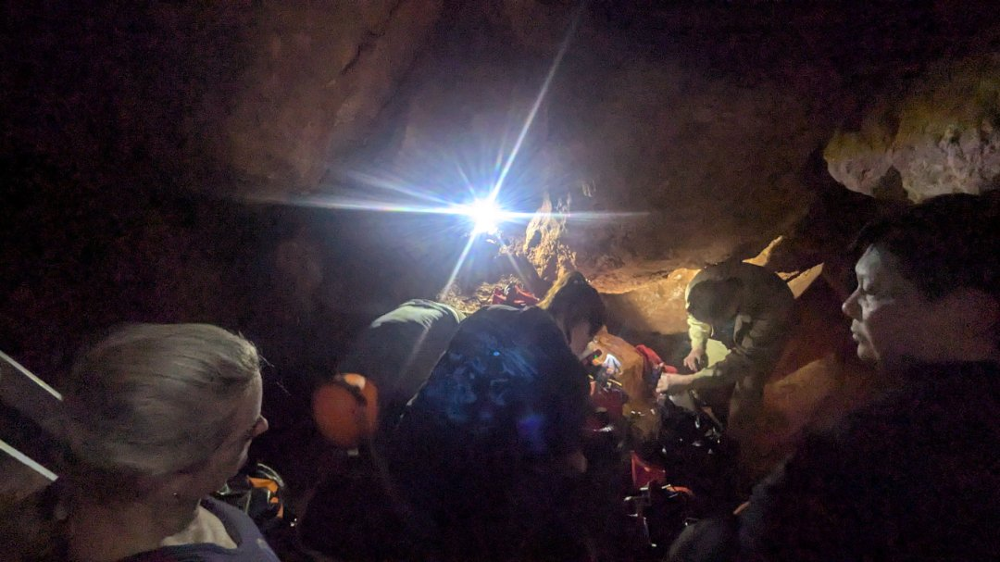

# About

## Logged Dives
2025-09-27 - McCavity cave

# References

3WE - Wellington - 5-14 Mitchell-Limekilns Caves.pdf

## Images
- 
- 

# Details

## Identification

- **Feature type:** Cave

## Cave and exploration data

- **Vertical access:** Yes
- **Goes to water:** Yes
