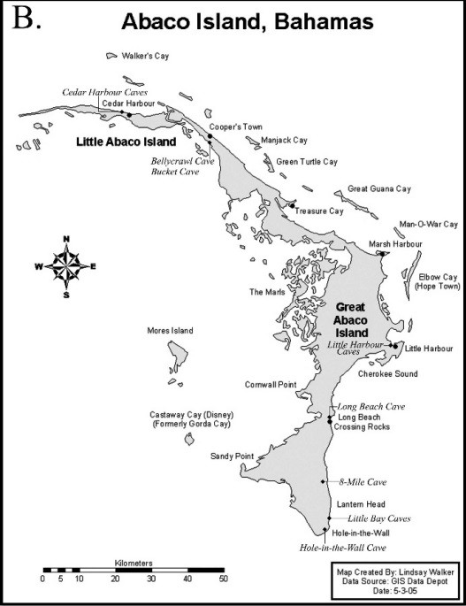

# About

Location Estimated from attached paper
"Little Harbour Caves" includes:
- Azimuth Cave
- Dripping Stones Cave
- Hunter's Cave
- Manchineal Cave
- Sitting Duck Cave

# Details

## Identification

- **Feature type:** Cave
- **System name:** Little Harbour Caves

# References

## Images
- 
- [The_caves_of_Abaco_Island_Bahamas_Keys_to_geologic - 77875333-9d4e83f6](https://github.com/twosharprocks/Karst-Database/blob/a91711b0be35b53a5de563e070ff13f8b90c3afa/Assets/0fc0e87e855fb7fa5a1f450eace4bdaddddaf8d2a4e697fd8247bfcc1cf9ecb3.pdf)
