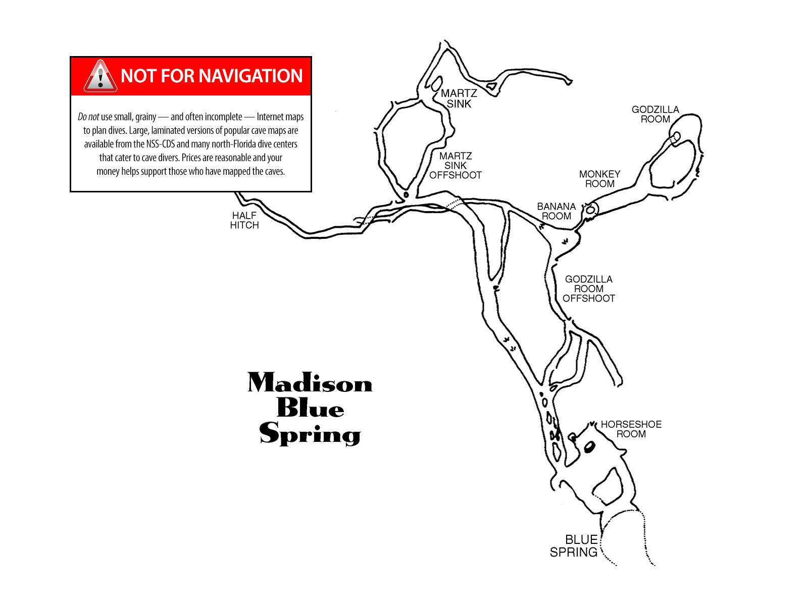
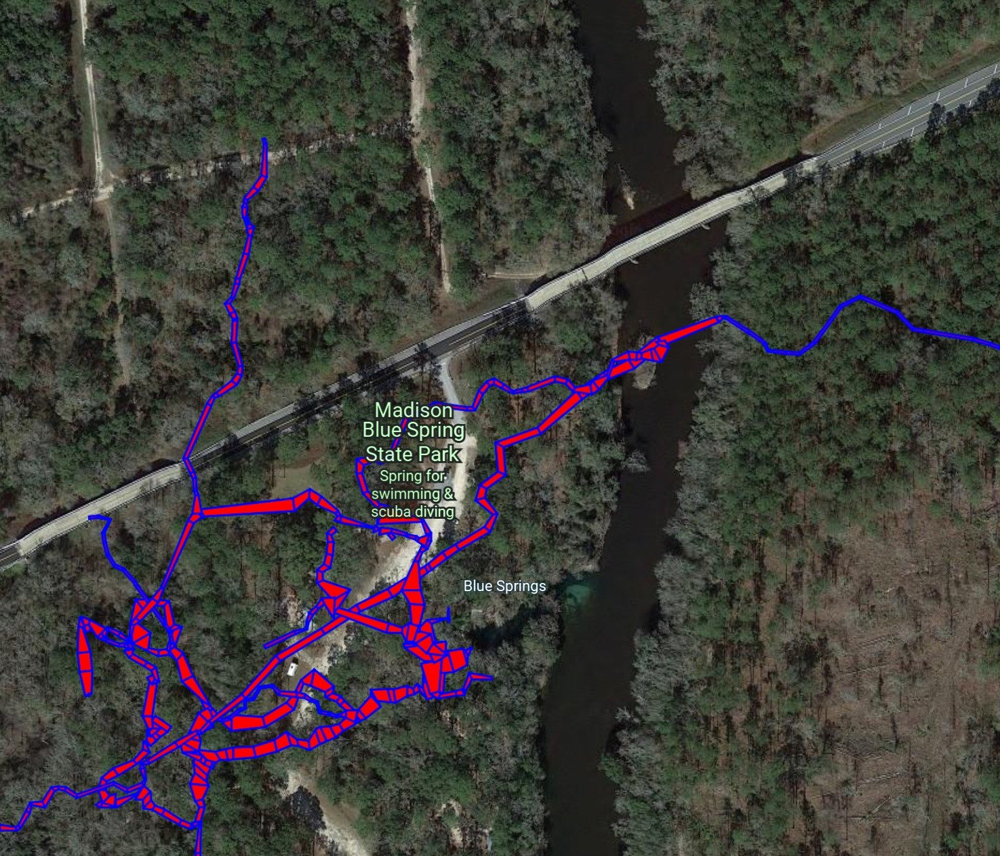

# Details

## Identification

- **Feature type:** Cave

## Cave and exploration data

- **Cave rating:** Advanced
- **Vertical access:** No
- **Exploration potential:** Medium
- **Goes to water:** Yes

# References

## Images
- 
- 
- [0bb0ede0-5a64-40e8-b41e-9eee68376dd9](https://www.youtube.com/watch?v=xuTh5uCLjg8)
