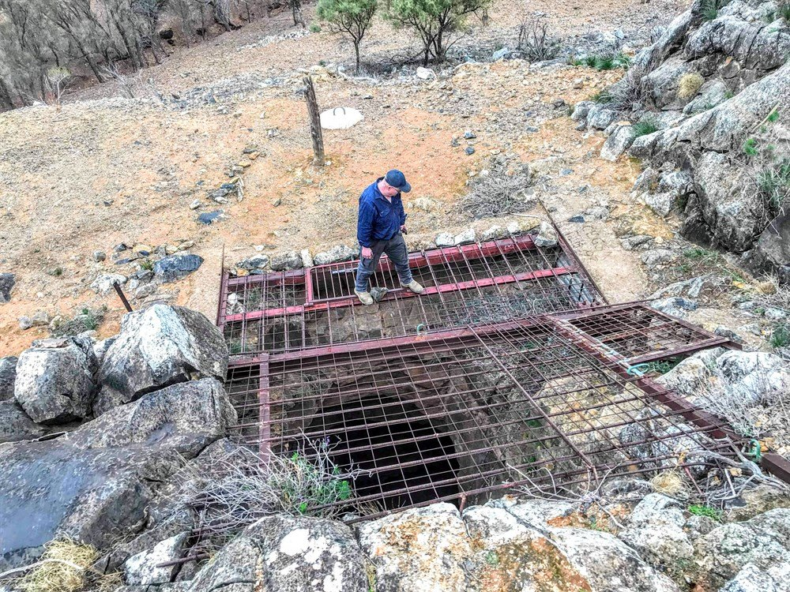
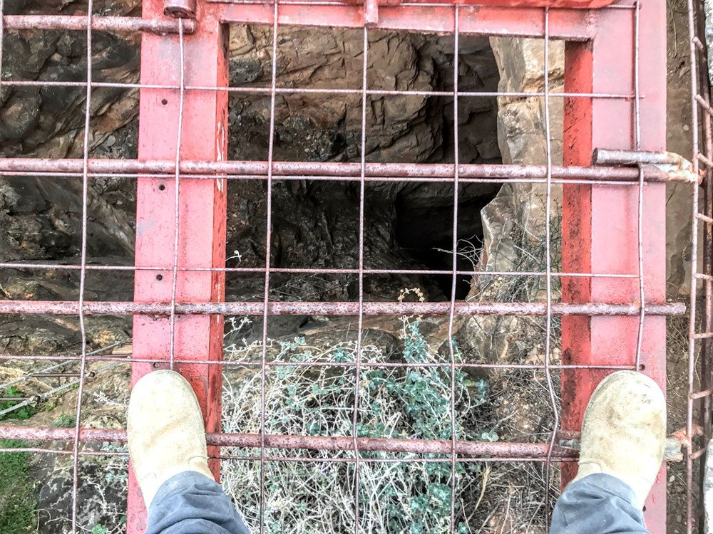
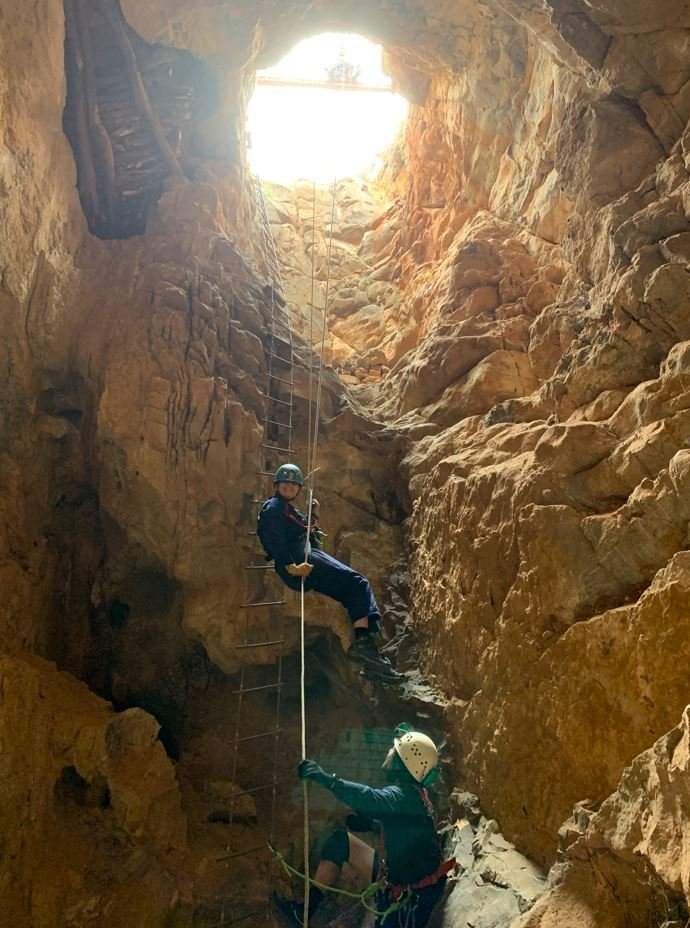

# About

Minburra Station

# Details

## Identification

- **Feature type:** Cave
- **Source:** ExploreOz

# Additional Notes

- **NLA:** https://catalogue.nla.gov.au/catalog/4314729

- **ExploreOz:** https://www.exploroz.com/places/43598/sa+mares-cave

- **FlindersUniversity:** https://news.flinders.edu.au/blog/2023/03/24/giant-eagle-discovered-in-flinders-ranges/mairs-cave-flinders-ranges/

# References

- **GoogleMaps:** https://goo.gl/maps/dUBZ1Uo8dKXRFQEGA

## Images
- 
- 
- 
